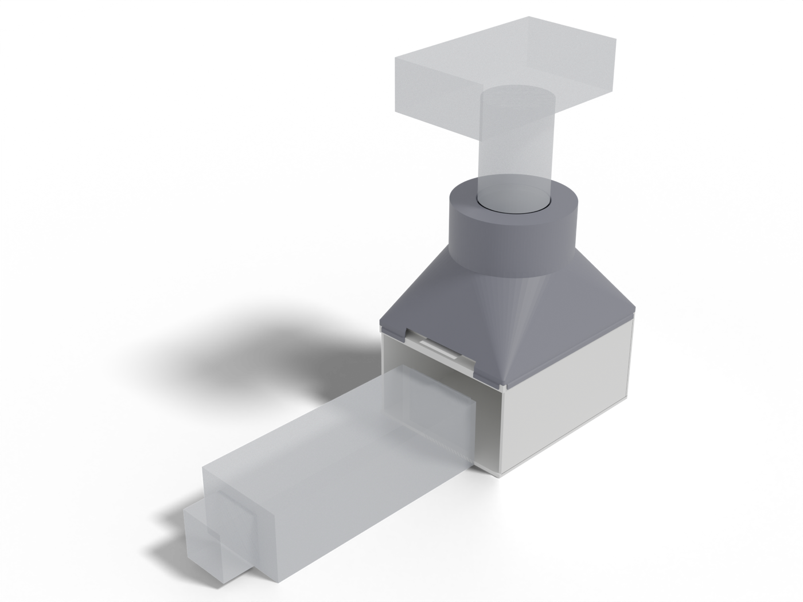
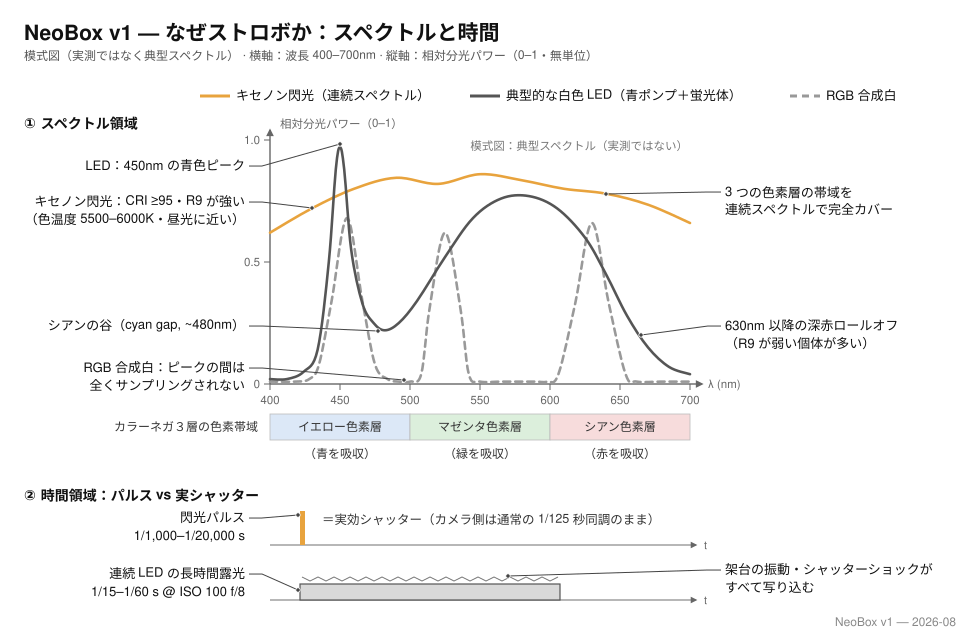
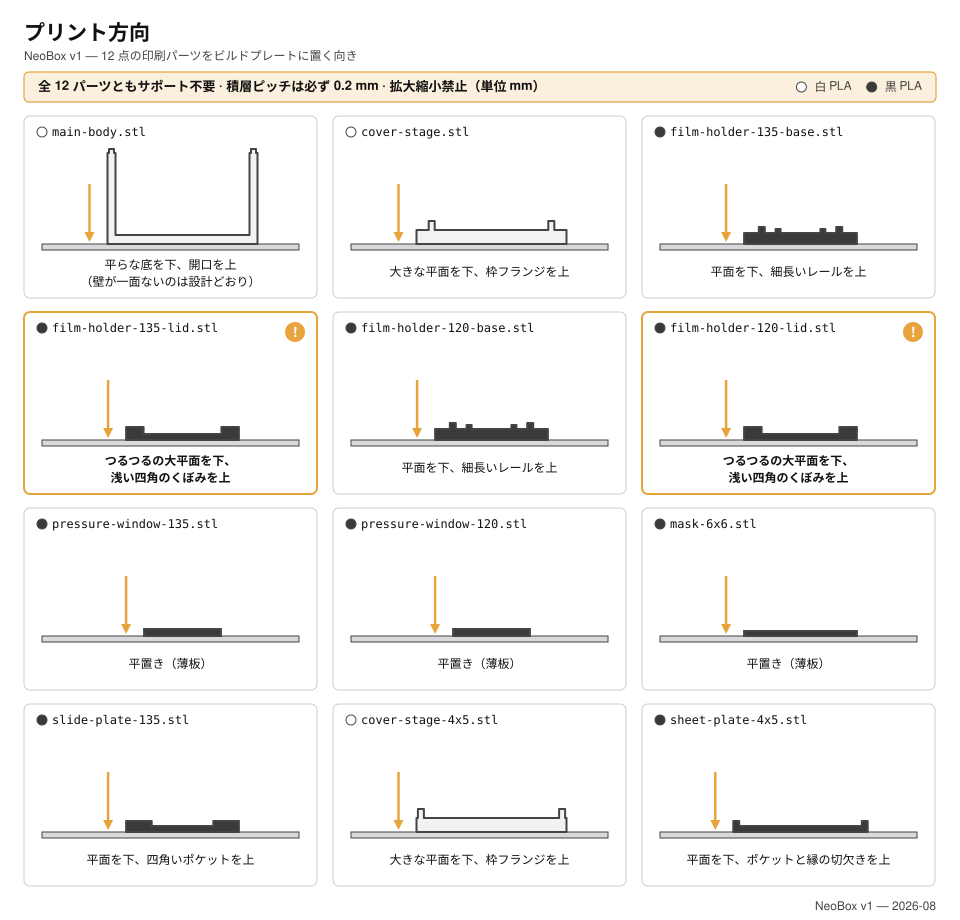
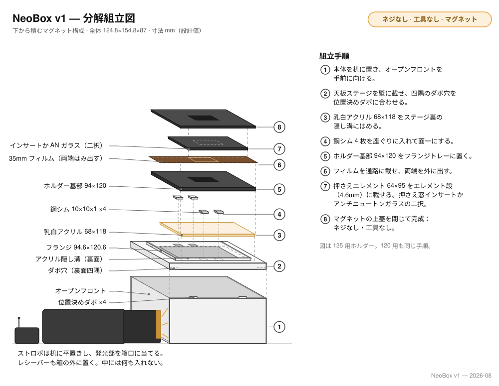
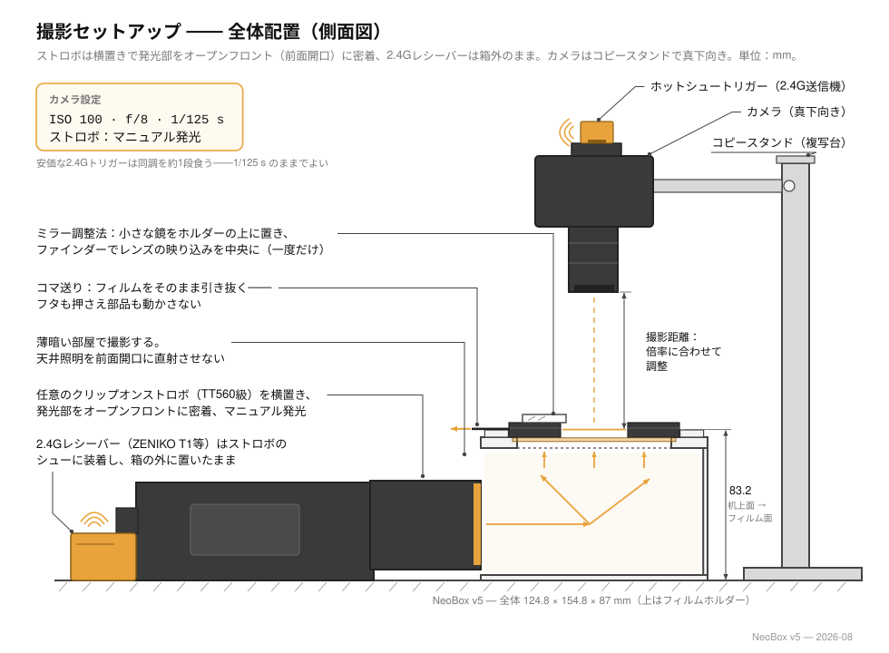

# NeoBox

[English](README.md) · [简体中文](README.zh-CN.md) · **日本語**

  

> 市販のクリップオンストロボを均一な光源に変え、135 と 120 フィルムをデジタルカメラで複写するための 3D プリント製ライトボックス。プリント部品 12 点、購入部品 3 点、ねじなし、接着なし、工具不要。



## これは何か

NeoBox は前面の壁がない白い箱です。ストロボは机に寝かせ、発光部を開口に向けて、箱の中へ横向きに発光します。光は白い壁で何度か反射し、乳白アクリルの板を上向きに通り抜けて、フィルムを下から照らします。カメラはマクロレンズでフィルムを真上から撮ります。これをカメラスキャンと呼びます。撮った RAW を後で反転すると、ポジになります。

ストロボは箱に入らないので、どのメーカーでも使え、箱は小さいままです。フィルムは磁石で閉じるホルダーに入れます。フォーマットを変えるときは、ホルダーをひと組持ち上げて、もうひと組を置くだけです。箱に調整する箇所はありません。カメラとフィルムの平行は小さな鏡で合わせます。

| 項目 | 値 |
|---|---|
| 外形 | 124.8 × 154.8 × 83 mm。ホルダーを載せた状態で高さ 87 mm |
| フォーマット | 135 と 120（6×9 まで）。6×6 はマスクを追加。マウント済み 135 スライドと 4×5 シートはオプション部品で対応 |
| フィルム面 | 机から 83.2 mm。両フォーマットで同じ |
| 拡散板 | 乳白アクリル 1 枚、68 × 118 × 2 mm、フィルムの 4.6 mm 下 |
| フィルムの平面保持 | フィルムは 0.4 mm の溝を滑り、上にはプリント製インサート、またはアンチニュートンガラス 1 枚、64 × 95 × 2 mm |
| 光源 | マニュアル発光量のあるクリップオンストロボなら何でも。参考機は NEEWER TT560 と ZENIKO T1 トリガーセット |
| 状態 | v1。作者と友人がプリントして使用中。文書中の均一性と平面度の数字は CAD の設計値で、計測器による測定値ではありません |

## なぜストロボか

閃光のパルスが露光そのものです。実用発光量では 1/1,000 〜 1/20,000 s しか続かないので、振動もシャッターショックも問題にならず、カメラはベース ISO と f/8 のままでいられます。

フィルムはスペクトルにうるさい素材です。カラーネガは三層の色素でできていて、シアン層とオレンジマスクはどちらもスペクトルの赤い端で働きます。キセノン管は約 5600 K の連続スペクトルを出し、深い赤が十分にあります。白色 LED は 480 nm 付近に谷があり、約 630 nm を過ぎると落ち込みます。それはこの二つが最も光を必要とする場所です。その欠けは反転した後に現れます。色のカーブが交差し、ホワイトバランスでは消えない色かぶりが残ります。



発光量を固定したマニュアルストロボはどのコマにも同じ光を与えるので、反転プロファイルはロールに一つで済みます。

## 必要なもの

| プリント部品、STL 12 ファイル | 購入部品 | 自分で用意するカメラ機材 |
|---|---|---|
| マット白の PLA：`main-body`、`cover-stage`、`cover-stage-4x5`（オプション） | 乳白アクリル 1 枚、厚さ 2 mm、68 × 118 mm に切断（縁が欠けやすいので 2 枚買う） | マニュアル露出、RAW 記録、メカシャッターのあるカメラ |
| 黒の PLA：`film-holder-135-base` と `-lid`、`film-holder-120-base` と `-lid`、`pressure-window-135`、`pressure-window-120`、`mask-6x6`（オプション）、`slide-plate-135`（オプション）、`sheet-plate-4x5`（オプション） | ネオジム磁石 32 個、Ø8 × 2 mm、N35 | フルサイズで 135 を撮るのに必要な 1:1 まで寄れるマクロレンズ |
| フィラメントは合計約 300–350 g | スチールシム 4 枚、10 × 10 × 1 mm または Ø10 × 1 mm、炭素鋼。ステンレスは不可 | 複写スタンド、または横アームのある三脚 |
| | オプション：アンチニュートンガラス 64 × 95 × 2 mm、黒の植毛シート、4×5 用の乳白板 106 × 130 × 2 mm | トリガーセット、レリーズ、約 30 mm の小さな平面鏡、ブロアー |

箱の部品代は約 CNY 65–140（JPY 1,500–3,000）です。検索ワード：`乳半アクリル板 2 mm 切断`、`ネオジム磁石 丸型 8 × 2 mm N35`、`スチールシム 10 × 10 × 1 mm`、`アンチニュートンガラス 切断`、`植毛シート 黒 粘着`。

## プリント

- 普通の PLA。白の 3 点は必ずマットの白。シルクや光沢は不可。内面が反射面になるからです。研磨も塗装もしません。
- 全部品 0.2 mm 積層、インフィル 15 %、サポートなし、標準の 0.4 mm ノズル。
- どの部品も平らな面を下にしてプリントします。二つのホルダー蓋だけは上面を下にし、凹みと磁石穴を上に向けます。
- 160 × 160 mm のビルドプレートで足ります。スライサーに拡大縮小させないこと。
- まず `film-holder-135-base`、`film-holder-135-lid`、`pressure-window-135` をプリントし、フィルムが滑ることを確かめてから残りをプリントします。

出力したら寸法を確かめます。本体は 124.8 × 154.8 × 75.6 mm。天板ステージは力を入れずに本体の四つのダボに落ちます。どの穴にも Ø8 × 2 の磁石が圧入できます。磁石がシムに吸い付きます。



<details>
<summary>出力サービスに送る文面</summary>

```text
STL 12 ファイル、単位はミリ、1:1。拡大縮小は不可。
普通の PLA：白 3 点（マット。シルク・光沢は不可）、黒 9 点。
全ファイル 0.2 mm 積層、インフィル 15 %、全ファイル サポート不要。
すべて平らな面を下に。二つのホルダー蓋のみ仕上がりの上面を下に。
160 × 160 mm のビルドプレートで足ります。

白：    main-body.stl            124.8 × 154.8 × 75.6
        cover-stage.stl          124.8 × 154.8 × 10
        cover-stage-4x5.stl      124.8 × 154.8 × 10   （オプション）
黒：    film-holder-135-base.stl 94 × 120 × 5
        film-holder-135-lid.stl  94 × 120 × 3
        film-holder-120-base.stl 94 × 120 × 5
        film-holder-120-lid.stl  94 × 120 × 3
        pressure-window-135.stl  64 × 95 × 2
        pressure-window-120.stl  64 × 95 × 2
        mask-6x6.stl             94 × 80 × 1          （オプション）
        slide-plate-135.stl      94 × 120 × 5         （オプション）
        sheet-plate-4x5.stl      112 × 138 × 5        （オプション）
```

</details>

## 組み立て



1. **磁石。** ホルダー底と蓋には各 8 個入ります。底の磁石は上面から、全部同じ向きで圧入します。蓋の穴は、まず磁石を一つ、向かい合う底の磁石に当てて吸い付かせ、露出した面に印を付け、外して、印の面を先にして下から蓋に圧入します。圧入した磁石は抜けないので、毎回極性を確かめてください。
2. **シム。** 天板ステージのデッキにある座ぐりに 4 枚のシムを落とします。接着不要。
3. **アクリル。** 両面の保護フィルムを剥がし、窓の上の凹部に板を置きます。固定せず、デッキより 0.4 mm 低く収まります。
4. **天板ステージ。** 四隅のダボ穴がダボに掛かるように本体に下ろします。自重で座ります。がたつくなら持ち上げて置き直します。押し込んではいけません。
5. **ホルダー。** ホルダー底をトレイの縁の内側に置きます。磁石がシムに引き寄せます。
6. **エレメントと蓋。** 底の 4.6 mm の段に押さえ窓インサートを載せるか、アンチニュートンガラスをマット面を下にして載せます。ガラスの下面の埃はピントが合ってしまうので、先にブロアーで吹きます。蓋を閉じます。
7. **カメラを正対させる。** 閉じたホルダーの上に鏡を置き、ライブビューで、レンズ自身の映り込みが中央で左右対称になるまでカメラを傾けます。これでセンサーはフィルム面と平行です。雲台を固定して、もう一度確かめます。

スタックは重力と磁石だけで保持されています。組んだまま運ばず、部品ごとに動かしてください。

## スキャン



**高さ。** レンズ前端は、机から 83.2 mm にレンズのワーキングディスタンスを足した高さです。フォーマットごとの支柱の高さを書き留めます。

| フォーマット | フルサイズ | APS-C |
|---|---|---|
| 135 | 1.0× | 0.65× |
| 6×4.5 | 0.58× | 0.38× |
| 6×6、6×7、6×9 | 0.43× | 0.28× |
| 4×5 | 0.25× | 0.16× |

**ピント。** ライブビューを 100 % に拡大し、グレインにピントを合わせ、マニュアルフォーカスに切り替えます。どこかの角がどうしても甘いなら、鏡の手順をやり直します。

| 設定 | 値 |
|---|---|
| モード、ISO、絞り | マニュアル、ベース ISO、f/5.6 〜 f/8 |
| シャッター | 1/125 s、メカシャッターまたは電子先幕。完全電子シャッターではストロボが光りません |
| ファイル、ホワイトバランス、手ぶれ補正 | RAW、固定、オフ |
| ストロボ | マニュアル発光、1/8 から。透明なフィルムベースがクリップ直前になるように合わせ、ロール中は触りません |

**フィルム。** ストリップを入れる前に毎回溝を吹きます。乳剤面を下にして差し込み、コマが中央に来るまでリーダーを引きます。送りは引くだけです。ロールの途中でホルダーを開けません。カールしたストリップは、インサートでは山を下に、ガラスでは山を上にして入れます。6×6 はトレイの 120 底の下にマスクを敷き、ピントを合わせ直します。マウント済みスライドはスライドプレートのポケットへ。4×5 シートは 4×5 天板ステージの上のシートプレートへ。窓が壁から 9 と 12 mm しか離れていないため、均一性は未検証です。

**撮影後。** 同じ設定で空のコマを一枚撮り、フラットフィールド補正に使います。次に透明なフィルムベースでホワイトバランスを取り、反転し、縁を切り落とします。ひとつのプロファイルでロール全体が済むのが普通です。RawTherapee、darktable、Negative Lab Pro のどれでもできます。

**カメラ筒。** 箱の上にかぶせ、フィルターねじでレンズを保持するプリント製のフードです。カメラはフィルムホルダーではなく箱そのものに固定されます。まだプリントしていません。フードと継ぎ手の試験片二つは `stl/camera-tube/` にあり、黒 PLA で、上面を下にしてサポートなしでプリントします。まず試験片をプリントし、差し込みが手で回り、手を離すと動かないことを確かめてください。あなたのレンズ用のコラムは `tools/camera_tube.py` が、測った四つの数値から生成します。[設計](docs/design.ja.md#7-カメラ筒)を参照してください。

## おかしいと感じたら

| 症状 | 原因と対処 |
|---|---|
| コマが真っ黒 | 電子シャッター、同調速度超過、受信機の電池切れ、チャンネル違い。この順に確かめます |
| コマを横切る境界のはっきりした暗い帯 | 実際の同調限界よりシャッターが速い。1/125 s にします |
| 毎コマ同じ一辺が甘い | フィルム面がセンサーと平行でない。鏡の手順をやり直します |
| 角が甘く、コマごとに変わる | フィルムが平らでない。絞り込む、装填の向きを確かめる、またはガラスを使います |
| 毎コマ同じ位置に暗い斑点 | ガラス下面の埃。入れる前に吹きます |
| 色のついた輪 | ガラスのマット面が上になっている。裏返します |
| ストリップに沿った傷 | 溝の中の砂粒。毎ストリップの前に吹きます |
| 露出がずれていく | ストロボの発光量が動いたか、電池切れ |
| 発光部の形をした明るい斑 | 白フィラメントが光沢。白の部品をマットで出し直します |
| 天板ステージががたつく | ダボがダボ穴の脇に乗っているか、エレファントフット。置き直すか、ダボの第一層を削ります |
| 蓋が勝手に浮く | 磁石が一個逆向き。予備の磁石で探します |
| ホルダーが吸い付かない | シムがステンレスか、入っていない |
| 部品が記載より小さい | スライサーが縮小した。100 % で出し直します |

## ファイルとライセンス

`cad/neobox.blend` が唯一の形状ソースです。`tools/export_stl.py` がそこから箱の 12 個の STL を再生成し、`tools/camera_tube.py` がカメラ筒の部品を書き出し、`tools/verify_stl.py` がすべてを検証します。図面は `tools/drawings/` から生成します。[設計](docs/design.ja.md)に全寸法とその理由があります。[CONTRIBUTING](CONTRIBUTING.md) に変更の送り方があります。

[Neo Analog Lab Inc.（ネオアナログラボ株式会社）](https://github.com/Neoanaloglab)が設計し、[MIT ライセンス](LICENSE)で公開しています。
