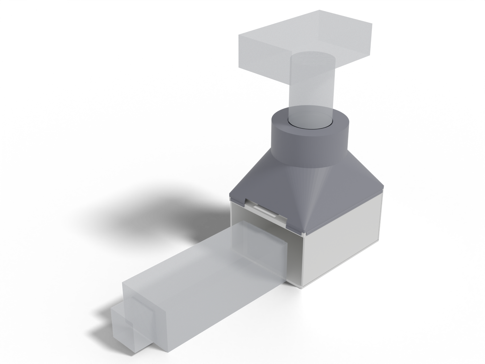
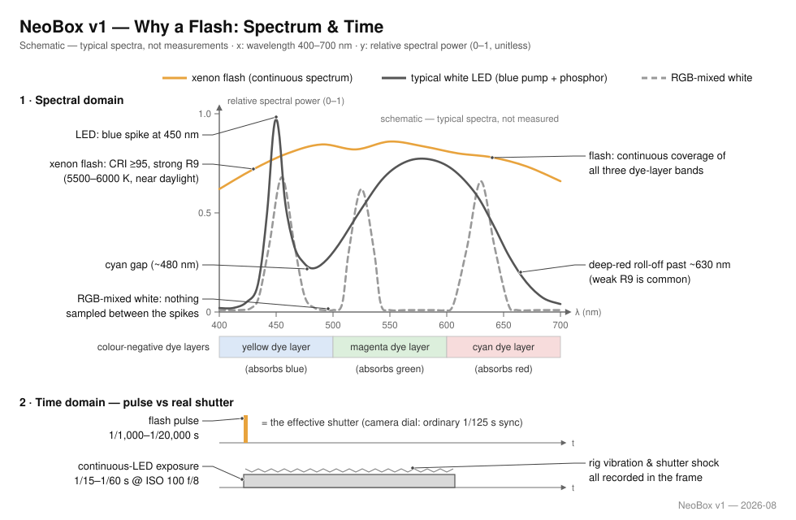
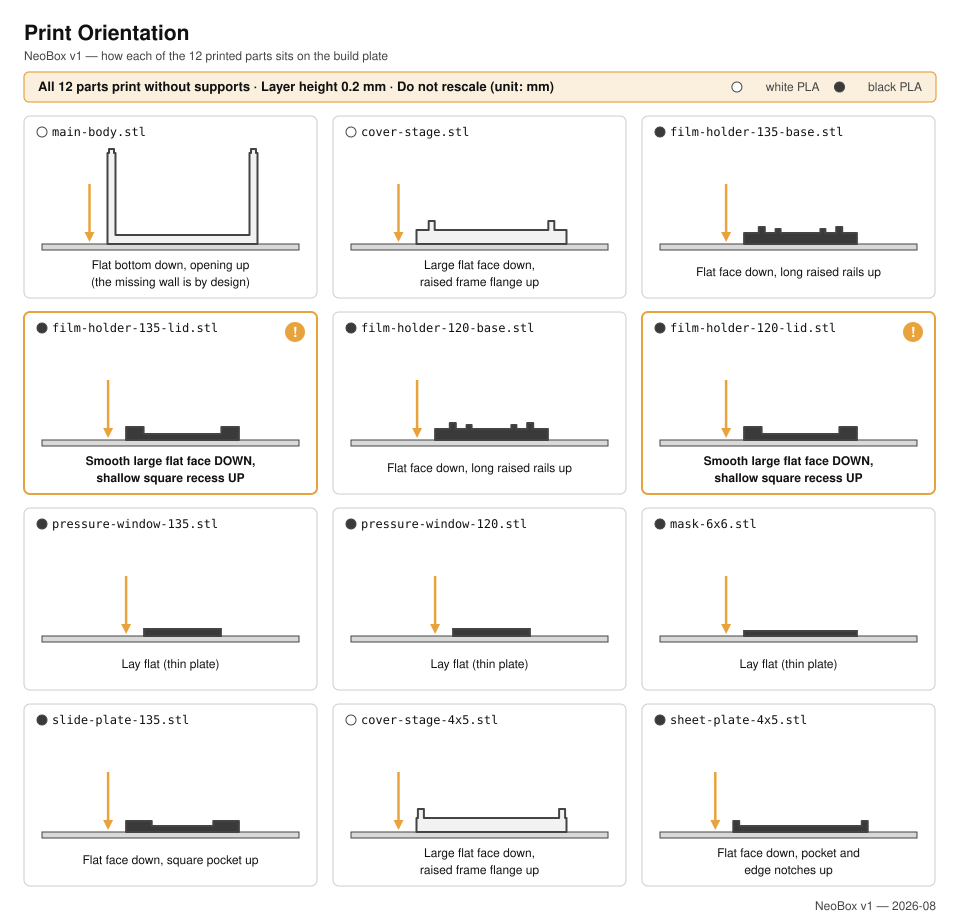
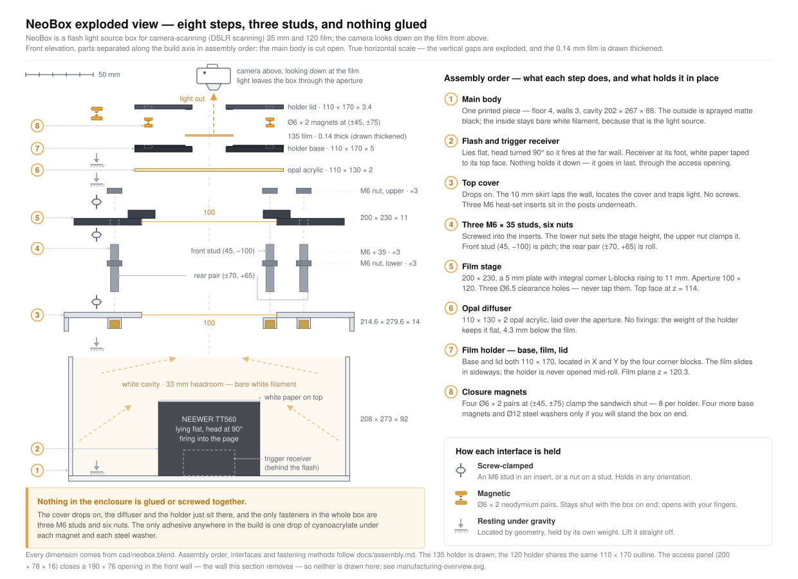
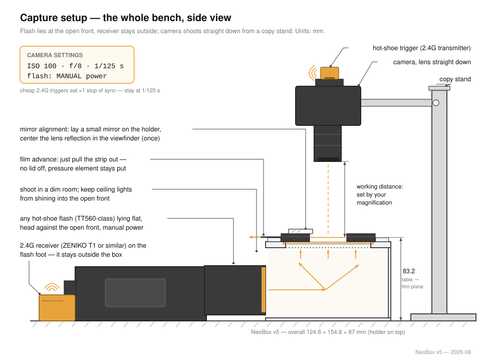

# NeoBox

**English** · [简体中文](README.zh-CN.md) · [日本語](README.ja.md)

  

> A 3D-printed light box that turns any hot-shoe flash into an even light source for photographing 135 and 120 film with a digital camera. 12 printed parts, 3 bought parts, no screws, no glue, no tools.



## What it is

NeoBox is a white box with no front wall. A flash lies on the desk with its head at the opening and fires sideways into the box. The light bounces off the white walls several times, passes up through a sheet of opal acrylic and lights the film from below. The camera looks straight down at the film through a macro lens. This is called camera scanning. You invert the raw file afterwards to get a positive.

The flash never enters the box, so any brand works and the box stays small. The film sits in a holder that closes with magnets. To change format you lift one holder off and set the other down. Nothing on the box is adjustable. You square the camera to the film with a small mirror.

| Item | Value |
|---|---|
| Outer size | 124.8 × 154.8 × 83 mm, 87 mm to the top of a seated holder |
| Formats | 135 and 120 up to 6×9. 6×6 with a mask. Mounted 135 slides and 4×5 sheets with optional parts |
| Film plane | 83.2 mm above the desk, the same for both formats |
| Diffuser | 1 opal acrylic sheet, 68 × 118 × 2 mm, 4.6 mm below the film |
| Film flatness | The film rides in a 0.4 mm channel under a printed insert, or under 1 anti-Newton glass, 64 × 95 × 2 mm |
| Light | Any hot-shoe flash with manual power. The reference is a NEEWER TT560 with a ZENIKO T1 trigger set |
| Status | v1, printed and in use by the author and friends. The evenness and flatness figures are design values from the CAD, not instrument measurements |

## Why a flash

The flash pulse is the exposure. At working power it lasts 1/1,000 to 1/20,000 s, so vibration and shutter shock do not matter, and the camera stays at base ISO and f/8.

Film is picky about the spectrum. Colour negative is three dye layers, and the cyan layer and the orange mask both work at the red end. A xenon tube gives a continuous spectrum of about 5600 K with strong deep red. A white LED has a dip near 480 nm and rolls off past about 630 nm, exactly where those two need light. The gaps show up after inversion as crossed colour curves and casts that no white balance removes.



A manual flash at a fixed power also gives every frame the same light, so one inversion profile fits a roll.

## What you need

| Printed, 12 STL files | Bought | Your own camera gear |
|---|---|---|
| Matte white PLA: `main-body`, `cover-stage`, `cover-stage-4x5` (optional) | 1 opal acrylic sheet, 2 mm, cut to 68 × 118 mm (order 2, the edges chip) | A camera with manual exposure, raw files and a mechanical shutter |
| Black PLA: `film-holder-135-base` and `-lid`, `film-holder-120-base` and `-lid`, `pressure-window-135`, `pressure-window-120`, `mask-6x6` (optional), `slide-plate-135` (optional), `sheet-plate-4x5` (optional) | 32 neodymium magnets Ø8 × 2 mm, N35 | A macro lens that reaches 1:1 for 135 on full frame |
| About 300–350 g of filament in all | 4 steel shims 10 × 10 × 1 mm or Ø10 × 1 mm, carbon steel, never stainless | A copy stand, or a tripod with a horizontal column |
| | Optional: anti-Newton glass 64 × 95 × 2 mm, a black flocking sheet, a 106 × 130 × 2 mm opal sheet for 4×5 | A trigger set, a remote release, a small flat mirror about 30 mm across, a rocket blower |

The box costs about CNY 65–140 (JPY 1,500–3,000) in parts. Search terms: `opal acrylic sheet 2 mm cut to size`, `neodymium disc magnet 8 × 2 mm N35`, `mild steel shim 10 × 10 × 1 mm`, `anti-Newton glass cut to size`, `self-adhesive black flocking sheet`.

## Print

- Plain PLA. The 3 white parts must be matte white, never silk or glossy, because their inside faces are the reflector. Do not sand or paint them.
- 0.2 mm layers on every part, 15 % infill, no supports anywhere, a standard 0.4 mm nozzle.
- Every part prints on its flat face. The two holder lids print top face down, so their recess and magnet pockets face up.
- A 160 × 160 mm bed is enough. Never let the slicer scale a file.
- Print `film-holder-135-base`, `film-holder-135-lid` and `pressure-window-135` first and check that a film strip slides through before you print the rest.

Check the parts as they come off. The main body measures 124.8 × 154.8 × 75.6 mm. The cover-stage drops onto the main body's four tenons without force. A Ø8 × 2 magnet presses into every pocket. A magnet sticks to the shims.



<details>
<summary>Text to send to a print service</summary>

```text
12 STL files, millimetres, 1:1. Do not scale.
Plain PLA: 3 white (matte, never silk or glossy), 9 black.
0.2 mm layers on every file, 15 % infill, no supports on any file.
Every part flat face down. Only the two holder lids go finished top face down.
A 160 × 160 mm bed is enough.

White:  main-body.stl            124.8 × 154.8 × 75.6
        cover-stage.stl          124.8 × 154.8 × 10
        cover-stage-4x5.stl      124.8 × 154.8 × 10   (optional)
Black:  film-holder-135-base.stl 94 × 120 × 5
        film-holder-135-lid.stl  94 × 120 × 3
        film-holder-120-base.stl 94 × 120 × 5
        film-holder-120-lid.stl  94 × 120 × 3
        pressure-window-135.stl  64 × 95 × 2
        pressure-window-120.stl  64 × 95 × 2
        mask-6x6.stl             94 × 80 × 1          (optional)
        slide-plate-135.stl      94 × 120 × 5         (optional)
        sheet-plate-4x5.stl      112 × 138 × 5        (optional)
```

</details>

## Assemble



1. **Magnets.** Each holder base and lid takes 8. Press the base magnets in from the top face, all the same way up. For each lid pocket, touch a loose magnet to the base magnet it will face, mark the exposed face, pull it off and press it into the lid from below, marked face first. A pressed magnet does not come out, so check the polarity every time.
2. **Shims.** Drop the 4 shims into the pockets in the cover-stage deck. No glue.
3. **Acrylic.** Peel the protective film off both faces and lay the sheet in its recess over the window. It sits loose, 0.4 mm below the deck.
4. **Cover-stage.** Lower it onto the main body so the four corner notches drop over the tenons. It seats under its own weight. If it rocks, lift it and set it down again. Never force it.
5. **Holder.** Set the holder base inside the tray flange. Its magnets pull it onto the shims.
6. **Element and lid.** Lay the pressure-window insert on the 4.6 mm ledge in the base, or the anti-Newton glass with its matte face down. Blow the glass clean first, because dust on its underside is in focus. Close the lid.
7. **Square the camera.** Lay the mirror on the closed holder, switch on live view, and tilt the camera until the reflection of its own lens is centred and symmetrical. The sensor is now parallel to the film plane. Lock the head and check again.

The stack is held by gravity and magnets only. Move the pieces separately, never the assembled box.

## Scan



**Height.** The lens front sits at 83.2 mm plus your lens's working distance above the desk. Write down the column height for each format.

| Format | Full frame | APS-C |
|---|---|---|
| 135 | 1.0× | 0.65× |
| 6×4.5 | 0.58× | 0.38× |
| 6×6, 6×7, 6×9 | 0.43× | 0.28× |
| 4×5 | 0.25× | 0.16× |

**Focus.** Magnify live view to 100 %, focus on the grain, then switch to manual focus. If one corner never comes sharp, redo the mirror step.

| Setting | Value |
|---|---|
| Mode, ISO, aperture | Manual, base ISO, f/5.6 to f/8 |
| Shutter | 1/125 s with a mechanical shutter or EFCS. A fully electronic shutter will not fire the flash |
| File, white balance, stabilisation | Raw, fixed, off |
| Flash | Manual power, start at 1/8. Set it so the clear film base sits just below clipping, then leave it for the whole roll |

**Film.** Blow the channel before every strip. Feed the strip in emulsion down and pull the leader until the frame is centred. Advance by pulling. Never open the holder mid-roll. Load a curled strip bow down under the insert and bow up under the glass. For 6×6, lay the mask in the tray under the 120 base and refocus. Mounted slides go in the slide plate's pocket. 4×5 sheets go in the sheet plate on the 4×5 cover-stage, where evenness is untested because the window sits only 9 and 12 mm from the walls.

**Afterwards.** Shoot one empty frame at the same settings and use it for flat-field correction. Then set the white balance on the clear film base, invert, and crop the rebate. One profile normally fits the whole roll. RawTherapee, darktable and Negative Lab Pro all do this.

**Camera tube.** A printed stand that holds the lens by its filter thread on top of the holder is in development. `tools/camera_tube.py` builds it from four numbers you measure. See [Design](docs/design.md#7-camera-tube).

## When something is wrong

| Symptom | Cause and fix |
|---|---|
| The frame is black | Electronic shutter, shutter above sync speed, flat receiver battery, wrong channel. Work down that list |
| A clean dark band across the frame | Shutter faster than the real sync limit. Use 1/125 s |
| One edge of every frame is soft | The film plane is not parallel to the sensor. Redo the mirror step |
| Corners soft, and it changes frame to frame | The film is not flat. Stop down, check the loading direction, or use the glass |
| Dark blobs in the same place every frame | Dust on the glass underside. Blow it before it goes in |
| Coloured rings | The glass is in with the matte face up. Turn it over |
| A scratch along the strip | Grit in the channel. Blow before every strip |
| Exposure drifts | The flash power was nudged, or the batteries are flat |
| A bright patch shaped like the flash head | Glossy white filament. Reprint the white parts matte |
| The cover-stage rocks | A tenon beside its notch, or elephant foot. Reseat it, or trim the first layer of the tenon |
| The lid pushes itself open | One magnet is reversed. Find it with a spare magnet |
| The holder does not snap down | The shims are stainless or missing |
| A part is smaller than listed | The slicer scaled it. Reprint at 100 % |

## Files and licence

`cad/neobox.blend` is the only source of geometry. `tools/export_stl.py` regenerates the 12 STL files from it and `tools/verify_stl.py` checks them. The drawings come from `tools/drawings/`. [Design](docs/design.md) holds every dimension and the reasons behind it. [CONTRIBUTING](CONTRIBUTING.md) explains how to send a change.

Designed by [Neo Analog Lab Inc.](https://github.com/Neoanaloglab), released under the [MIT License](LICENSE).
