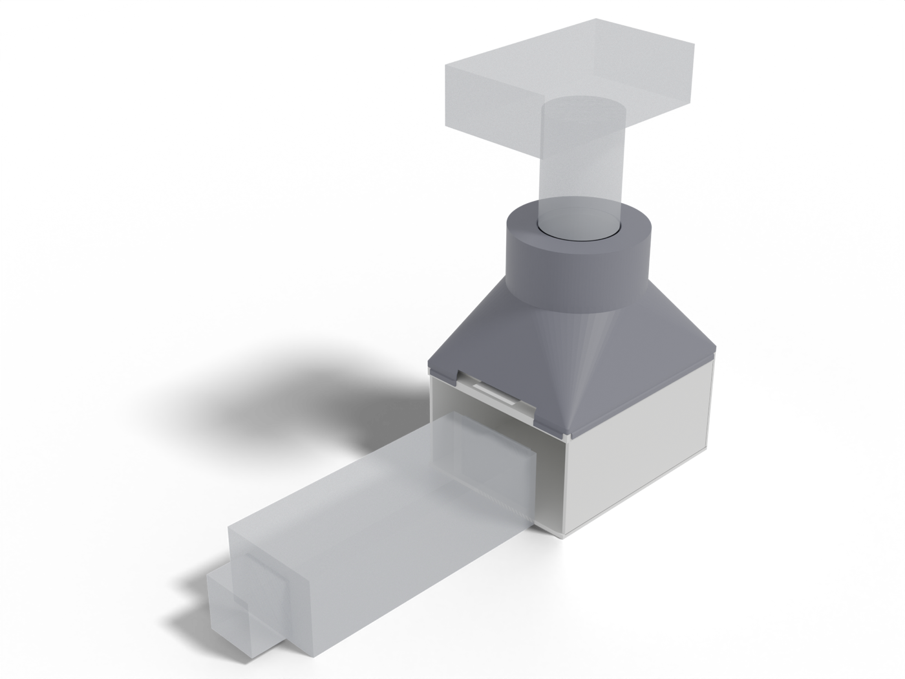
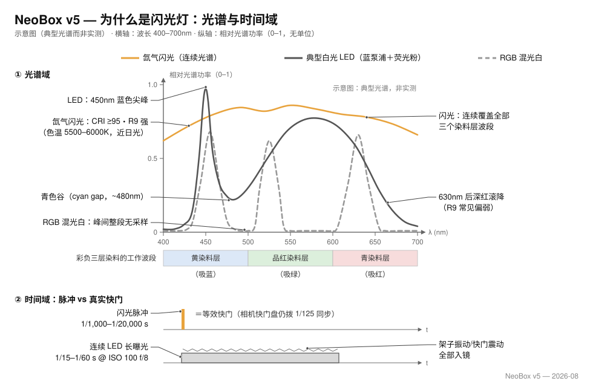
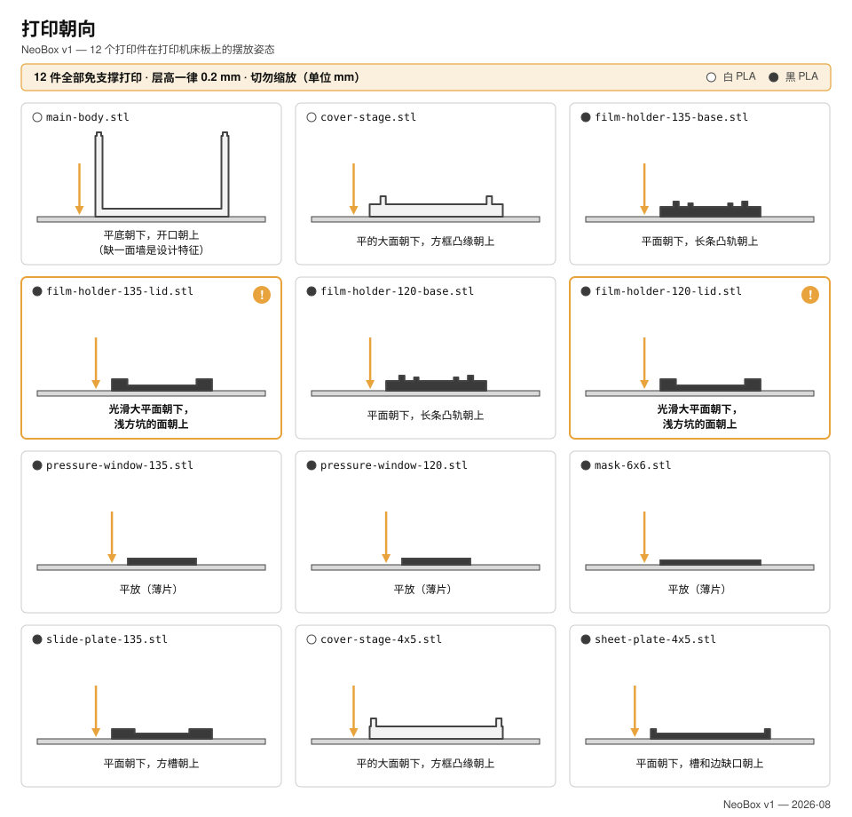
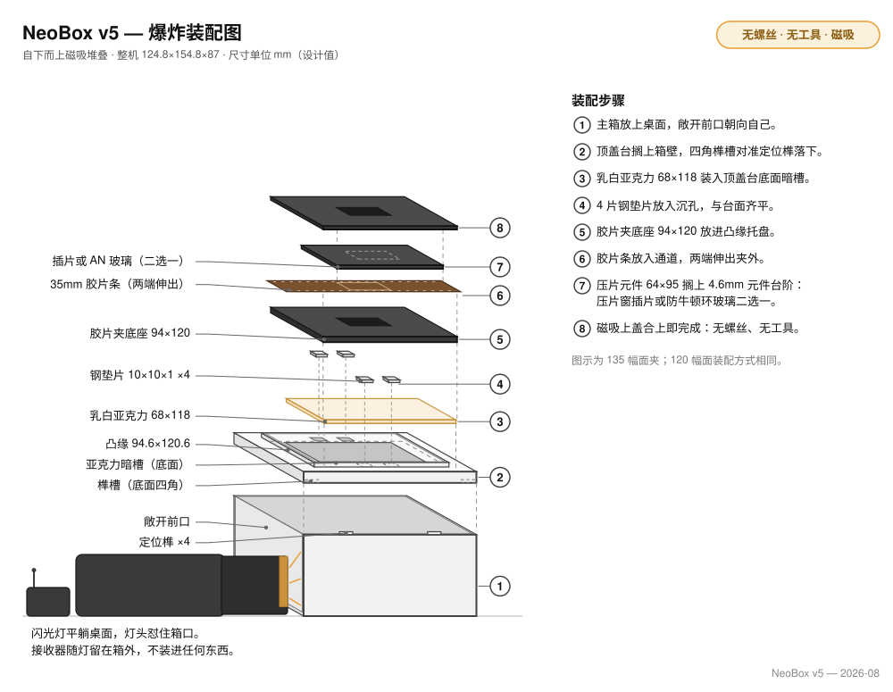
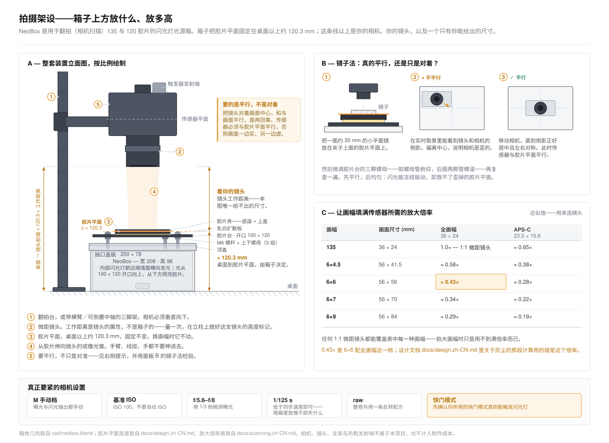

# NeoBox

[English](README.md) · **简体中文** · [日本語](README.ja.md)

  

> 一个 3D 打印的灯箱，把任何一支热靴闪光灯变成均匀的光源，用数码相机翻拍 135 和 120 胶片。12 个打印件，3 样采购件，没有螺丝，没有胶水，不用工具。



## 它是什么

NeoBox 是一个没有前壁的白色箱子。闪光灯平躺在桌面上，灯头对着箱口，横着往箱子里打光。光在白墙之间反射几次，再向上穿过一块乳白亚克力板，从下面照亮胶片。相机装微距镜头，从正上方拍胶片。这种做法叫相机翻拍。拍完把 raw 文件反相，就得到正像。

闪光灯从不进箱，所以什么牌子都能用，箱子也做得小。胶片装在用磁铁合上的胶片夹里。换画幅就是提起一副夹子，放下另一副。箱子上没有任何可调的东西。相机与胶片的平行靠一面小镜子来校。

| 项目 | 数值 |
|---|---|
| 外形 | 124.8 × 154.8 × 83 mm，装上胶片夹后高 87 mm |
| 画幅 | 135 和 120 到 6×9。6×6 加一片遮幅插片。装框的 135 幻灯片和 4×5 页片用可选件 |
| 胶片平面 | 离桌面 83.2 mm，两种画幅相同 |
| 扩散板 | 乳白亚克力 1 块，68 × 118 × 2 mm，在胶片下方 4.6 mm |
| 压平 | 胶片在 0.4 mm 的滑槽里滑动，上面是打印的压片窗插片，或者 1 片 64 × 95 × 2 mm 的防牛顿环玻璃 |
| 光源 | 任何带手动出力的热靴闪光灯。参考机是 NEEWER TT560 配 ZENIKO T1 引闪套装 |
| 状态 | v1，作者和朋友已打印并在用。文档里的均匀度和压平数字是 CAD 里的设计值，不是仪器测量值 |

## 为什么用闪光灯

闪光脉冲就是曝光。工作功率下它只持续 1/1,000 到 1/20,000 s，所以震动和快门震动都不要紧，相机可以停在基准 ISO 和 f/8。

胶片对光谱很挑剔。彩色负片是三层染料，其中青色层和橙色掩膜都工作在光谱的红端。氙气灯管给出约 5600 K 的连续光谱，深红充足。白光 LED 在 480 nm 附近有凹谷，过了约 630 nm 就滚降，正好是这两层最需要光的地方。缺口要到反相之后才显现。颜色曲线交叉，偏色怎么调白平衡都去不掉。



固定出力的手动闪光灯还让每一格得到同样的光，一套反相参数就能通吃一卷。

## 需要什么

| 打印件，12 个 STL | 采购件 | 你自己的相机器材 |
|---|---|---|
| 哑光白色 PLA：`main-body`、`cover-stage`、`cover-stage-4x5`（可选） | 乳白亚克力 1 块，2 mm 厚，裁成 68 × 118 mm（买 2 块，边缘容易崩） | 一台能手动曝光、拍 raw、有机械快门的相机 |
| 黑色 PLA：`film-holder-135-base` 和 `-lid`、`film-holder-120-base` 和 `-lid`、`pressure-window-135`、`pressure-window-120`、`mask-6x6`（可选）、`slide-plate-135`（可选）、`sheet-plate-4x5`（可选） | 钕磁铁 32 颗，Ø8 × 2 mm，N35 | 一支能到 1:1 的微距镜头，全画幅拍 135 要用到 |
| 耗材共约 300–350 g | 钢垫片 4 片，10 × 10 × 1 mm 或 Ø10 × 1 mm，碳钢，不能用不锈钢 | 翻拍台，或者带横臂的三脚架 |
| | 可选：防牛顿环玻璃 64 × 95 × 2 mm、黑色植绒贴、4×5 用的 106 × 130 × 2 mm 乳白板 | 引闪套装、快门线、一面约 30 mm 的小平面镜、气吹 |

箱子的零件约 CNY 65–140（JPY 1,500–3,000）。淘宝搜索词：`乳白亚克力板 定制 2 mm`、`钕磁铁 8 × 2 mm N35`、`铁片 10 × 10 × 1 mm`、`防牛顿环玻璃 定制`、`黑色植绒布 背胶`。

## 打印

- 普通 PLA。3 个白色件必须用哑光白，不能用丝绸或亮面料，因为它们的内壁就是反射面。不要打磨，不要喷漆。
- 每个件层高 0.2 mm，填充 15 %，全部不用支撑，标准 0.4 mm 喷嘴。
- 每个件都平面朝下打。只有两个夹上盖顶面朝下，让它的凹槽和磁铁孔朝上。
- 160 × 160 mm 的打印床就够。绝不要让切片软件缩放文件。
- 先打 `film-holder-135-base`、`film-holder-135-lid` 和 `pressure-window-135`，确认片条能滑过再打其余的。

件打出来就量一下。主箱是 124.8 × 154.8 × 75.6 mm。顶盖台不用力就能落到主箱的四个定位榫上。每个孔都能压进一颗 Ø8 × 2 的磁铁。磁铁能吸住垫片。



<details>
<summary>发给打印店的话术</summary>

```text
12 个 STL 文件，单位毫米，1:1，请勿缩放。
普通 PLA：白色 3 件（哑光，不要丝面或亮面），黑色 9 件。
全部文件层高 0.2 mm，填充 15 %，全部免支撑。
全部平面朝下。只有两个夹上盖成品顶面朝下贴床。
160 × 160 mm 的打印床即可。

白色：  main-body.stl            124.8 × 154.8 × 75.6
        cover-stage.stl          124.8 × 154.8 × 10
        cover-stage-4x5.stl      124.8 × 154.8 × 10   （可选）
黑色：  film-holder-135-base.stl 94 × 120 × 5
        film-holder-135-lid.stl  94 × 120 × 3
        film-holder-120-base.stl 94 × 120 × 5
        film-holder-120-lid.stl  94 × 120 × 3
        pressure-window-135.stl  64 × 95 × 2
        pressure-window-120.stl  64 × 95 × 2
        mask-6x6.stl             94 × 80 × 1          （可选）
        slide-plate-135.stl      94 × 120 × 5         （可选）
        sheet-plate-4x5.stl      112 × 138 × 5        （可选）
```

</details>

## 装配



1. **磁铁。** 每个夹底座和夹上盖各装 8 颗。底座的磁铁从顶面压入，全部同一个朝向。上盖的每个孔，先拿一颗散磁铁去碰它将要面对的那颗底座磁铁，在露出的那面做记号，拔下来，做了记号的面朝前从下面压进上盖。压进去的磁铁取不出来，所以每一颗都要先验极性。
2. **垫片。** 把 4 片垫片放进顶盖台台面的沉孔里。不用胶。
3. **亚克力。** 两面的保护膜都撕掉，把板放进窗口上方的暗槽里。它是松的，比台面低 0.4 mm。
4. **顶盖台。** 放到主箱上，让四角的榫槽套住定位榫。它靠自重落座。晃的话就提起来重放。绝不要硬压。
5. **胶片夹。** 把夹底座放进托盘凸缘里。磁铁会把它吸到垫片上。
6. **压片元件和上盖。** 把压片窗插片放在底座 4.6 mm 的台阶上，或者放防牛顿环玻璃，磨砂面朝下。玻璃先吹干净，因为它底面的灰尘是在焦点上的。合上上盖。
7. **校正相机。** 把镜子平放在合好的胶片夹上，打开实时取景，调相机的倾斜，直到镜头自己的倒影居中且对称。这时传感器就与胶片平面平行了。锁紧云台，再看一次。

整摞东西只靠重力和磁铁。要挪就分件挪，不要搬装好的箱子。

## 翻拍



**高度。** 镜头前端离桌面的高度是 83.2 mm 加上你镜头的工作距离。把每种画幅的立柱高度记下来。

| 画幅 | 全画幅 | APS-C |
|---|---|---|
| 135 | 1.0× | 0.65× |
| 6×4.5 | 0.58× | 0.38× |
| 6×6、6×7、6×9 | 0.43× | 0.28× |
| 4×5 | 0.25× | 0.16× |

**对焦。** 实时取景放大到 100 %，对胶片颗粒对焦，然后切到手动对焦。有一个角始终不清楚，就回去重做镜子那一步。

| 设置 | 值 |
|---|---|
| 模式、ISO、光圈 | 手动，基准 ISO，f/5.6 到 f/8 |
| 快门 | 1/125 s，用机械快门或电子前帘。全电子快门不会触发闪光灯 |
| 文件、白平衡、防抖 | raw，固定，关 |
| 闪光灯 | 手动出力，从 1/8 开始。调到透明片基刚好不溢出，然后整卷不再动 |

**装片。** 每条片条装之前先吹滑槽。药膜面朝下把片条送进去，拉片头直到画幅居中。过片靠拉。整卷拍完之前不开夹子。卷曲的片条，用插片时拱面朝下，用玻璃时拱面朝上。拍 6×6 时把遮幅插片垫在托盘里的 120 底座下面，重新对焦。装框幻灯片放进幻灯片板的方槽。4×5 页片放在 4×5 顶盖台上的片板里，它的均匀度没有验证过，因为窗口离箱壁只有 9 和 12 mm。

**拍完之后。** 用同样的设置拍一张空白帧，做平场校正。然后用透明片基定白平衡，反相，裁掉片边。一套参数通常整卷通用。RawTherapee、darktable 和 Negative Lab Pro 都能做。

**相机筒。** 一个打印的罩子，扣在盒子顶上，靠滤镜螺纹托住镜头，相机因此固定在盒子本身上，而不是胶片夹上。它还没有打印过。罩子、两件接头试片，以及 Laowa 85 拍 1:1 和拍 4×5 用的零件，都在 `stl/camera-tube/` 里，黑色 PLA，顶面朝下打印，不用支撑。先打试片，确认插头用手能转、松手不动。别的镜头由 `tools/camera_tube.py` 根据你量的四个数生成载筒。见[设计](docs/design.zh-CN.md#7-相机筒)。

## 出问题的时候

| 现象 | 原因和处理 |
|---|---|
| 画面全黑 | 电子快门、快门超过同步速度、接收器没电、频道不对。按这个顺序查 |
| 画面上一条干净的暗带 | 快门快过真实的同步极限。用 1/125 s |
| 每一格都有一条边发虚 | 胶片平面与传感器不平行。重做镜子那一步 |
| 四角发虚，而且每格不一样 | 胶片不平。收小光圈，检查装片方向，或者换玻璃 |
| 每格同一位置有暗斑 | 玻璃底面有灰。放进去之前吹一下 |
| 彩色圆环 | 玻璃放反了，磨砂面朝上。翻过来 |
| 片条上一道划痕 | 滑槽里有砂粒。每条片条之前都吹 |
| 曝光漂移 | 闪光灯出力被碰了，或者电池没电 |
| 一块灯头形状的亮斑 | 白料是亮面的。白色件用哑光料重打 |
| 顶盖台晃 | 榫落在槽旁边，或者有象足。重放，或者修掉榫的第一层 |
| 上盖自己顶开 | 有一颗磁铁装反了。拿备用磁铁找出来 |
| 胶片夹吸不住 | 垫片是不锈钢的，或者没放 |
| 件比标称的小 | 切片软件缩放了。按 100 % 重打 |

## 文件和许可

`cad/neobox.blend` 是唯一的几何来源。`tools/export_stl.py` 从它重新生成箱体的 12 个 STL，`tools/camera_tube.py` 生成相机筒零件，`tools/verify_stl.py` 负责全部校验。图纸由 `tools/drawings/` 生成。[设计](docs/design.zh-CN.md)记录每一个尺寸和背后的理由。[CONTRIBUTING](CONTRIBUTING.md) 说明怎么提交修改。

由 [Neo Analog Lab Inc.（ネオアナログラボ株式会社）](https://github.com/Neoanaloglab)设计，以 [MIT 许可证](LICENSE)发布。
