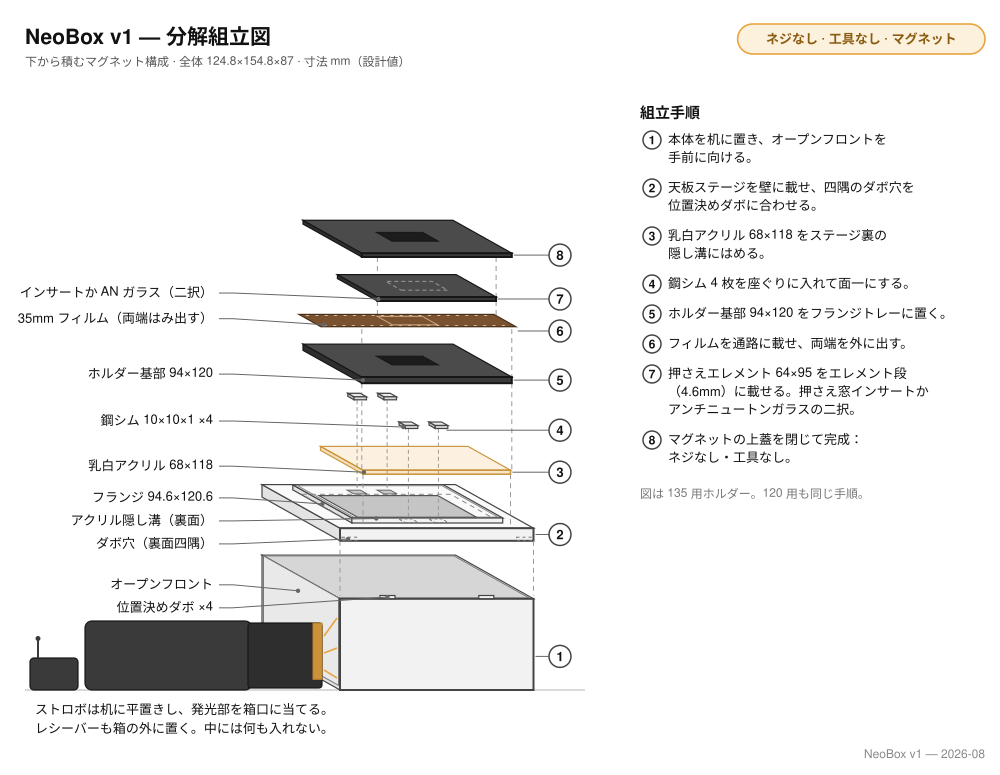
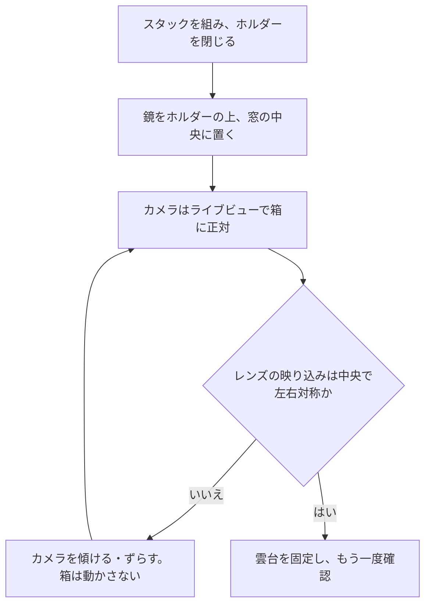

# 組立

[English](assembly.md) · [简体中文](assembly.zh-CN.md) · **日本語**

> プリントパーツ 12 個、マグネット 32 個、スチールシム 4 枚、乳白アクリル 1 枚を、実際に使える光源に変えるまで。道具はひとつも使いません。極性を合わせて圧入するマグネット、本体から天板ステージ、フィルムホルダーへと重力だけで積み上がるスタック、そしてフィルム面をセンサーと平行にする鏡の方法を扱います。

**目次：** [始める前に](#始める前に) · [工具と安全](#工具と安全) · [何が何を固定するか](#何が何を固定するか) · [組立手順](#組立手順) · [フォーマット切り替えと日常の扱い](#フォーマット切り替えと日常の扱い) · [うまくいかないとき](#うまくいかないとき)

## 始める前に

このビルドには、ねじが 1 本もありません。ねじ山も接着剤も塗装もありません。だから工具も要りません。どの結合もマグネットか、位置決めの形状か、重力のどれかです。すべての手順は元に戻せます。載せたのと同じ動きで、そのまま持ち上げて外せます。硬化や乾燥を待つ時間はどこにもないので、組立はひと息で終わります。ゆっくりやる価値があるのはマグネットの圧入だけです。全工程でそこだけが、やり直しの利かない操作だからです。

手をつける前に、パーツを確認してください。パーツごとの完全な一覧は [printing.ja.md](printing.ja.md#組み立てる前に各パーツを確認する) に、購入部品は[部品表](bom.ja.md)にあります。次の 4 つのどれかが通らなければ、組立はそこで止まります。

- [ ] **天板ステージ**が、四隅のダボ穴を壁上端の位置決めダボ（壁の上に立つ小さな突起）に合わせると、自重だけで**本体**に落ち、がたつかずに座る。
- [ ] **Ø8 × 2 mm のマグネット**が座ぐり穴に手で入り始め、しっかり押すと底まで届く。しまりばめ（穴のほうがマグネットよりわずかに小さい）なので、きついのが正解です。
- [ ] **スチールシム**がマグネットに吸い付く。ステンレスは吸い付かず、あとになっても何も警告してくれません。
- [ ] **フィルムストリップ**が無理なく**ホルダー底**の溝を通り、**ホルダー蓋**ががたつかずに載る。

## 工具と安全

工具の一覧はありません。工具そのものがないからです。はんだごても、スパナも、ナイフも、接着剤も、塗料も使いません。あると便利なものは 2 つだけです。ホコリを飛ばすブロアーと、最後のステップで使う 30 mm 程度の小さな平面鏡です。マグネットが親指で押し切れないときは、マグネットを机に置いて、パーツのほうを上から押し付けてください。この机が、このビルドで「工具」にいちばん近いものです。

> [!WARNING]
> - **Ø8 × 2 mm のマグネット**は小さくて強力で、誤飲の危険が本当にあります。子どもとペットの手の届かない場所に置いてください。2 個が吸い付くときに皮膚を挟みます。磁気カードのデータを消し、ハードディスクにも悪影響を与えます。
> - 圧入したマグネットは簡単には抜けません。極性（どちらの面を外に向けるか）の確認は、毎回**押し込む前に**行ってください。
>
> 箱の中に電気製品は何ひとつ入りません。ストロボはオープンフロント（前面開口）の外に寝かせて中へ発光させ、受信機もその横に置いたままです。

## 何が何を固定するか

| インターフェース | 方式 |
|---|---|
| 本体 | 一体プリントの 1 部品。組み立てる箇所はない |
| 天板ステージ → 本体 | 壁の上端に載り、四隅のダボ穴が位置決めダボに掛かる。重力のみ、ねじなし |
| スチールシム → 天板ステージ | ステージ面（天板ステージの上面）の座ぐり穴 4 か所に落とし、面一に納まる。接着なし。座ぐりが位置を決め、真上のマグネットが押さえる |
| 乳白アクリル → 天板ステージ | 透過窓に被さる凹部に納まり、上面はステージ面より 0.4 mm 低い。固定なし |
| ホルダー底 → 天板ステージ | トレイフランジが位置を決め、底のマグネットがスチールシムに吸着して引き付ける |
| 押さえエレメント → ホルダー底 | インサートまたはアンチニュートンガラスがエレメント段（4.6 mm）に載る。意図して緩い |
| ホルダー蓋 → ホルダー底 | マグネット 8 ペア |
| ストロボ → 箱 | 箱には決して入れない。オープンフロントの外の机に寝かせ、発光部を庫内へ向ける |

## 組立手順

### ステップ 1 — マグネットを圧入する

**必要なもの：** ホルダーの 4 部品（ホルダー底 2 枚、ホルダー蓋 2 枚）、Ø8 × 2 mm マグネット 32 個、マーカーペン。

各部品にマグネットを 8 個ずつ圧入します。ホルダー底は**上から**、上面の座ぐり穴へ。ホルダー蓋は**下から**、裏面の座ぐり穴へ。このステップは極性（どちらの面を外に向けるか）がすべてです。底の各マグネットは、将来向かい合う蓋のマグネットと引き合わなければなりません。しかも押し込む前に合わせておく必要があります。圧入は、このビルドでいちばん取り消しの利かない操作だからです。

1. マグネットは 1 本のスタックのまま持ち、端から 1 個ずつ、途中で裏返さずに取ります。こうすればどのマグネットも同じ向きでスタックを離れます。
2. ホルダー底を平らに置き、8 個を同じ向きのまま上面から 1 個ずつ、それぞれ穴の底まで圧入します。たいてい親指で足ります。足りなければマグネットを机に置き、パーツのほうを押し付けてください。
3. ホルダー蓋を裏返して、裏面を上に向けます。座ぐり穴ごとに、まずばらのマグネットを、向かい合うことになる圧入済みの底マグネットに触れさせます。引き合う向きでぱちんと付きます。露出している面にペンで印を付け、引きはがし、**印の面から先に**蓋の穴へ圧入します。印のない面、つまり引き合う面が見える状態で仕上がります。
4. もう一方のフォーマットの底と蓋にも同じことをします。

**チェックポイント：** どの蓋も底にぱちんと吸い付き、閉じたホルダーを片端で持っても閉じたままです。蓋のマグネットは蓋の裏面と面一で仕上がります。底のマグネットは板面から 0.4 mm 出っ張ります。これは設計どおりで、押し込み不足ではありません。沈めようとしないでください。

**失敗の形：** 逆向きのマグネットが 1 個あると、その角で蓋が押し開かれます。そして圧入済みのマグネットは、簡単には出てきません。手順 3 の「触れさせて印を付ける」確認は 1 個あたり数秒です。省くと、部品ごと失いかねません。

> [!IMPORTANT]
> このサンドイッチを閉じているのは 8 ペアのマグネットだけです。その後ろにクリップもねじもありません。どの底にも、どの蓋にも 8 個すべてを入れます。v1 に「省略できるマグネット」はありません。

### ステップ 2 — 鉄ワッシャーを座ぐりに落とす

**必要なもの：** 天板ステージ、スチールシム 4 枚（10 × 10 × 1 mm の角形、または Ø10 × 1 mm の円形）。

1. ステージ面の座ぐり穴 4 か所に、シムを 1 枚ずつ落とします。

このステップはこれで全部です。接着はしません。座ぐりがシムをステージ面と面一に位置決めし、使用時には真上に来るホルダー底のマグネットが押さえます。

**チェックポイント：** ステージ面を指先でなぞって、どのシムの縁にも段差を感じないこと。予備のマグネットで、どのシムもまっすぐ吊り上げられること。吊り上がらないシムはステンレスです。今ここで交換してください。あとになっても何も教えてくれません。

**失敗の形：** ステンレスのシムは見た目がまったく同じで、音もなく失敗します。ホルダー底が定位置に引き込まれなくなります。ステージ面から出っ張ったシムは、上に載る底を傾けます。

### ステップ 3 — アクリルを凹部に収める

**必要なもの：** 68 × 118 × 2 mm の[乳白](glossary.ja.md#乳白-opal)アクリル（4×5 天板ステージなら 106 × 130 × 2 mm の板）、ブロアー。

1. **両面の保護フィルムを剥がします。** アクリル板は両面ともフィルム付きで届きます。
2. 両面をブロアーで払います。
3. トレイ中央、透過窓に被さる凹部へ板を置きます。落とし込むと、上面はステージ面より 0.4 mm 低いところで止まります。

**チェックポイント：** 板の全周がステージ面より低く、凹部の中で少し動かせること。緩いのが正解です。何も固定していませんし、この 0.4 mm の段差のおかげで、上に載るホルダーさえ板には触れません。

**失敗の形：** 面に残った保護フィルムは光の拡散のしかたを変えますが、乳白の板の上ではとても見つけにくいものです。収める前に、四隅で剥がし残しの端を探してください。

> [!NOTE]
> アクリルに載ったホコリはコマには写りません。この板そのものがフィルムを照らす拡散面で、レンズのピントはここには合っていないからです。手入れは、ときどき乾いた布で拭くだけで十分です。アルコール、アンモニア、ガラスクリーナーは使わないでください。3 つともアクリルにクレーズ（微細なひび）を生じさせます。

### ステップ 4 — 天板ステージを本体に載せる

**必要なもの：** 本体、シムとアクリルを収めた天板ステージ。

1. トレイフランジをつまんで天板ステージを持ち、四隅のダボ穴を壁上端の位置決めダボに合わせ、まっすぐ下ろします。自重で座ります。
2. 浮いたりがたついたりするなら、どこかのダボが穴に入らず横に乗り上げています。まっすぐ持ち上げて、載せ直してください。押さない、ひねらない。

**チェックポイント：** 天板ステージが壁の上端に全周すきまなく平らに座り、がたつかないこと。そして同じくらい軽く、まっすぐ持ち上げて外せること。

**失敗の形：** ダボが穴に入らないのはプリントの問題です。どちらかのパーツの最初の数層に出た[エレファントフット](glossary.ja.md#エレファントフット-elephant-foot)（最初の数層が押しつぶされて広がったもの）が原因です。力で押し込まないでください。[printing.ja.md](printing.ja.md#きつい場合と緩い場合の対処) を参照してください。

### ステップ 5 — ホルダー底をトレイに収める

**必要なもの：** 載せ終えた天板ステージ、使うフォーマットのホルダー底（マウント済みスライドならスライドプレート）。6×6 を撮るなら 6×6 マスクも。

1. トレイフランジの内側へ底を下ろします。すきまは片側 0.3 mm で、気になるほどの遊びもなく収まります。
2. 手を離して落ち着かせます。底のマグネットがステージ面のスチールシムを見つけ、底を平らに、定位置へ引き込みます。

**チェックポイント：** 底がトレイの床に平らに座ってがたつかず、着地の瞬間にマグネットが受け取る感触があるはずです。持ち上げてもう一度落としてみてください。毎回同じ収まり方をするはずです。

**失敗の形：** 落としても無反応で、吸着も位置決めの感触もないなら、ステップ 2 のシムがステンレスか、そもそも入っていません。フランジに入らない底は、これもエレファントフットです。力で押し込まないでください。

> [!NOTE]
> 6×6 を撮るときは、先に **6×6 マスク**をトレイに敷き、その上に 120 の底を載せます。ホルダー全体が 1 mm 高く座りますが、それで正常です。6×4.5 の専用マスクはありません。120 の窓のまま撮って、あとでトリミングしてください。マウント済みスライドでは、**スライドプレート**が 135 の底の代わりにトレイに単独で立ちます。マグネットもエレメントも蓋もないので、ステップ 6 は不要です。4×5 では、**シートプレート**が同じように **4×5 天板ステージ**のトレイに立ちます。この天板ステージにはステップ 3 の専用アクリルを入れ、ステップ 4 とまったく同じようにダボに載せます。マグネットはなく、ステップ 6 も不要です。

### ステップ 6 — 押さえエレメントを載せ、蓋を閉じる

**必要なもの：** 使うフォーマットの押さえ窓インサート、またはアンチニュートンガラス 64 × 95 × 2 mm（1 枚で両フォーマット兼用）。それと対応するホルダー蓋、ブロアー。

1. エレメントを外側レールのエレメント段（4.6 mm）に載せます。段はエレメントをフィルムの通り道の 0.4 mm 上に支え、この 0.4 mm が押さえ設計のすべてです。フィルムはエレメントの下をすべって送られ、浮き上がった部分はエレメントの下面に沿って平らにならされます。エレメントは一度収めたら、以後は触りません。
2. ガラスを使う場合は、**つや消し（AN）面を下**にして、フィルム側へ向けます。つや消し面がフィルムベースの光沢面に接することで、ニュートンリング（フィルムが滑らかな面に押し付けられたときに出る色の縞）を防ぎます。収める直前に下面をブロアーで払ってください。焦点面まで 0.2 mm しかなく、そこのホコリは写ります。
3. 蓋を載せます。8 ペアのマグネットが引き込んで閉じます。

**チェックポイント：** 蓋が全周で座り、浮いた角がないこと。そして閉じた蓋の下で、エレメントにかすかな遊びが残っていること。蓋の内側の空間には 0.4 mm の余裕を持たせてあり、浮いているのが正解です。エレメントががっちり挟まっているなら、どこかが出っ張っています。強く押さず、開けて確かめてください。

**失敗の形：** ガラスを光沢面を下にして入れると、フィルムベースとのあいだにニュートンリングが出ます。閉じない角が 1 つあるなら、ステップ 1 で逆向きに入れたマグネットが、ここで表に出てきたのです。

### ステップ 7 — カメラ側で平行を出す：鏡の方法

箱には水平調整の機構がありませんが、足りないわけではありません。大事な関係はただひとつ、**フィルム面とセンサーの平行**です。それを合わせる正しい場所はカメラ側です。カメラ側でのひと調整が、プリントパーツの公差まで含めて、連鎖全体を一度に修正するからです。

**必要なもの：** カメラの下に据えた組み上がりの箱、30 mm 程度の小さな平面鏡。

1. 閉じたホルダーの上、フィルム窓の中央に鏡を平らに置きます。
2. ライブビューをオンにします。鏡にレンズとカメラが映り込んでいるはずです。
3. **カメラを**傾けたりずらしたりして、レンズの映り込みが画面のちょうど中央に来て、左右対称に見えるようにします。箱は動かしません。
4. 映り込みが中央に来たとき、センサーは鏡と平行で、その鏡はフィルム面に載っています。これで完了です。
5. 雲台（スタンドでカメラを支える部分）を固定して、もう一度確認します。締めるときに位置がずれるからです。

**チェックポイント：** 雲台を固定した状態でも映り込みが中央にあること。箱かカメラを動かしたら、そのたびに確認し直してください。数秒で済みます。

なぜカメラ側で、なぜ鏡なのか

水準器は重力に対する水平を測りますが、重力は光路の中にありません。床に対して完璧に水平な面でも、センサーに対しては傾いていることがあります。鏡が測るのは、まさにその唯一大事な関係です。しかもずれを 2 倍にして見せてくれます。センサーの光軸と鏡面のあいだの角度は、映り込みの位置のずれとして 2 倍で現れます。だから「レンズ自身の映り込みを中央に置く」ことは、感度の高いゼロ合わせになります。ずれが消えるまで調整すればよいのです。

カメラ側で調整すれば、鏡より下にあるすべて（壁上端の平面度、ダボの座り、積み重なったプリント公差）も同じひと動作で吸収できます。箱の下に何かを噛ませても、直せるのは箱だけです。v1 が箱側の水平調整機構を改良せずに削除したのは、これが理由です。

カメラ側のセットアップについては、スタンドは[平行出し](scanning.ja.md#平行出し)を、フォーマットごとの高さは[カメラの高さとスタンド](scanning.ja.md#カメラの高さとスタンド)を参照してください。

## フォーマット切り替えと日常の扱い

- **フォーマットの切り替えは、ホルダーの交換です。** ホルダーはマグネットで載っているだけなので、丸ごと持ち上げて、もう一方のフォーマットのホルダーを収めます。インサートはそれぞれのホルダーに入れたままにします。アンチニュートンガラスを使うなら、1 枚で両フォーマット兼用なので、ガラスだけをもう一方のホルダーのエレメント段へ移します。
- **フィルム送り：** ホルダーの外に出ている先端をつまんで、そのまま引きます。末端はトレイフランジの上端（フィルム面より 0.2 mm 低い位置）に載って支えられて進みます。長いストリップは、反対の手で末端側を支えてください。
- **装填の向き：** ガラスなら反りの凸面を上に、インサートなら凸面を下にします。
- **マウント済みスライド：** 135 のホルダーを持ち上げて外し、スライドプレートを収めます。マウントは、窓にかざして見るときと同じ向き、つまり上から見て像が正しく読める向き（乳剤面が下）でポケットに落とし込みます。取り出すときは 2 つの指掛け溝に指を掛けます。ほかは何も変わりません。ピントだけ合わせ直してください。
- **4×5 シート：** 天板ステージを持ち上げて外し、専用アクリルを入れた 4×5 天板ステージを同じダボに載せます。そのトレイにシートプレートを収め、シートを上から見て像が正しく読める向き（乳剤面が下）でポケットに落とし込みます。取り出すときは縁の切欠きに指を掛けます。ピントを合わせ直し、ポールの高さも取り直してください。4×5 の撮影倍率はおよそ 0.25× です。
- **アクリルの取り出し：** ホルダーを外し、オープンフロントから手を入れて、透過窓越しに板を上へ押し出します。
- **天板ステージは丸ごと持ち上げられます。** トレイフランジをつまんで、まっすぐ上へ。
- **ストロボは常に箱の外：** オープンフロントに寝かせ、発光部を庫内へ向けます。受信機も外に置いたままです。電波はクリアで、電池交換に箱を開ける必要もありません。撮影は薄暗い部屋で行い、天井の照明が開口へ直接差し込まないようにしてください。

> [!IMPORTANT]
> 組み上がった箱は、重力で積んであるだけのスタックです。どの部品も、ほかのどの部品にも固定されていません。傾けないでください。組んだまま運ばないでください。ホルダーと天板ステージを外し、部品ごとに分けて運びます。

## うまくいかないとき

| この段階での症状 | 見に行く先 |
|---|---|
| 天板ステージが浮く・がたつく、ホルダー底がトレイに落ち着かない | [組み立ての問題](troubleshooting.ja.md#組み立て) |
| 暗い染み、片側だけ明るい、全コマに走る輪郭のはっきりした暗い帯 | [光と均一性](troubleshooting.ja.md#光と均一性) |
| フィルムの溝がきつすぎる／ゆるすぎる、パーツが反って出てきた | [printing.ja.md](printing.ja.md#きつい場合と緩い場合の対処) |

---

← [3D プリント](printing.ja.md) · [ドキュメント一覧](../README.ja.md#ドキュメント) · [スキャン](scanning.ja.md) →
