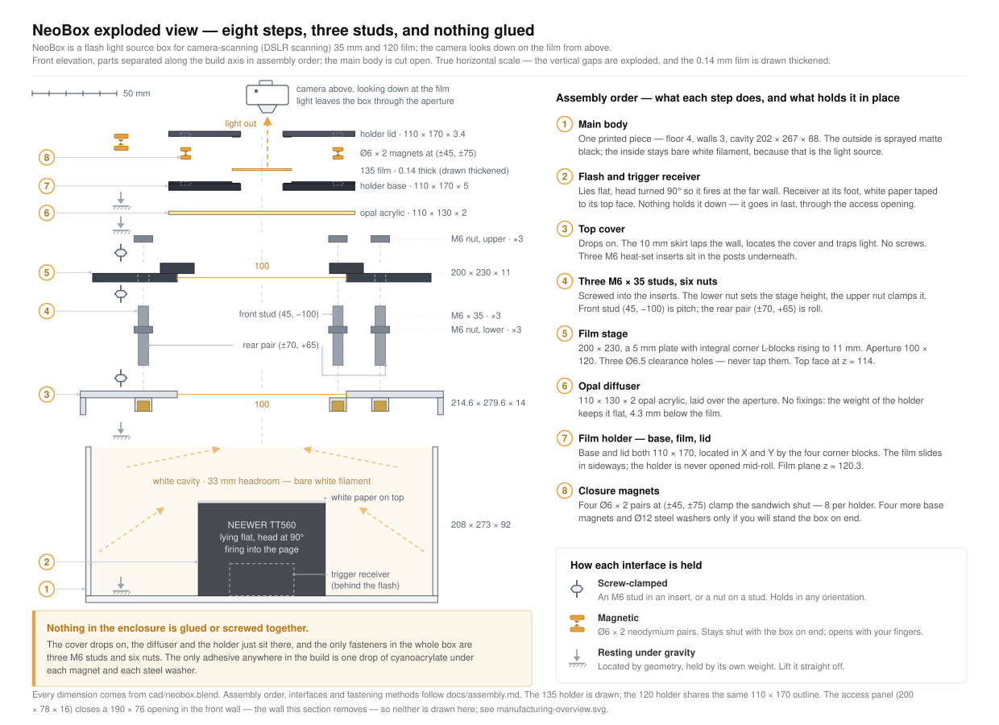
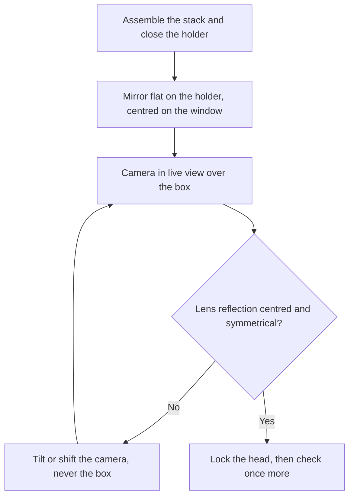

# Assembly

**English** · [简体中文](assembly.zh-CN.md) · [日本語](assembly.ja.md)

> How to turn twelve printed parts, thirty-two magnets, four steel washers and a sheet of opal acrylic into a working light source, with no tools at all: magnets pressed in with their polarity paired, a gravity stack from main body to cover-stage to film holder, and the mirror method that sets the film plane parallel to your sensor.

**Contents:** [Before you start](#before-you-start) · [Tools and safety](#tools-and-safety) · [What connects to what](#what-connects-to-what) · [Assembly steps](#assembly-steps) · [Formats and everyday handling](#formats-and-everyday-handling) · [If something is wrong](#if-something-is-wrong)

## Before you start

This build has no screws, threads, glue or paint, so it needs no tools. Every joint is a magnet, a locating feature or gravity. Every step can be undone. Parts lift apart the same way they went together. Nothing has to cure or dry, so you can assemble the whole box in one sitting. The only part worth doing slowly is the magnets. They are the one thing that is hard to undo.

Check the parts before you start. The full per-part list is in [printing.md](printing.md#check-each-part-before-you-assemble), and the purchased parts are in [bom.md](bom.md). These four checks are the ones that stop the build if they fail:

- [ ] The **cover-stage** drops onto the **main body** with its four corner notches over the locating tenons (the small raised blocks on the wall tops), and sits flat without rocking.
- [ ] A **Ø8 × 2 magnet** starts into its counterbore by hand and needs a firm push to seat. It is an interference fit (the pocket is slightly smaller than the magnet), so snug is correct.
- [ ] A **steel washer** sticks to a magnet. A stainless one will not, and nothing later in the build will warn you.
- [ ] A **film strip** slides through the **holder base** channel without being forced, and the **holder lid** sits on the base without rocking.

## Tools and safety

There is no tool list, because there are no tools: no soldering iron, no spanners, no knife, no glue, no paint. Two extras are useful: a blower for dust, and a small flat mirror about 30 mm across for the last step. If a magnet is too stiff to push in with a thumb, set the magnet on the table and press the part down over it. The table is the closest thing to a tool in this build.

> [!WARNING]
> - The **Ø8 × 2 magnets** are small, strong and a real swallowing hazard. Keep them away from children and pets. Two magnets snapping together can pinch skin, and they will wipe magnetic cards and disturb hard drives.
> - A magnet that has been pressed in is hard to get back out. Check the polarity (which way round the magnet faces) **before** you press, every single time.
>
> Nothing electrical ever goes inside the box. The flash lies outside at the open front and fires in, and the receiver that triggers it stays outside with it.

## What connects to what

| Interface | Method |
|---|---|
| Main body | One printed piece, nothing to assemble |
| Cover-stage → main body | Rests on the wall tops, four corner notches over the locating tenons. Gravity only, no screws |
| Steel washers → cover-stage | Dropped into four counterbores, flush with the deck (the cover-stage's top face). No glue. The counterbores and the magnets above them do the holding |
| Opal acrylic → cover-stage | Lies in its recess over the light window, top face 0.4 mm below the deck. Loose |
| Holder base → cover-stage | The tray flange locates it, and its base magnets pull it down onto the steel washers |
| Pressure element → holder base | The insert or the AN glass rests on the 4.6 mm element ledge. Deliberately loose |
| Holder lid → holder base | Eight magnet pairs |
| Flash → box | Never inside. It lies on the table at the open front with its head firing into the cavity |

## Assembly steps

### Step 1 — Press in the magnets

**You need:** the four clamp parts (two holder bases, two holder lids), the 32 Ø8 × 2 magnets, a marker pen.

Every clamp part takes eight magnets. Bases take theirs from **above**, into the counterbores in the top face. Lids take theirs from **below**, into the underside. Polarity (which way round each magnet faces) is the whole point of this step. Each base magnet must attract the lid magnet that will face it, and that has to be right before you press, because pressing is the nearest thing to permanent in this build.

1. Keep the magnets as one stack and take them off one end without flipping any. That way every magnet leaves the stack the same way up.
2. Lay a holder base flat and press its eight magnets in from the top face, all the same way up, each to the bottom of its pocket. Thumb pressure usually seats them. If not, put the magnet on the table and press the part down over it.
3. Turn a holder lid underside-up. For each pocket, first touch the loose magnet to the pressed-in base magnet it will face. It snaps on in the attracting orientation. Mark the exposed face with the pen, pull the magnet off, and press it into the lid pocket **marked face first**, so the unmarked, attracting face is left showing.
4. Repeat for the other format's base and lid.

**Checkpoint:** each lid snaps shut onto its base and stays shut when you hold the closed holder by one end. The lid magnets finish flush with the lid's underside. The base magnets stand 0.4 mm above the base's plate face. That is by design and does not mean a bad press, so do not try to sink them.

**Failure mode:** one reversed magnet pushes its corner of the lid open, and a pressed-in magnet does not come out easily. The touch-and-mark check in sub-step 3 takes seconds per magnet. Skipping it can cost you the part.

> [!IMPORTANT]
> The eight magnet pairs are all that holds the sandwich shut. There are no clips or screws behind them. Every base and every lid gets its full eight. No magnet in v1 is optional.

### Step 2 — Drop the steel washers into the cover-stage

**You need:** the cover-stage, the four steel washers (10 × 10 × 1 mm squares or Ø10 × 1 discs).

1. Drop one washer into each of the four counterbores in the deck.

That is the whole step. No glue is needed. Each counterbore holds its washer flush with the deck, and in use the holder-base magnets above press it down.

**Checkpoint:** run a fingertip across the deck and you feel no edge at any washer. A spare magnet lifts each washer straight back out. If the magnet will not lift a washer, that washer is stainless. Swap it now, because nothing later will tell you.

**Failure mode:** a stainless washer looks identical and fails silently. The holder base never gets pulled into place. A washer that sits above the deck tilts the base above it.

### Step 3 — Acrylic into its recess

**You need:** the 68 × 118 × 2 mm [opal](glossary.md#opal) acrylic sheet (or the 106 × 130 × 2 mm sheet, if you are building the 4×5 cover-stage), a blower.

1. **Peel the protective film off both faces.** Acrylic sheet comes with a film on both sides.
2. Blow both faces clean.
3. Lay the sheet into the recess over the light window, in the middle of the tray floor. It drops in and stops with its top face 0.4 mm below the deck.

**Checkpoint:** the sheet sits below deck level all round and can be nudged slightly in its recess. Loose is correct. Nothing fixes it in place, and the 0.4 mm step means even the holder above never touches it.

**Failure mode:** protective film left on a face changes how the light is diffused, and on opal sheet it is hard to see. Look for a peel edge at the corners before the sheet goes in.

> [!NOTE]
> Dust on the acrylic never shows in a frame. The sheet is the glowing surface that lights the film, and the lens does not focus on it. An occasional wipe with a dry cloth is all it needs. Never use alcohol, ammonia or glass cleaner. They all craze acrylic, leaving fine cracks in it.

### Step 4 — Cover-stage onto the main body

**You need:** the main body, the cover-stage with its washers and acrylic in place.

1. Hold the cover-stage by the tray flange, line up its four corner notches with the locating tenons on the wall tops, and lower it straight down. It seats under its own weight.
2. If it stands high or rocks, a tenon is sitting beside its notch instead of in it. Lift the cover-stage straight off and seat it again. Never press, never twist.

**Checkpoint:** the stage sits flat on the wall tops with no gap and no rocking, and lifts straight back off just as freely.

**Failure mode:** a notch that will not take its tenon is a printing fault, [elephant foot](glossary.md#elephant-foot) (the first layers squashed out wider) on either part. Do not force it. See [printing.md](printing.md#if-it-came-out-tight-or-loose).

### Step 5 — Holder base into the tray

**You need:** the cover-stage in place, the holder base for your format (or the slide plate, for mounted slides), and the 6×6 mask if that is your frame.

1. Lower the base inside the tray flange. With 0.3 mm of clearance per side, it goes in with no play worth noticing.
2. Let it settle. The base magnets find the steel washers in the deck and pull the base flat into place.

**Checkpoint:** the base lies flat on the tray floor and does not rock, and you should feel the magnets take it as it lands. Lift it out and drop it in again. It should land the same way every time.

**Failure mode:** if the base does not settle and nothing grips it, the washers from Step 2 are stainless or missing. A base that will not enter the flange without force is elephant foot again. Do not push it.

> [!NOTE]
> For 6×6 frames, lay the **6×6 mask** in the tray first and the 120 base on top of it. The whole clamp then sits 1 mm higher, which is normal. There is no 6×4.5 mask. Shoot through the 120 window and crop afterwards. For mounted slides, the **slide plate** stands in the tray on its own, in place of the 135 base. It has no magnets, no element and no lid, so Step 6 does not apply to it. For 4×5, the **sheet plate** stands the same way in the tray of the **4×5 cover-stage**. That stage goes onto the tenons exactly as in Step 4, with its own acrylic from Step 3. It has no magnets, and Step 6 does not apply.

### Step 6 — Pressure element in, lid on

**You need:** the pressure-window insert for your format (or the 64 × 95 × 2 mm AN glass, one sheet serves both formats), the matching holder lid, a blower.

1. Set the element down on the 4.6 mm element ledge in the outer rails. The ledge holds it 0.4 mm above the film path, and that 0.4 mm is the whole pressure design. The film advances by sliding underneath, and any bow in the strip is smoothed flat against the element's underside on the way through. The element is fitted once and then left alone.
2. If you use the glass, put it in **matte (AN) face down**, toward the film. The matte face against the glossy side of the film base is what prevents Newton's rings (the coloured fringes that appear where film is pressed against a smooth surface). Blow the underside clean just before it goes in. It will sit 0.2 mm from the focal plane, and dust *there* does show in the frame.
3. Set the lid on. The eight magnet pairs snap it down.

**Checkpoint:** the lid seats all round with no corner standing open, and the element can still move a tiny bit under the closed lid. The lid cavity leaves it 0.4 mm of room, and that float is correct. If the element is clamped rigid, something is sticking up somewhere. Open the holder and look rather than pressing harder.

**Failure mode:** glass put in glossy face down invites Newton's rings against the film base. A corner that will not close is a reversed magnet from Step 1, showing up late.

### Step 7 — Level at the camera: the mirror method

The box has no levelling hardware, and none is missing. Only one relationship matters: **the film plane parallel to the sensor**. The camera end is the right place to set it, because one adjustment there corrects the whole chain at once, printed tolerances included.

**You need:** the assembled box under your camera, a small flat mirror about 30 mm across.

1. Lay the mirror flat on the closed holder, centred over the film window.
2. Switch on live view. You will see the lens and the camera reflected in the mirror.
3. Tilt and shift **the camera** until the reflection of the lens sits dead centre in the frame and looks symmetrical. Leave the box where it is.
4. Once the reflection is centred, the sensor is parallel to the mirror, and the mirror is lying on the film plane. Done.
5. Lock the head (the mount that holds the camera on the stand), then look once more. Tightening moves things.

**Checkpoint:** with the head locked, the reflection is still centred. Repeat the check whenever the box or the camera has moved. It takes seconds.

Why the camera, and why a mirror

A spirit level measures against gravity, and gravity is not part of the optical chain. A stage that is perfectly level to the floor can still be tilted relative to the sensor. The mirror measures the one relationship that matters, and it doubles the error. Any angle between the sensor's axis and the mirror shows up twice over in where the reflection lands. That makes centring the lens's own reflection a sensitive null test, where you adjust until the error disappears.

Adjusting at the camera rather than at the box also absorbs everything below the mirror in the same move: wall-top flatness, tenon seating, the stack of printed tolerances. Packing the box up with shims could only ever correct the box. That is why v1 removed the box-side levelling hardware instead of refining it.

For the camera side of the setup, see [parallelism](scanning.md#parallelism) for the stand and [camera height and the stand](scanning.md#camera-height-and-the-stand) for the height for each format.

## Formats and everyday handling

- **Changing format means changing the clamp.** Lift the whole clamp off (magnets alone hold it) and drop the other format's clamp in. Each clamp keeps its own insert fitted. If you use the AN glass, that one sheet serves both formats, so only the glass moves across to the other clamp's ledge.
- **Advancing film:** pinch the leader where it sticks out of the clamp and pull. The tail rides on the top of the tray flange, 0.2 mm below the film plane, which supports it on the way. With a long strip, steady the far end with your free hand.
- **Loading direction:** with the glass, load the strip curl-up. With the insert, load it curl-down.
- **Mounted slides:** lift the 135 clamp out, set the slide plate in, and drop the mount into its pocket the way you would hold it up to a window, with the image reading correctly from above (emulsion down). Lift it out by the two finger wells. Nothing else changes. Refocus.
- **4×5 sheets:** lift the cover-stage off and set the 4×5 cover-stage on the same tenons, with its own acrylic in place. Set the sheet plate in its tray and drop the sheet into the pocket with the image reading correctly from above (emulsion down). Lift it out by the edge notches. Refocus and re-set the column height. 4×5 wants about 0.25×.
- **Getting the acrylic out:** lift the clamp off, reach in through the open front, and push the sheet up through the light window.
- **The cover-stage comes off as one piece:** grip it by the tray flange and lift straight up.
- **The flash never goes inside:** it lies at the open front with its head firing into the cavity. The receiver stays outside, where its signal is clean and its batteries are easy to reach. Work in a dim room and keep ceiling light out of the box mouth.

> [!IMPORTANT]
> The assembled box is a gravity stack. No part is fastened to any other. Never tilt it, and never carry it assembled. Take the clamp and the cover-stage off and move the pieces separately.

## If something is wrong

| Symptom at this stage | Where to look |
|---|---|
| The cover-stage stands high or rocks, or the holder will not settle in the tray | [Assembly problems](troubleshooting.md#assembly) |
| A dark patch, a bright side, or a clean dark band across frames | [Light and evenness](troubleshooting.md#light-and-evenness) |
| The film channel is too tight or too loose, or a part came out warped | [printing.md](printing.md#if-it-came-out-tight-or-loose) |

---

← [Printing](printing.md) · [Documentation index](../README.md#documentation) · [Scanning](scanning.md) →
