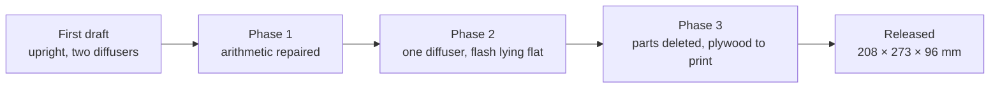

# Design log

**English** · [简体中文](design-log.zh-CN.md) · [日本語](design-log.ja.md)

> Why NeoBox ended up this shape: twenty-six decisions in the order they were taken, and the four ideas that were considered and turned down. Read it before you modify anything.

**Contents:** [How to read this log](#how-to-read-this-log) · [Phase 1: the first draft did not close](#phase-1-the-first-draft-did-not-close) · [Phase 2: from 32 litres to about 5](#phase-2-from-32-litres-to-about-5) · [Phase 3: removing everything unnecessary](#phase-3-removing-everything-unnecessary) · [Phase 4: the flash leaves the box](#phase-4-the-flash-leaves-the-box) · [Things deliberately not done](#things-deliberately-not-done)

## How to read this log

A note on numbering first: v1 to v5 in this log are internal draft numbers. The fifth draft is what shipped as the public release (version 1). The printed prototype discussed below is internal draft 4.

The design moved through three phases: repairing a first draft whose height figures did not add up, collapsing a tall upright box into a flat horizontal one, and then deleting everything that turned out to be unnecessary.

> [!NOTE]
> Nothing here was settled by building anything. **The released box has since been printed and used, but every decision below was reached before that,** in CAD and arithmetic, or in correspondence with a print vendor. The dimensions quoted are those of the released geometry. Figures from superseded revisions are not repeated, because they were never re-verified.

Each entry is a heading, so any of them can be linked from elsewhere, for example `design-log.md#18-layer-quantised-holders`.

## Phase 1: the first draft did not close

The first specification was an upright box that stood the flash on its foot under two diffuser layers. None of that layout survives, but five of the rules it produced do.

*Entries: [1](#1-the-height-was-arithmetically-impossible) · [2](#2-unframed-diffusers-leak) · [3](#3-all-white-was-wrong-above-the-last-diffuser) · [4](#4-a-centring-stop-for-the-flash-head) · [5](#5-a-top-that-could-carry-the-levelling-load) · [6](#6-light-labyrinth-vents-instead-of-straight-holes) · [7](#7-flat-field-before-judging-evenness) · [8](#8-the-large-format-provision)*

### 1. The height was arithmetically impossible

The draft called for three stacked air gaps: flash head to the first diffuser, a mixing space between the two diffusers, and a black chamber above the second. Added together, they came to more than the interior height the same document declared. On top of that, the budget did not include the flash itself.

The fix was a method.

> [!IMPORTANT]
> **Build the height by adding up measured layers from the floor upward, then read off the outer dimension. Never fix the outer height first and work the layers out backwards from it.** The released stack is derived that way. It is set out in [design.md](design.md#2-dimension-chain).

### 2. Unframed diffusers leak

The diffuser sheets were smaller than the cavity they sat in, so light could pass around their edges instead of through them. Each diffuser was given a full-width carrier panel, with only the emitting window left open.

**Lesson: if light can get around a diffuser, the diffuser is doing nothing.**

### 3. All-white was wrong above the last diffuser

White walls above the final diffuser bounce stray light back down onto the film and lower contrast. That section became matte black. The rule survives into the released design. Everything above the diffuser is black, and everything below it is bare white filament.

**Lesson: keep everything below the diffuser white and everything above it black.**

### 4. A centring stop for the flash head

A speedlight lying on its side does not put its head on the centreline of the box. The hot spot (the brightest patch of light) follows the head. The draft gained a stop that put the head where the optics assumed it was. In the released box the same job is done by a simple routine. Draw a line on the floor around the flash, so that it goes back to the same place every time.

**Lesson: if a part's position changes the light, give it either a location feature or a mark.**

### 5. A top that could carry the levelling load

The draft put the levelling screws directly on a thin sheet top, which they would have crushed. The top became a thicker panel with metal load points. The released top cover keeps the principle. The three heat-set inserts sit in dedicated posts underneath it, not in the 4 mm cover plate itself.

**Lesson: a levelling point carries load, so put material behind it.**

### 6. Light-labyrinth vents instead of straight holes

A straight ventilation hole in a light box is also a light leak. The draft's vents became labyrinths, bent passages that let air through while blocking light. The released design goes further and has no vents at all. See [Ventilation](#ventilation) below.

**Lesson: before cutting a hole for heat, work out what it does to the light.**

### 7. Flat-field before judging evenness

The draft's evenness target mixed up two different things: the lens's own vignetting (darkening towards the corners) and real unevenness in the light source. [Flat-field correction](glossary.md#flat-field-correction) separates them. You photograph the bare lit surface, then use that frame to divide out the falloff. The target for the source itself is **±0.1 [EV](glossary.md#ev) corner to corner**, and it applies only after that correction.

**Lesson: state what a tolerance is measured against, or nobody can meet it.**

### 8. The large-format provision

The reservation for a future 4×5 version had the same missing flash height as the main box. So it was recalculated from the layer sum instead of being scaled up. It remains a reservation only. The released box covers 35 mm and 120 film up to 6×9 through a 100 × 120 mm aperture.

## Phase 2: from 32 litres to about 5

Three decisions took the design from an upright cabinet to something that sits on a desk.

*Entries: [9](#9-two-diffusers-became-one) · [10](#10-upright-became-lying-flat) · [11](#11-smaller-flashes-do-not-help)*

### 9. Two diffusers became one

Two diffusing layers with a mixing space between them is the textbook way to build an even emitting surface. It is also most of why the first draft was so tall. The design was cut to one sheet.

That choice is **not** validated by any measurement of this box. It is carried over from the author's existing camera-scanning workflow, which lays film directly on a light pad with a single diffusing surface close underneath. The mixing distance below the remaining sheet was then increased rather than copied. The gap in the two-layer design existed to feed the second layer, and copying it across would have printed the flash's hot spot straight onto the emitting surface.

**Lesson: a dimension copied from a design you have just cut in half is a leftover, so re-derive it before you trust it.**

### 10. Upright became lying flat

The height of the box was still dictated by the flash standing on its foot plus a vertical mixing distance. The footprint was a leftover from the two-diffuser era. Laying the flash flat and firing it sideways moved the mixing distance into the depth of the box, and the flash body already occupied that depth.

That single change took the volume from about **32 litres to about 5**. The released box is 208 × 273 × 96 mm, about 5.4 litres. An interim revision turned the light with a 45° reflector plate, which was itself deleted later ([entry 16](#16-fasteners-and-internal-parts-deleted)).

**Lesson: if a box is too tall, find the dimension that is doing two jobs and turn it sideways.**

### 11. Smaller flashes do not help

Four alternatives were checked before the layout was frozen: the Godox TT350, the iM30Pro, the iT30Pro and the KEKS KF-01. None of them shrinks the box meaningfully.

Why a smaller flash does not make a smaller box

In an upright layout the mixing distance is set by geometry, and the size of the flash does not enter into it. Even a thought experiment with a flash of zero thickness still loses to the horizontal layout. In the horizontal layout the width is set by the aperture and the film stage (208 mm, whatever flash is inside). The depth is set by the flash body, the trigger receiver and the reflection zone lying end to end. A smaller flash saves no volume, and it costs power headroom and recycle time.

The design was therefore fixed around hardware the author already owned: a NEEWER TT560 speedlight and a ZENIKO T1 trigger set. The published STLs fit that flash only. The formulas in [design.md](design.md#generalising-to-another-flash) give the numbers for a different one, but they do not resize the files.

**Lesson: find the dimension that actually sets the size before optimising the part you happen to be holding.**

## Phase 3: removing everything unnecessary

Nine entries. Three of them came from a print vendor who read the drawings more carefully than the author had.

*Entries: [12](#12-the-mid-level-carrier-panel-and-black-chamber-came-out) · [13](#13-the-diffuser-moved-above-the-film-stage) · [14](#14-positive-fastening-for-use-on-end) · [15](#15-plywood-became-3d-printing) · [16](#16-fasteners-and-internal-parts-deleted) · [17](#17-the-film-run-out-corridor) · [18](#18-layer-quantised-holders) · [19](#19-no-single-layer-steps) · [20](#20-orientation-instructions-must-name-what-the-operator-can-see)*

### 12. The mid-level carrier panel and black chamber came out

With one diffuser left, the carrier panel that had framed the second one had nothing left to frame, and the black chamber above it had nothing to line. Both were deleted. The diffuser went directly over the aperture, and the cavity became white throughout. The 135 and 120 film holders were designed and released in the same revision.

**Lesson: deleting a part usually leaves the parts that supported it without a purpose, so check them before detailing the design again.**

### 13. The diffuser moved above the film stage

The opal acrylic diffuser was lifted out of the enclosure and onto the film stage. There it rests over the aperture, held flat by the weight of the film holder. The distance from film to diffuser became about **4.3 mm**, which matches the light-pad geometry the design was modelled on.

That is a trade against dust. A particle on the diffuser shows up as a soft blob about 0.2 mm across at the film plane, at f/8 and 0.43× [magnification](glossary.md#magnification-ratio) (the 6×6-on-full-frame case). That is invisible on inverted negatives but visible on slides. The trade was accepted because the cost lands in a routine rather than in a tolerance. At the start of every session, blow both faces of the diffuser and the [film gate](glossary.md#film-gate) clean. The anti-direct-light baffle and its brackets went at the same time.

> [!NOTE]
> That revision also replaced the interior liners with white paint on the panels. That belonged to the plywood construction and did not survive [entry 15](#15-plywood-became-3d-printing). **Do not paint the inside of the printed box.** The interior is bare white filament by design.

**Lesson: moving a part to where it works optically can be worth a maintenance cost, as long as that cost is a routine task.**

### 14. Positive fastening for use on end

For the box to work standing on end, every part that gravity had been holding in place had to be held positively. Four magnets in each holder base pull onto steel washers on the film stage. The film stage itself is clamped between a lower nut and an upper nut on three studs, which screw into the top cover's heat-set inserts.

This is where a real error was caught. The stage holes had been specified as threaded. A threaded plate on a stud of the same pitch forms a differential screw. The plate and the stud advance together, so the height cannot be set at all. The holes became Ø6.5 mm clearance holes (plain holes that the stud passes through freely).

> [!CAUTION]
> Never tap the three film-stage holes. Ø6.5 mm clearance holes are mandatory. A tapped plate cannot be levelled, and re-drilling one afterwards usually ruins the plate.

**Lesson: check that a fastening scheme can move the way it needs to, not only that it is strong enough.**

### 15. Plywood became 3D printing

A laser-cut plywood shell with tab-and-slot joints was drawn, then abandoned once it was clear the intent had been a printed box all along.

Printing thinned the walls to 3 mm and the floor to 4 mm. It removed all interior painting and replaced threaded inserts in wood with heat-set brass inserts. The cable gland and the access opening became part of the print instead of operations done after it. No internal optical dimension changed. The plywood DXFs are still in `cad/legacy-plywood/`, but they are a historical record of a partial panel set, **not a buildable alternative**. There is no plywood route to this box.

**Lesson: change the process while the optics are still numbers rather than parts.**

### 16. Fasteners and internal parts deleted

Six M3 posts holding the top cover down became a top cover with a 10 mm skirt that simply drops on. The skirt is both the location feature and the light trap, and no screws hold the enclosure together at all.

Then the internal parts went one after another: the drawer tray (the flash lies on the floor instead), its brackets, the strap that held the flash, and finally the 45° reflector plate. The far wall already turns the light, and every internal part is one more thing to align. What remains in the default build is **eight printed parts**, one opal acrylic diffuser and three studs. That is nine STL files, including the optional 6×6 mask.

**Lesson: a deleted part costs nothing to print and nothing to align.**

### 17. The film run-out corridor

The first fit-check of the integrated film stage found two blocks sitting centred on the holder ends, exactly across the channel mouths. Their tops were just below the film plane. A film strip could never have been threaded through. The same check found the front stud rising to film height in the middle of the path the film has to travel.

Both were moved rather than shrunk. The blocks became four corner blocks at |x| = 40–60 mm, which leaves both channel mouths fully open. The front stud moved to (45, −100) mm relative to the stage centre. The constraint is now permanent. Beyond the ends of the holder, nothing may rise near film height inside |x| < 31 mm, which is half the width of 120 film (about 62 mm across). That volume is the [run-out corridor](glossary.md#run-out-corridor).

**Lesson: clearance between parts is not enough, so give the moving workpiece its own swept corridor and treat that corridor as a part.**

### 18. Layer-quantised holders

The print vendor measured the holder's exposed z-steps (the small vertical steps in the part) and pushed back on the 0.12–0.16 mm [layer heights](glossary.md#layer-height) the drawings asked for. At their default 0.2 mm layers, they said, the steps would not come out cleanly. They were right, and the fault was in the geometry rather than in the printer. A 0.5 mm step is not a multiple of any common layer height. It slices to two and a half layers, and the slicer rounds it up or down as it sees fit.

Rather than argue about calibration, every vertical feature was redrawn as a multiple of 0.2 mm. That took the channel to **0.4 mm** without moving the film plane. The windows grew about 0.5 mm per side in the same pass (25 × 37 mm for 135, 57 × 85 mm for 120), to absorb variation between camera gates and the printer's XY tolerance. Crop the extra away in post.

**Lesson: a dimension the manufacturing process cannot produce is a design bug, not a vendor limitation.**

### 19. No single-layer steps

Vendor round three. The features still left at 0.2 mm (the land relief on the holder bases, the pressure strips under the holder lids) are exactly one layer tall at the default layer height. They are printable in theory. But a single-layer step depends entirely on how much the first layer is squashed and on flow calibration, so the vendor asked for more height.

All of them now measure 0.4 mm, two layers, without disturbing anything that matters. The base plate thinned to 3.8 mm, so the land tops (the film plane) stayed put while the relief doubled. The lid plate and the rails rose together, so the pressure strips deepened while the channel stayed 0.4 mm. The strips also gained 0.3 mm of side clearance to the rails, so the holder lid cannot wedge. The film plane, channel, windows, outline and magnet spacing are all unchanged.

**Lesson: make every exposed z-step at least two layers tall, because a single layer cannot be trusted to come out at the right height.**

### 20. Orientation instructions must name what the operator can see

The vendor asked which face the drawings' orientation note actually referred to. (The note was a first-revision phrase naming the channel side, since deleted from every document.) Working the answer out again from print physics showed that the note itself was wrong. It would have stood the holder base on its two rail crests and left the film-bearing lands hanging over air. So the one surface that has to be flat would have been built on [supports](glossary.md#supports).

The correct orientation for every holder part is flat face down, with the features growing upward and no supports at all. But a slicer will not get there by itself. `film-holder-*-lid.stl` loads with the pressure strips facing down and must be rotated 180° about X after import. Every vendor script now places parts by a feature the operator can see ("the face with the two long ridges goes up") and states support locations explicitly. The per-part cards in [printing.md](printing.md#the-twelve-parts) follow the same rule.

**Lesson: write orientation instructions around a feature the operator can see and point at.**

## Phase 4: the flash leaves the box

Phase 3 closed a three-phase history at the released 208 × 273 × 96 mm box. Then the box got built. A vendor printed v4 for about CN¥1,200, and hand-held experiments with that unit reopened the design. The four entries below, added 2026-08-14, take it to **v5**.

> [!NOTE]
> The note in [How to read this log](#how-to-read-this-log) predates these entries and now needs one amendment: **v4 has been printed and handled, and v5 has since been printed and used as well.** These entries were written before v5 existed in plastic. Apart from the hand-held v4 observations reported below, every v5 figure is CAD and arithmetic (`cad/neobox.blend`), and none has been re-derived from the printed box.

*Entries: [21](#21-the-flash-moved-outside-and-the-front-opened-fully) · [22](#22-flattening-converged-on-an-insert-platform) · [23](#23-the-design-went-screwless) · [24](#24-the-cover-absorbed-the-film-stage-and-the-print-thinned)*

### 21. The flash moved outside and the front opened fully

Everything about v4's footprint assumed the flash lived inside. The depth was the TT560 body, the trigger receiver and the reflection zone lying end to end ([entry 11](#11-smaller-flashes-do-not-help)), and the access panel existed to reach them. Then came a hand-held test with the printed v4 unit. A flash merely held at the opening, firing into the white cavity, lit the film aperture just as evenly by eye. That was not a calibrated measurement (the flat-field discipline of [entry 7](#7-flat-field-before-judging-evenness) still applies), but it was enough to rule out the flash bay. The light is mixed at the white walls, and the space around the flash body plays no part in it.

In v5 the flash never enters the box. It lies on the desk with its head against a **fully open front** (the front wall simply does not exist). The ZENIKO T1 receiver stays outside with it, where the radio signal is better and changing a battery means opening nothing. What used to be a bay for one specific flash is now a mixing cavity and nothing else:

- The main box shrinks from 208 × 273 × 96 mm to **124.8 × 154.8 × 73 mm**, about 65% less printed material.
- The access panel is deleted. There is nothing inside left to reach.
- **Any hot-shoe flash fits.** The STLs no longer encode the TT560's dimensions. It is now just the reference model.
- The largest part is 154.8 mm long, so a 160 × 160 mm bed prints everything. The old 220 mm bed warning is obsolete.

The price is that the open front lets room light in. That was accepted, because the flash pulse is far brighter than room light. Work in a dim room, and keep ceiling lights from shining into the opening.

**Lesson: a part that only needs to shine into the box can sit outside it.**

### 22. Flattening converged on an insert platform

v4 flattened film with pressure strips under the holder lid and a 0.4 mm channel ([entries 18](#18-layer-quantised-holders) and [19](#19-no-single-layer-steps)). v5 reopened the question from scratch. Three answers were tried and dropped before the one that survived:

- **Pressure strips, carried over.** They hold the film only at the window edges. The idea of upgrading to glass, for flatness across the whole frame, kept coming back.
- **A glass lid you lift.** An optional sheet laid over the window and removed to advance the film. Rejected on cadence, meaning how often the operator has to do it. [Entry 13](#13-the-diffuser-moved-above-the-film-stage) accepted a cost that lands once per session. Lifting glass lands the cost once **per frame**, and over a 36-exposure roll it becomes the slowest step in the whole workflow.
- **Foam suspension.** The pressure element pressed down by a foam pad in the lid. Rejected on lifetime. Foam ages, and the preload (the pressing force) decays with it.
- **The insert platform.** The holder bases' outer rails carry a **4.6 mm element ledge**. An interchangeable pressure element drops onto it: the printed **pressure-window insert** by default, or a single sheet of **anti-Newton glass** as the upgrade. The element seats once and is never touched again. The film rides the lands at 4.2 mm and the element's underside sits at 4.6 mm, so a **0.4 mm channel** runs under all four edges and right across the frame. The film advances by pulling the leader. No lid is opened and no element is lifted, and the curl is pressed flat as the film slides through.

The numbers, from CAD: with the insert the film can rise at most about 0.28 mm inside the window. At 1:1 and f/8 the depth of field is roughly ±0.4 mm, so that stays within it. With the glass the cap is continuous across the whole frame. One **64 × 95 × 2 mm** sheet serves both formats, because the 135 base carries two rail sets. The inner rails guide the narrow film, and the outer rails share the same ledge as the 120 base. There is an insert for each format, and the glass is one part.

**Lesson: count the operator's motions per frame rather than per session, and remember that a part set once and never handled again cannot drift.**

### 23. The design went screwless

v4 clamped its film stage between locknuts on three M6 studs screwed into heat-set inserts, and it was levelled by turning the nuts ([entry 14](#14-positive-fastening-for-use-on-end)). v5 deletes all of it: the three studs, the six nuts, the inserts, and with them every threaded interface in the machine. Two convictions drove the deletion:

- **Plastic should not carry threads.** Even with brass inserts, the thread's load ends up in the plastic around it. Every threaded joint in a printed machine is a wear point and adds to the tolerance stack (the posts of [entry 5](#5-a-top-that-could-carry-the-levelling-load) existed only to serve one such joint).
- **Levelling belongs at the camera, not the box.** Set a small mirror on the film stage and look through the viewfinder. When the reflection of the lens sits centred, the sensor is parallel to the film plane. That one check aligns the pair that actually matters, the camera and the film, and absorbs the box's print tolerances on the way. No amount of stud-turning could do that, because the studs could only ever adjust the box and never see the camera above it.

With the screws gone, assembly is gravity and magnets. The cover-stage sits on the wall tops, located by four **tenons** on the walls that drop into **notches** in its corners. It sits one way only, nothing is tightened, and no tool is needed anywhere in the build. The CAUTION in entry 14 still stands for v4 hardware. v5 has no stage holes to tap.

**Lesson: put the adjustment where the error can be seen, as the mirror check does and the studs never could.**

### 24. The cover absorbed the film stage and the print thinned

The invoice for the v4 prototype (about CN¥1,200) said more about the design than any review had. A print vendor charges for volume, so every wall adds to the bill. v5 goes after the grams directly:

- **Walls 2.4 mm, floor 3.0 mm** (down from 3 and 4). With every threaded interface gone ([entry 23](#23-the-design-went-screwless)), no wall or plate carries a fastener load any more. The shell only has to stand up, stay white and locate the cover-stage.
- **The top cover and the film stage merged into one part, the cover-stage:** a single plate seated on the walls, which carries the holder tray, the light window and the diffuser recess. One of the largest parts in the build no longer exists, and neither does the seam between the two.
- **The diffuser shrank to 68 × 118 mm** (v4: 110 × 130). A v4 sheet can be cut down by the acrylic shop and reused.
- **The steel washers became four 10 × 10 mm shims**, sunk flush into counterbores in the cover-stage deck.

Everything still prints without supports, flat face down. The whole nine-file set is estimated at **300–350 g** of filament. That is an estimate from CAD, like every other v5 figure, but one the next invoice will check.

**Lesson: printed volume needs a budget of its own, like any other dimension.**

### 25. Mounted slides: a plate of their own

Mounted 135 slides were out of scope through v5. A card or plastic mount is about 1.2 – 3.2 mm thick, and the 135 channel is 0.4. The obvious fix, a 50 × 50 pocket cut into the 135 base, was rejected at once. The pocket would take out the land on all four sides of the window, and the land is the whole flattening system ([entry 22](#22-flattening-converged-on-an-insert-platform)). A filler plug to restore the land for strips would add a part. The film plane would then depend on how the plug seats instead of on a printed step.

What shipped instead is a fourth holder set that is one part: `slide-plate-135.stl`, a 94 × 120 × 5 plate with a 51.4 mm square pocket 2.0 deep, a 26 × 38 window through its floor and two blind finger wells. It stands in the tray where a holder base stands, so the 135 set is not touched at all. It has no lid, magnets or glass, because a mount is rigid and the box is horizontal. The pocket locates the mount and gravity holds it. The film plane lands at about 82.6 – 83.6 depending on the mount. That is within refocusing distance of the strip plane at 83.2, the same adjustment the 6×6 mask already asks for.

**Lesson: if a new format cannot share the flattening geometry, give it its own part rather than compromising the shared one.**

### 26. 4×5 on the same body, as an experiment

Design § 10 had reserved 4×5 for a bigger box. That box would put v1's mixing margins around the window, which works out to a body about 165 × 186 mm and a 220-class bed. Before deriving that, a cheaper question was asked first. What does 4×5 cost on the body that already exists? Two parts. A second cover-stage with the same outline and four notches carries a 102 × 126 window, a recess for a 106 × 130 × 2 opal sheet and a 112.6 × 138.6 tray. A sheet plate in that tray takes the 101.6 × 127 sheet in a 102.2 × 127.6 pocket over a 97 × 121 window. There is no pressure element. At 0.25× the depth of field at f/8 is roughly 8 – 10 mm, ten times the 135 case, so a sheet's curl is invisible. Nothing else in the box changes, and everything still prints on a 160 × 160 bed.

What it gives up is the mixing margin: 9 and 12 mm to the walls instead of 29 and 27.5. Whether that shows as a gradient is unknown, exactly as v1's own evenness is unknown. The acrylic still diffuses, flat-field correction still exists, and the bigger box remains available as the second step. The stage ships as an experiment on the same body because finding out costs two files and one acrylic cut, while guessing would cost a whole new body.

**Lesson: before scaling the box up, find out what the existing box can do, because a two-part experiment is cheaper than deriving a whole new enclosure.**

## Things deliberately not done

Four changes that were considered on their merits and turned down. If you are about to propose one of these, start here.

*[LED panel](#a-high-cri-led-panel-instead-of-a-flash) · [second diffuser](#a-second-diffuser) · [fusing the top cover on](#fusing-the-top-cover-into-the-main-body) · [ventilation](#ventilation)*

### A high-CRI LED panel instead of a flash

This is the only change that would make the box meaningfully smaller (about 100 mm tall and roughly 4 litres). An LED panel is already an area source (it emits from its whole surface), so it needs almost no mixing distance.

It was turned down in favour of the flash. Inside a closed box the flash pulse is the entire exposure, so vibration and shutter shock stop mattering, and there is power in reserve at base ISO and f/8. The access panel is nevertheless sized so that an LED panel could be fitted later without moving the film plane or the camera height.

### A second diffuser

Two diffusers would improve uniformity. Restoring the second sheet and its chamber costs about **43 mm** of height in the current design. It is worth reconsidering only for a 4×5 version, or for slide film if a single sheet proves marginal.

### Fusing the top cover into the main body

Rejected on printability alone. A closed hollow box puts a 202 × 267 mm unsupported ceiling over the cavity, which an FDM printer cannot [bridge](glossary.md#bridging). It would need internal supports, which could only be pulled out through the 190 × 76 mm access opening and would leave scars across the optical ceiling. Printing on any other face just moves the problem.

The saving would be nil in any case. The top cover already attaches without fasteners, and its skirt is the light trap. One seam-free variant would genuinely work (print with the top plate on the build plate, walls rising from it, and the access panel moved to the floor). But it trades a top seam for a bottom seam and means remodelling everything. If the top cover ever feels loose, two small self-tapping screws through the skirt are a better fix than fusing it.

### Ventilation

Left out of the prototype. A speedlight fired only now and then (a low duty cycle) produces little heat, and every hole is a potential light leak. If a session runs hot, pull the access panel off between rolls.

---

← [Design](design.md#design) · [Documentation index](../README.md#documentation) · [Glossary](glossary.md#glossary) →
