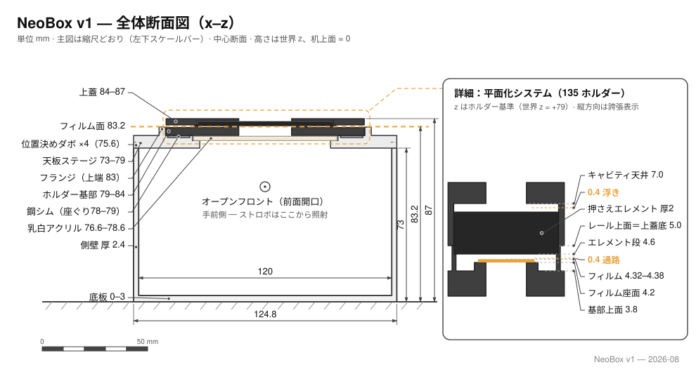
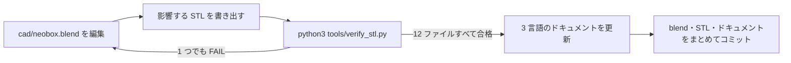

# 設計

[English](design.md) · [简体中文](design.zh-CN.md) · **日本語**

> エンジニアリングの参照資料です。どの寸法がどこから来ているのか、どの数字が光学的でどの数字が構造的なのか、ひとつ変えると何が起きるのか、そして CAD ソースを開き、編集し、書き出し直して検証するまでを扱います。

**目次：** [1. 光路](#1-光路) · [2. 寸法チェーン](#2-寸法チェーン) · [3. 光学上の判断](#3-光学上の判断) · [4. 天板ステージ](#4-天板ステージ) · [5. フィルムホルダー](#5-フィルムホルダー) · [6. 筐体](#6-筐体) · [7. フォーカス用ライト](#7-フォーカス用ライト) · [8. ストロボの運用](#8-ストロボの運用) · [9. 位置合わせと再現性](#9-位置合わせと再現性) · [10. v1 本体での 4×5](#10-v1-本体での-45) · [11. ソースファイルを扱う](#11-ソースファイルを扱う)

参考ストロボ：**NEEWER TT560** スピードライト 1 灯と **ZENIKO T1** 2.4 GHz トリガーセット。設計時に照合に使ったものというだけで、同じ機種を使う必要はありません。ストロボは箱の**外**、机の上に横たわるので、本書のどの寸法もストロボには依存しません。マニュアルで発光量を設定できるスピードライトなら何でも使えます。

| 表記 | 本書での意味 |
|---|---|
| 寸法 | ミリメートル。幅 × 奥行 × 高さ（X × Y × Z）の順に書く |
| `z` | 机の面を 0 とした絶対高さ。箱は机に直接立つので、本体の外底面からの高さでもある |
| パーツローカル z | [§2](#2-寸法チェーン) の積層量子化の表は、各パーツ自身のプリント底面から測る。使う箇所で明記する |
| XY 座標 | 箱の中心から測った値。箱の中心は採光窓の中心でもある |
| STL バウンディングボックス | 「STL バウンディングボックス」と明記した箇所だけの意味。値の大きい順に並んでいるので、X × Y × Z の順とは限らない |
| 出典 | 以下の数値はすべて `cad/neobox.blend` か、書き出し済みの STL ファイルから読んだもの。自分で読む手順は [§11](#11-ソースファイルを扱う) |

> [!IMPORTANT]
> ジオメトリは Blender 上で寸法を照合し、書き出した STL ファイルを数値で検証してあり、箱は出力されて使われています。**本書に出てくる性能値は、いまも設計目標です。測定値ではありません。** 拡散のためのマージンも、≤ 0.28 mm という平面保持の上限も、被写界深度によるカバーも同じです。出力した箱は目視でも反転後でもムラなくスキャンできています。ただし均一性は計測器で測られておらず、本書のどこにも測ったかのような記述はありません。

---

## 1. 光路



机から上へ、順に積み上げると：

**机に横たわるストロボ → 完全に開いた前面 → 白い拡散チャンバー 120 × 150 × 70 → 天板ステージの採光窓 62 × 95 → 乳白アクリル 68 × 118 × 2、上面 78.6 → 空気 4.6 mm → フィルム面 z = 83.2。**

ストロボは箱の中にはありません。箱と同じ机の上に横たわり、発光部を**オープンフロント（前面開口）**に寄せて、水平に拡散チャンバーへ発光します。箱の前面には、壁がそもそもありません。TT560 の発光面は 60 × 45、中心は机から 31 mm で、高さ 70 mm の開口に余裕をもって収まります。

**フィルムに向けられている光は一切ありません。** 採光窓は拡散チャンバーの天井、ビームと直角の位置にあります。光は素地のままの白い PLA で何度も拡散反射してからでなければ窓に届きません。これが内部を[拡散チャンバー (integrating cavity)](glossary.ja.md#積分キャビティ-integrating-cavity) にしています。壁で光を何度も跳ね返して混ぜ合わせる空間のことです。光は 62 × 95 の窓を抜け、そのすぐ上、天板ステージに埋め込まれた[乳白 (opal)](glossary.ja.md#乳白-opal) アクリル 1 枚で最後の均しを受けます。

オープンフロントこそが v1 の設計変更のすべてです。実際に出力したプロトタイプ（社内第 4 版）はストロボを密閉した箱に収めており、その厄介ごとはすべてそこから生じていました。箱の高さはストロボの厚みから導出されていました。発光量のダイヤルに触るためのアクセスパネルが要り、配線のためのケーブルグランドが要りました。公開 STL は特定の 1 機種にしか合いませんでした。ストロボが外に出れば、その全部が消えます。どのメーカーのストロボでも使えます。レシーバーは机の上に残るので、電波の通りがよく、電池交換もしやすくなります。パネルもグランドも換気の問題も存在しなくなります（[§6](#6-筐体)）。対価は、環境光が拡散チャンバーに入り得ることです。このトレードは承知のうえで織り込んであります。同調速度において、閃光のパルスは室内の環境光よりはるかに明るいからです（[§8](#8-ストロボの運用)）。

> [!NOTE]
> **薄暗い部屋で撮影し、天井の照明が開口へ直射しないようにしてください。** パルスが環境光を圧倒するのは設計の前提です。ただし、開いた前面へまっすぐ向いた明るいランプだけは、そのマージンを削ってしまう唯一の置き方です。

---

## 2. 寸法チェーン

プロトタイプの箱はストロボから導出されており、その数字はプロトタイプとともに失効しました。v1 はその結びつきを断ちます。ストロボは箱に入らないので、寸法チェーンはもはや製品カタログから始まりません。机から始まり、パーツの上にパーツを重ねて、重力で上へ伸びていきます。

### プリントパーツ

STL は 12 ファイル。白 3 点、黒 9 点、すべてサポート不要です：

| STL | 色 | 外形 (mm) | 内容 |
|---|---|---|---|
| `main-body.stl` | 白 | 124.8 × 154.8 × 75.6 | 本体：底 3.0、左右と奥の壁 2.4、前面は全開。側壁の上面に位置決めダボ 2.4 × 12 × 2.6 を 4 個 |
| `cover-stage.stl` | 白 | 124.8 × 154.8 × 10.0 | 天板ステージ：壁に載る 6 mm 板。採光窓・アクリル凹部・シムポケット・ホルダートレイを持つ（[§4](#4-天板ステージ)） |
| `film-holder-135-base.stl` | 黒 | 94 × 120 × 5 | 135 ホルダー底：窓 25 × 37、内側のガイドレール、4.6 のエレメント段を持つ外レール（[§5](#5-フィルムホルダー)） |
| `film-holder-135-lid.stl` | 黒 | 94 × 120 × 3 | 135 ホルダー蓋：窓 25 × 37、エレメントの収まるキャビティ、マグネットポケット 8 |
| `film-holder-120-base.stl` | 黒 | 94 × 120 × 5 | 120 ホルダー底：窓 57 × 85（6×9 フルコマ）、溝幅 62、外レールと段は 135 と同一 |
| `film-holder-120-lid.stl` | 黒 | 94 × 120 × 3 | 120 ホルダー蓋：窓 57 × 85、それ以外は 135 の蓋と同じ |
| `pressure-window-135.stl` | 黒 | 64 × 95 × 2 | 押さえ窓インサート 135（窓 25 × 37） |
| `pressure-window-120.stl` | 黒 | 64 × 95 × 2 | 押さえ窓インサート 120（窓 57 × 85） |
| `mask-6x6.stl` | 黒 | 94 × 80 × 1 | 6×6 マスク（窓 56.5 × 56.5）。トレイの中、120 の底の下に敷く |
| `slide-plate-135.stl` | 黒 | 94 × 120 × 5 | マウント済み 135 スライド用のスライドプレート：51.4 × 51.4 のポケット、窓 26 × 38、指掛け溝 2 つ。1 部品で完結する 4 組目のホルダー（[§5](#5-フィルムホルダー)） |
| `cover-stage-4x5.stl` | 白 | 124.8 × 154.8 × 10.0 | 4×5 天板ステージ：天板ステージと同じ外形・板・4 つのダボ穴に、採光窓 102 × 126、アクリル凹部 107 × 131、トレイ 112.6 × 138.6 を持つ。シムポケットはない（[§10](#10-v1-本体での-45)） |
| `sheet-plate-4x5.stl` | 黒 | 112 × 138 × 5 | 4×5 シートプレート：102.2 × 127.6 のポケット、窓 97 × 121、縁の切欠き 2 つ。4×5 天板ステージのトレイに立つ |

どのパーツも平らな面を下にしてプリントします。ホルダー蓋 2 点だけは**上面を下**にします。最長のパーツは 154.8 mm なので、160 × 160 のビルドプレートで足ります。積層ピッチ・向き・スライサー設定は[プリントの資料](printing.ja.md)にあります。

### 高さ

アセンブリ全体がひとつの重力スタックです。どのパーツも、すぐ下のパーツの上に載っているだけです。ワールド z、机 = 0：

| 層 | z 範囲 | 備考 |
|---|---|---|
| 机 | 0 | ストロボと箱は同じ面に立つ |
| 本体の底板 | 0 – 3.0 | |
| 拡散チャンバー | 3.0 – 73.0 | 内寸 120 × 150 × 70、前面は開いている |
| 天板ステージの板 | 73.0 – 79.0 | 壁の上面に載る 6 mm 板。デッキ面は 79.0 |
| 乳白アクリル | 76.6 – 78.6 | 凹部に収まり、上面はデッキより 0.4 低い |
| スチールシム | 78.0 – 79.0 | ポケットに収まり、デッキと面一 |
| トレイのフランジ | 79.0 – 83.0 | ホルダー座を囲む縁。高さ 4 |
| ホルダー底 | 79.0 – 84.0 | フランジの内側、デッキの上に立つ。スライドプレートも同じ 5 mm を占める |
| **フィルム面** | **83.2** | 受けの上面。どちらのフォーマットでも同じ高さ |
| スライドのフィルム面 | ≈ 82.6 – 83.6 | スライドプレート内：ポケットの底 82.0 にマウント厚のおよそ半分を足した高さ。ピントを合わせ直す |
| 4×5 のフィルム面 | ≈ 82.2 | シートプレートのポケットの底 82.0 に載ったシート。ピントを合わせ直す |
| 押さえエレメント | 83.6 – 85.6 | インサートまたは AN ガラス。4.6 の段に載る |
| ホルダー蓋 | 84.0 – 87.0 | 組み上がりの総高 87 |

### 幅と奥行

本体の外形は 124.8 × 154.8 です。壁は 2.4 で前面は開いているので、内部拡散チャンバーは **120 × 150 × 70** です。オープンフロントは拡散チャンバーの断面そのまま、120 × 70 です。62 × 95 の採光窓は中央にあります。窓の縁から最寄りの壁までの白壁マージンは **x 方向 29 mm、y 方向 27.5 mm** です。これが拡散のためのマージンです。設計として意図的に余裕をもたせた値です。下限は求められておらず、実測もありません。

### 別のストロボへの一般化

導出し直すものは何もありません。ストロボのカタログ値を箱の高さに変換していたプロトタイプの式は、入力そのものが消えたので式ごと消えました。**v1 の箱のどの寸法も、いかなるストロボのいかなる寸法にも依存していません。** 代わりのストロボに必要なのは、マニュアルで発光量を設定できること、そして横に寝かせた発光部が開口へ水平に発光できることだけです。TT560 の発光面 60 × 45・中心高さ 31 は参考値です。上限ではありません。レシーバーも箱の外なので、トリガーの機種も同様に自由です。ストロボを替えても `cad/neobox.blend` にも STL にも触りません（[§11](#11-ソースファイルを扱う)）。

### 積層ピッチへの量子化

**この設計でプリントされる z 方向の形状はすべて 0.2 mm のちょうど整数倍で、露出する水平の段差はどれも 0.4 mm（2 層）を下回りません。** 各パーツは自身のプリントの向きで、ビルドプレートに接する面を基準に、このグリッドに合わせてあります：

| パーツ（基準 = プリント底面） | z の段 |
|---|---|
| 本体 | 0 · 3.0 底板の上面 · 73.0 壁の上面 · 75.6 ダボの上面 |
| 天板ステージ | 0 · 2.8 ダボ穴の天井 · 3.6 アクリル凹部の底 · 5.0 シムポケットの底 · 6.0 デッキ · 10.0 フランジの上面 |
| ホルダー底（両フォーマット共通） | 0 · 2.2 マグネットポケットの底 · 3.8 板面 · **4.2 受け** · **4.6 エレメント段** · 5.0 レールの上面 |
| ホルダー蓋（上面を下にしてプリント） | 0 · 1.0 キャビティの天井 · 3.0 蓋の下面（アセンブリ座標では 8.0 / 7.0 / 5.0） |
| インサート／マスク | 平板、2.0 ／ 1.0 |
| スライドプレート | 0 · 1.0 指掛け溝の底 · 3.0 ポケットの底 · 5.0 上面 |
| 4×5 天板ステージ | 0 · 2.8 ダボ穴の天井 · 3.6 アクリル凹部の底 · 6.0 デッキ · 10.0 フランジの上面 |
| シートプレート | 0 · 1.0 切欠きの底 · 3.0 ポケットの底 · 5.0 上面 |

このグリッドは[積層ピッチ (layer height)](glossary.ja.md#積層ピッチ-layer-height)のためのものです。0.2 mm のピッチなら、上の段はすべて層の境界にぴたりと載るので、プリントされた 0.4 の段差は本物の 0.4 になります。スライサーが丸める余地はありません。0.1 mm もこのグリッドを割り切れますが、0.12 と 0.16 は割り切れません。この理屈はプロトタイプのホルダーで生まれ、そのまま引き継がれています（[設計ログ](design-log.ja.md#18-ホルダーを積層ピッチに量子化)の第 18 項）。プロトタイプではホルダーだけがこれに従っていました。v1 では設計全体が従います。発注時のプリント仕様は全パーツ 0.2 です（[プリントの資料](printing.ja.md)）。検証スクリプトは書き出しのたびにグリッドと最小段差を強制します（[§11](#11-ソースファイルを扱う)）。

---

## 3. 光学上の判断

**最後の拡散板は、天板ステージに埋め込んだ乳白板 1 枚です。** アクリルは購入部品で、68 × 118 × 2 です。69 × 119・深さ 2.4 の凹部に落とし込むと、横のクリアランスは各 0.5 mm、上面はデッキより 0.4 低くなります。ホルダーはデッキの上に立つので、**アクリルには何も触れません**。アクリルは光を整えるだけで、荷重は受け持ちません。フィルム面の高さは終始プリントされたプラスチックを介して伝わり、アクリルは関与しません。取り出すときは、ホルダーを外し、箱の開口から手を入れて採光窓越しに突き上げます。

**アクリルの上の塵は写りません。** アクリルそのものが、拡散して発光する面だからです。その上に載った粒子は光源の一部になります。光源とレンズの間に立つ物体ではないので、輪郭を投影できません。ときどき拭けば十分で、セッションのたびに掃除する必要はありません。（オプションのガラスの上の塵は正反対のケースです。[§5](#5-フィルムホルダー) を参照。）

**拡散のマージン。** 窓から壁までの距離（x 29、y 27.5）が、拡散チャンバーが窓をどれだけ均一に満たせるかを決める数字です。意図的に余裕をもたせた設計マージンです。下限は求められておらず、実測の裏付けもありません。

**拡散チャンバー内は白一色、つや消しのみ。** 白い PLA そのものが拡散面です。内側は塗装しないでください。白いパーツにシルクや光沢のフィラメントも使わないでください。つやのある壁は、発光部を明るい点として映してしまいます。つや消しの壁なら光を散らします。

**アクリルより上はすべて黒。** ホルダー・インサート・マスクは黒でプリントするので、拡散板より上の迷光は吸収されます。フィルムへ跳ね返ることはありません。オプションとして、デッキに A5 の黒い植毛シート（起毛した粘着シート）を貼れば、最後のぎらつきも消せます（[部品表](bom.ja.md)）。

**環境光は許容します。** 箱は環境光を締め出してはいません。オープンフロントは室内光を通します。設計の答えは運用側にあります。薄暗い部屋で撮り、開口へ直射するランプを置かず、カメラは同調速度にします。残った環境光は、パルスがはるかに上回ります（[§8](#8-ストロボの運用)）。

**内部に調整パーツは置かない。** 光路のどこにも反射板もバッフルも水平出しの金物もありません。拡散チャンバーは素の白壁だけです。内部パーツは 1 つ増えるごとに、位置を合わせる手間が 1 つ、ずれる原因が 1 つ増えます。均一性は[フラットフィールド補正 (flat-field correction)](glossary.ja.md#フラットフィールド補正-flat-field-correction)をかけたテストフレームで確認します。この補正が、レンズの周辺減光（レンズ由来の四隅の暗さ）と光源そのもののムラを切り分けてくれます（[組み立ての資料](assembly.ja.md)）。

---

## 4. 天板ステージ

天板ステージは、プロトタイプの天板とフィルムステージを 1 枚の白い板に統合したものです。かつての天板 1 枚・ステージ 1 枚・寸切りボルト 3 本・ナット 6 個・インサートナット 3 個が、いまはプリントパーツ 1 点です。壁の上面に直接載り、拡散チャンバーより上の光学系すべてを受け持ちます。

この 1 パーツが持っているもの：

- **板体**：124.8 × 154.8、全高 10。構造板は 6 mm で、デッキ面は z = 79.0 に来ます。四隅のダボ穴（深さ 2.8）が本体の高さ 2.6 のダボにかぶさり、縦方向に 0.2 の逃げがあります。板は壁の上面に座り、ダボの上には決して載りません。ダボは XY の位置決めだけを受け持ちます。
- **採光窓**：62 × 95、中央、板を貫通。
- **アクリル凹部**：69 × 119、深さ 2.4、底は 76.6、デッキ側に開口。乳白板は上から落とし込み、上面はデッキより 0.4 低く収まります（[§3](#3-光学上の判断)）。
- **トレイ**：94.6 × 120.6 のホルダー座を囲む高さ 4 のフランジ（立ち上がった縁）で、上面は 83.0。ホルダーを片側 0.3 mm の隙間で位置決めします。フランジの上面はフィルム面より 0.2 低く、ホルダーから出たフィルムの尾をそこで受け支えます（[§5](#5-フィルムホルダー)）。
- **シムポケット**：(±41, ±12) に 4 個、10.6 角・深さ 1.0。それぞれに 10 × 10 × 1 のスチールシム（または Ø10 × 1 の円板）を落とし込むと、デッキと面一になります。シムはホルダー底のマグネットの受け座で、ホルダーはトレイにぱちんと吸い付いて動かなくなります。プロトタイプで接着していたシムと同じ仕事を、接着なしでやります。

動かすときは、フランジをつまんで持ち上げます。天板ステージ全体が一体で箱から外れます。

**水平出しの金物はありません。これは意図したものです。** プロトタイプは 3 本の M6 寸切りでフィルムステージを箱に対して水平にしていました。v1 は寸切りもナットもインサートも、その手順ごと削除しました。

<details>
<summary>なぜ水平出しはカメラ側へ移ったのか</summary>

この設計では、プラスチックは決してねじを受け持ちません。FDM でプリントしたねじは弱く、荷重でクリープします。プロトタイプはすでに真鍮のインサートと鋼の寸切りでそれを避けていました。v1 はそれすら不要にしました。

より深い理由もあります。意味のある平行はただひとつ、**フィルム面とセンサー**の平行です。ステージを箱に対して水平にしても、それは直接には得られません。プロトタイプで 3 つのナットを回し終えても、カメラをステージに正対させる作業は残っていました。v1 は、意味のあるその一手だけを残しました。フィルムステージに小さな鏡を置き、ファインダーを覗きながら、レンズ自身の反射が中央に来るまでカメラを動かします。中央に来た瞬間、センサーは鏡と平行であり、したがって鏡が載っているフィルム面と平行です（[鏡を使う方法](assembly.ja.md#ステップ-7--カメラ側で平行を出す鏡の方法)）。

鏡はプリントされたスタック全体の*最終結果*（底板・壁・板体・ホルダー）の上に載っています。だから、その下にあるすべてのプリント公差は、この一度の位置合わせで吸収されます。箱がどこかの基準まで平らである必要はありません。カメラのほうが、フィルム面が実際にある場所へ合わせに行きます。

</details>

---

## 5. フィルムホルダー

フォーマットごとにホルダー 1 組です。ホルダー底とホルダー蓋、どちらも 94 × 120 で、天板ステージのトレイに立ちます。フォーマットの変更は、1 組を持ち上げてもう 1 組を下ろすだけです。マグネットが外れて吸い直すまで 5 秒ほどで、ほかには何も動きません。コマ送りは、閉じたままのホルダーからフィルムを引き抜く動作です。1 本の途中でホルダーを開けることはありません。マウント済み 135 スライド用の 4 組目は、蓋のない 1 枚の板です（[下記](#マウント済みスライドスライドプレート)）。

| 項目 | 135 ホルダー | 120 ホルダー |
|---|---|---|
| 外形（底・蓋とも） | 94 × 120 | 94 × 120 |
| ホルダー底／蓋の板厚 | 5 ／ 3 | 5 ／ 3 |
| [窓 (window)](glossary.ja.md#窓-window)（底・蓋・インサートで共通） | 25 × 37 | 57 × 85（6×9 に対応） |
| フィルムの通り幅 | 内レールの間 35.4 | 溝の壁の間 62.0 |
| エレメント段（[下記](#フィルムの平面保持)） | 高さ 4.6、x 31 – 32.2 | 同一 |
| マグネット Ø8 × 2 | 底に 8 個 + 蓋に 8 個 | 同じ |

**窓は名目のコマに対して片側あたり約 0.5 mm 大きく開けてあります**（135 の名目は 24 × 36、120 の名目は 56 × 84）。カメラごとの画面枠のばらつきと、プリンタの XY 公差を吸収するためです。コマに合わせたトリミングは後処理で行います。[フィルムの装填](scanning.ja.md#フィルムの装填)を参照してください。

### フィルムの平面保持

フィルム面は[受け (land)](glossary.ja.md#受け-land)の上面です。受けは窓を**四辺すべて**で囲む細い台で、ホルダー底の底面から 4.2 の高さにあります。フィルムの厚みは 0.12 – 0.18 なので、その上面は 4.32 – 4.38 に来ます。そのすぐ上の 0.2 グリッドの段が **4.6** です。そして 4.6 はまさに、エレメント段に載せたものの下面が来る高さです。この 3 つの数字がシステムのすべてです：

**受け 4.2 → フィルム上面 4.32 – 4.38 → エレメント下面 4.6。**

これで窓の四辺の受けの上に 0.4 mm の通り道ができます。エレメントの下ならどこでも、フィルムは 0.22 – 0.28 mm だけ自由に浮けます。エレメントとは、段に載せる 64 × 95 × 2 の板のことです。交換式であることの根拠はここにあります：

- **標準：プリントの押さえ窓インサート**（フォーマットごとに 1 枚）。窓の周囲を一周する硬い天井が、縁での浮きを ≤ 0.28 に抑えます。開いた窓の真上では、フィルムは拘束されません。それでも等倍・f/8 の被写界深度は約 ±0.4 mm あり、残った反りを覆います。
- **アップグレード：アンチニュートンガラス 1 枚、64 × 95 × 2、両フォーマット共用。** フルコマを連続して覆う天井になり、どの位置でも ≤ 0.28 mm に収まります。つや消し（AN）面を下にして、光沢のあるフィルムベース側に当てるので[ニュートンリング (Newton rings)](glossary.ja.md#ニュートンリング-newton-rings)は出ません。乳剤面は下の開いた窓を向き、何にも触れません。

**なぜガラス 1 枚でサンドイッチが完成するのか：** 昔ながらのガラスキャリアが 2 枚のガラスを必要とするのは、スタックの底面を定義するものがほかにないからです。ここでは底面がプリントされていて、受けが 4.2 の高さで四辺からフィルムを支えます。だから上にガラスを 1 枚置けばサンドイッチは閉じます。手入れすべきガラス面は半分になり、乳剤の下にはガラスが 1 枚もありません。

**なぜ 1 枚のガラスが両フォーマットに合うのか：** どちらの底も外レールの断面が同一だからです。エレメント段が x 31 – 32.2・高さ 4.6 にあります。その外の段が 32.2 – 33.5・高さ 5.0 で、エレメントの横方向を位置決めします。つまり同じ 64 × 95 の座が両方に存在します。135 の底では、細いストリップを導く内レール（±17.7 – 19.7）が 64 幅の板と干渉します。そのため |y| < 48 の中央部を丸ごと省き、両端に 12 mm のガイドだけを残してあります。ガラスはその切れ目から段の上へ落ち、ガイドが長手方向のずれを挟み止めます。

エレメントは一度据えたら、以後は手を触れません。コマ送りは、ホルダーから突き出たフィルムの先端をつまんで引くだけです。反った部分はエレメントの下面をくぐるときに押し伸ばされます。蓋のキャビティ（64.8 × 96、天井 7.0）は 0.4 の浮きしろを残してエレメントを囲みます。蓋はエレメントの位置を決めますが、決して押し付けません。エレメントの高さは常に段がプリントした 4.6 のままです。力で押し込む嵌合ではありません。装填の向きの目安：**ガラスなら反りを上に**（ガラスが押し伸ばします）、**インサートなら反りを下に**。ホルダーから出たフィルムはトレイのフランジに掛かり、その上面はフィルム面より 0.2 低い位置にあります。フランジはフィルムを支えるだけで、挟みはしません。長いストリップは尾側を手で支えてください。

> [!CAUTION]
> **ガラスの下面は焦点面からわずか 0.2 mm で、そこに載った塵はほぼピントの合った状態で写ります。** ガラスを据える前に両面をブロワーで吹いてください。箱の中で塵が写る面はここだけです。アクリルの上の塵は写りません（[§3](#3-光学上の判断)）。

**マグネット。** Ø8 × 2 の N35 を圧入します（少し小さい穴に押し込んで固定する方法で、接着剤はどこにも使いません）。1 パーツに 8 個、両セットで 32 個。底のマグネットは板面から 0.4 突き出します。蓋のマグネットは蓋の下面と面一です。閉じたとき両者の面は 0.8 離れていて、**決して接触しません**。だから蓋は常にプリントされたレールの上面に座り、通り道の高さはプリントされた数字のままです。マグネットはこの高さに関わりません。極性は、底と蓋のすべての位置が引き合うように組にしてください。圧入の前に必ず相手のマグネットと吸着を確かめてください。圧入したマグネットは二度と抜けません。

**6×6 と 6×4.5。** 6×6 では `mask-6x6.stl`（94 × 80 × 1、窓 56.5 × 56.5）をトレイの中、120 の底の*下*に敷きます。ホルダー 1 組がまるごと 1 mm 高くなりますが、これは正常です。ピントを合わせ直して続けてください。6×4.5 に専用マスクはありません。後処理でトリミングします。

### マウント済みスライド：スライドプレート

マウントに入ったスライドの厚みはおよそ 1.2 – 3.2 mm で、0.4 mm の通り道の何倍もあるので、135 ホルダーには決して入りません。かといって 135 の底にポケットを掘れば、ストリップを支える受けがなくなります（[設計ログのエントリ 25](design-log.ja.md#25-マウント済みスライドには専用の板を)）。そこで `slide-plate-135.stl` を、1 部品で完結する 4 組目のホルダーとしました。94 × 120 × 5 の黒い板 1 枚で、135 のホルダー 1 組の代わりにトレイに立ちます。蓋もマグネットも押さえエレメントもありません。マウントは硬く、箱は水平なので、ポケットが位置を決め、重力が押さえます。

| 項目 | スライドプレート |
|---|---|
| 外形と厚み | 94 × 120 × 5。トレイの座はホルダー底と同じ |
| ポケット | 51.4 × 51.4、深さ 2.0。底は板の底面から 3.0（z = 82.0） |
| 窓 | 26 × 38、ポケットの底を貫通 |
| 指掛け溝 | 2 つ、18 × 12、ポケットの短辺の中央。底は 1.0 で、貫通しない |
| フィルム面 | ポケットの底にマウント厚のおよそ半分を足した高さ：紙マウントで約 82.6、ガラスマウントで約 83.6。ピントを合わせ直す |

**なぜ 51.4 か：** マウントの公称は 50 × 50 ですが、紙マウントは 50.8（2 インチ）まであります。51.4 なら最大のマウントでも片側 0.3 mm、プラマウントなら 0.7 mm の隙間が残ります。これはホルダー底がトレイに持つ隙間と同じです。**なぜ深さ 2.0 か：** いちばん薄い紙マウント（約 1.2）でもポケットの壁が捕まえます。いちばん厚いガラスマウント（約 3.2）は 1.2 突き出しますが、上には何もないので邪魔になりません。**なぜ 25 × 37 ではなく 26 × 38 か：** マウントはポケットの中で最大 0.7 mm 動けます。公称 24 × 36 のコマに対して片側 1 mm の余裕があれば、画面を縁取るのは常にマウント自身の開口になります。プリントの縁が画面を縁取ることはありません。それでもどのマウントも窓を四辺とも 5 mm 以上覆うので、光は漏れません。**指掛け溝**は、ポケットの縁より 0.8 低く座る紙マウントの縁に爪を掛けるためのものです。貫通せず、ポケットの底より 2.0 深いだけなので、光は通しません。

マウントは、窓にかざして見るときと同じ向きに入れます。上から見て像が正しく読める向き、つまり乳剤面が下です。ストリップと同じ規則です。反った紙マウントや、マウントから浮いたコマは、ここでは何も平らにしません。専用のスライドスキャナーでも同じです。1:1・f/8 での約 ±0.4 mm の被写界深度が、そのほとんどを吸収します。

---

## 6. 筐体

**本体**は一体でプリントする 1 パーツで、底板 3.0、左・右・奥の壁 2.4 からなり、前面には壁がありません。側壁の上面に位置決めダボが 4 個（2.4 × 12 × 2.6）立ち、天板ステージの四隅のダボ穴と噛み合います。

**オープンフロントが削除したもの。** プロトタイプにアクセスパネルが要ったのは、ストロボの発光量ダイヤルが遮光された箱の中にあったからです。配線が遮光壁を貫くので、ケーブルグランドが要りました。熱の逃げ場がないので、換気にも答えが要りました。v1 の箱の中には、手を伸ばす相手がそもそもありません。ストロボもレシーバーもその電池も机の上にあります。発光量の変更は指先ひとつです。フォーカス用ライトのケーブルは開口からそのまま外へ出ます。拡散チャンバーは外気に通じています。3 つの問題は、前の壁と一緒に消えました。

**ねじなし、接着剤なし、工具なし。** この設計のどこにも、プラスチックに噛み込むねじ山はありません。すべての結合は、ダボ穴に入るダボか、重力か、マグネットです。天板ステージはダボで位置が決まり、自重で座ります。ホルダーはマグネットでシムに吸い付きます。蓋はマグネットで底に吸い付きます。エレメントは重力で段に載っています。マグネットは圧入、シムは置くだけです。組み立てとは順番に積むことで、数分で終わります（[組み立ての資料](assembly.ja.md)）。

> [!NOTE]
> **このビルド全体の締結部品の一覧は：ねじ 0 本、接着剤 0 滴。** プロトタイプに最後まで残っていた 2 つの接着箇所（ホルダーのマグネットとスチールシム）も消えました。v1 のマグネットは圧入で、シムはポケットに収まっています。

> [!WARNING]
> **重力スタックは、傾けて運んではいけません。** 組み上がった箱は、位置が合っているだけで、固定されてはいません。机の上を水平に滑らせるか、分解して別々に運んでください。天板ステージはフランジをつまめば一動作で外れます。

### 各部の位置一覧

XY は箱の中心から、z は机から。`cad/neobox.blend` から読んだ値です。

| 部位 | XY | z | 寸法 |
|---|---|---|---|
| オープンフロント | 前面 | 3.0 – 73.0 | 拡散チャンバーの全断面、120 × 70 |
| 位置決めダボ 4 個 | 側壁の上面 | 73.0 – 75.6 | 2.4 × 12 × 2.6 |
| ダボ穴 4 個 | 天板ステージの下面 | 深さ 2.8 | ダボに対し縦 0.2 の逃げ |
| 採光窓 | 中央 | 板を貫通、73.0 – 79.0 | 62 × 95 |
| アクリル凹部 | 中央 | 底 76.6、79.0 のデッキへ開口 | 69 × 119、深さ 2.4 |
| シムポケット 4 個 | (±41, ±12) | 78.0 – 79.0 | 10.6 角、深さ 1.0 |
| トレイのフランジ | 94.6 × 120.6 の座を囲む | 79.0 – 83.0 | 縁、高さ 4 |

> [!TIP]
> ダボとダボ穴の嵌め合いは、FDM の通常の誤差に収まる寸法です。エレファントフット（最初の層のつぶれ）、XY の膨らみ、反りのどれもがここを食い潰します。天板ステージがきつい、あるいはガタつくときは、スライサーの設定で対処します。ファイルは編集しません。[きつい場合と緩い場合の対処](printing.ja.md#きつい場合と緩い場合の対処)を参照してください。

---

## 7. フォーカス用ライト

内蔵のフォーカス用ライトはなく、筐体の中に電気部品は一切ありません。構図合わせとピント合わせは普通の室内光で足ります。薄暗い部屋でもフィルムのディテールは十分見えます。オープンフロントへ直接差し込まない限り、どんな照明でも構いません。撮影の瞬間は、部屋の光をストロボが圧倒します。

---

## 8. ストロボの運用

マニュアル発光量のみ、通常シンクロ、[RAW](glossary.ja.md#raw) で撮影します。[TTL](glossary.ja.md#ttl-through-the-lens-調光) 調光はここでは無意味です。被写体は永遠に変わらないので、発光量は一度マニュアルで決めれば終わりです。[HSS](glossary.ja.md#hss-ハイスピードシンクロ) が解決する問題は、[同調速度 (sync speed)](glossary.ja.md#同調速度-sync-speed)以下には存在しません。どちらにもお金を払わないでください。

**パルスがそのまま露光です。** 前面が開いていても、薄暗い部屋なら、同調速度の 1 回の露光が拾う環境光はパルスに比べて無視できます。つまりストロボ自身の発光時間が実効シャッターになります。これは三脚で耐えられるどんな定常光の露光時間より、桁違いに短い時間です。振動もシャッターショックも床の揺れも、問題でなくなります。

**シャッター速度：推奨は 1/125 秒。** フォーカルプレーンシャッターの同調速度は通常 1/160 – 1/250 とされます。安価な 2.4 GHz トリガーの遅延が、そこから約 1 段を食います。だから 1/125 です。本当の限界を超えると、画面を横切る縁のくっきりした暗い帯が出ます。見間違えようのない症状です。

> [!IMPORTANT]
> **電子シャッターでは、たいていストロボがそもそも発光しません。** ボタンを押しても何も起きないときは、まずここを確認してください。詳しくは[露出](scanning.ja.md#露出)にあります。

発光量の変更は指先ひとつです。ストロボは目の前の机に横たわっていて、開けるものも、乱すものもありません。レシーバーはその隣、箱の外にあり、電波の通り道はきれいで、電池交換は何にも触れません。実際には発光量はテストフレームで一度決めたら、あとは触りません。露出の手順は[露出](scanning.ja.md#露出)にあります。

---

## 9. 位置合わせと再現性

フィルム面は**どちらのストリップのフォーマットでも** z = 83.2 に固定です。6×6 マスクは 120 の 1 組を 1 mm 持ち上げます。スライドプレートとシートプレートは、フィルムをそこから 1 mm 以内に置きます。いずれもピントを合わせ直すだけで、ほかは何も変わりません。135 と 120 で変わるのは必要な撮影倍率、したがってカメラの高さです。フィルムの高さは変わりません。カメラの高さは、フィルム面の高さにレンズの[ワーキングディスタンス](glossary.ja.md#ワーキングディスタンス-working-distance)を足して求めます。計算は[カメラの高さとスタンド](scanning.ja.md#カメラの高さとスタンド)にあります。

**平行出しは一度の位置合わせ：鏡を使う方法です。** フィルムステージに小さな鏡を置き、ファインダーの中でレンズ自身の反射を中央に持ってきます。その瞬間、センサーはフィルム面と平行になり、その下のスタック全体のプリント公差も同じ一手で吸収されています（[鏡を使う方法](assembly.ja.md#ステップ-7--カメラ側で平行を出す鏡の方法)、理由は [§4](#4-天板ステージ)）。箱に水平出しの金物がひとつもないのは、まさにこのためです。

カメラが決まったら、動かすのは箱のほうです。机の上で箱をずらしてコマを中央に持ってきます。カメラの向きはそのままにしておきます。ストロボは開口へ軽く寄せ直すだけです。決まったら位置を再現できるようにしておきます。ベースボードに位置決めピンを 2 本打つか、箱の外形を鉛筆でなぞるか、どちらでも構いません。あわせて、フォーマットごとに使ったポールの高さも書き留めておきます。

**平行が先、均一性が後。** ストロボは振動を止めますが、センサーと平行になっていないフィルム面を直すことはできません。まず鏡を使う方法、それから[フラットフィールド補正](glossary.ja.md#フラットフィールド補正-flat-field-correction)をかけたテストフレームで均一性を確認します。

---

## 10. v1 本体での 4×5

4×5 のシートフィルムは、本体をそのままに、オプションの部品 2 点と一回り大きいアクリル 1 枚で載ります。`cover-stage-4x5.stl` が天板ステージの代わりに載り、そのトレイに `sheet-plate-4x5.stl` が立ち、凹部には 106 × 130 × 2 の乳白板が入ります。ほかは何も変わりません。同じダボ、同じオープンフロントに同じストロボ、同じ重力スタック、同じ 160 × 160 のビルドプレートです。

| 項目 | 4×5 天板ステージ | v1 天板ステージ |
|---|---|---|
| 外形・板・ダボ穴 | 124.8 × 154.8、6 mm の板、ダボに掛かる 4 つのダボ穴 | 同一 |
| 採光窓 | 102 × 126 | 62 × 95 |
| アクリル凹部 | 107 × 131、底は 3.6。106 × 130 × 2 の板用 | 69 × 119。68 × 118 × 2 用 |
| フランジ内側のトレイ | 112.6 × 138.6、フランジ幅 4、上面 10.0 | 94.6 × 120.6、フランジ幅 7 |
| シムポケット | なし：シートプレートにマグネットはない | 4 個 |
| 拡散マージン（窓の縁から壁まで） | x 方向 9、y 方向 12 | x 方向 29、y 方向 27.5 |

| 項目 | シートプレート |
|---|---|
| 外形と厚み | 112 × 138 × 5。4×5 のフランジの内側でデッキの上に立つ |
| ポケット | 102.2 × 127.6、深さ 2.0。底は板の底面から 3.0（z = 82.0） |
| 窓 | 97 × 121、ポケットの底を貫通。画面 96 × 120 に、いつもの片側 0.5 を足したもの |
| 縁の切欠き | 2 つ、幅 18、短辺側。シートの縁の 3.7 内側から板の縁を突き抜けて外まで。底は 1.0 |
| フィルム面 | シートはポケットの底に載る：約 82.2 |

**なぜシートに押さえエレメントが要らないのか。** フルサイズのカメラで 4×5 を撮る倍率はおよそ 0.25× です。そのとき f/8 の被写界深度はおよそ 8 – 10 mm で、135 の場合の 10 倍です。シート自身のミリ単位の反りは、この尺度では見えません。だからこの板は、シートの縁を受ける受けを持つポケットで、上には何も載りません。蓋もガラスもマグネットもありません。シートは 1 枚ずつ、上から見て像が正しく読める向き（乳剤面が下）で入れ、縁の切欠きから取り出します。

**分かっていないこと：均一性。** v1 の窓は壁から 29 と 27.5 mm、4×5 の窓は 9 と 12 mm です。マージンの下限はこれまで一度も確立されておらず、何も測っていません。だから 4×5 ステージは、同じ本体の上での実験として公開します。均一性の数値は示していません。まず何も入れずに 1 コマ撮ってください。受け入れられない勾配が見えたら、後処理のフラットフィールド補正が第一の手段（[scanning.ja.md](scanning.ja.md#フラットフィールド補正と反転)）、より大きな箱が第二の手段です。

<details>
<summary>マージンが足りないと分かったときの、大きな箱への道</summary>

導出すべきは、同じ種類の、ただ大きいだけの箱です。102 × 126 の窓はそのままに v1 のマージンを与えると、拡散チャンバー内寸は 160 × 181、本体外形はおよそ 164.8 × 185.8 になります。160 × 160 のビルドプレートを超えるので、220 クラスが必要になります。天板ステージ、トレイ、シートプレート、アクリルもそれに合わせて拡大します。オープンフロントの構成、ねじなしの重力スタック、積層グリッドはそのまま使えます。ストロボは大きくしなくて済むかもしれません。窓が大きくなる分で約 1.2 段失い、1:1 から 0.25× に下がる分で約 1.3 段戻るからです。ただしこれも測っていません。
</details>

---

## 11. ソースファイルを扱う

`cad/neobox.blend` が、このリポジトリで唯一のジオメトリのソースです。12 の STL ファイルはすべてここから生成されています。blend ファイルを通さずに STL へ届いた変更は、次に誰かが書き出し直した時点で失われます。

### ファイルを開く

| 項目 | 値 |
|---|---|
| Blender のバージョン | **3.0 以降。** ファイルは Zstandard 圧縮で、3.0 より前の Blender ではそもそも読めません。ファイルヘッダーには、最後に保存したバージョンとして **Blender 5.2** が記録されています |
| 単位系 | メートル法、unit scale 0.001、長さの単位はミリメートル。**Blender の 1 単位が 1 mm** |
| シーンの配置 | アセンブリは組み付いた位置のままモデリングしてあり、z の基準は本書と同じです。机（箱の外底面）が z = 0 です。Laowa 85 用のカメラ筒は、ベースとコラムに、リング・レンズ・カメラボディのモックアップを添えて、135 のホルダーの蓋の上に組み付いた位置で立っています。120 のホルダー 1 組はアセンブリの脇 x = 200 に、6×6 マスクは x = 350 に、スライドプレートは x = 500 に、4×5 ステージは x = 650 に置いてあります |

### コレクション構成

```
Scene Collection
├── mock_view-target    ビューのターゲット用の empty
├── Scaffolding         Camera、Light：レンダリング用の足場
├── NeoBox_v1           筐体、天板ステージ、モックアップ
├── Holder_135          135 のホルダー 1 組。組み付いた位置にあり、蓋の上にカメラ筒の一式が立つ
├── Holder_120          120 のホルダー 1 組。x = 200 に置いてある
├── Masks               6×6 マスク。x = 350 に置いてある
├── Holder_slide        スライドプレートとマウントのモックアップ。x = 500 に置いてある
└── Stage_4x5           4×5 天板ステージとシートプレート、そのモックアップ。x = 650 に置いてある
```

### どのオブジェクトがどの STL になるか

| STL ファイル | Blender のオブジェクト | 内容 |
|---|---|---|
| `main-body.stl` | `main-body_floor`、`main-body_wall-left`、`main-body_wall-right`、`main-body_wall-rear` | **4 オブジェクト**：底板、左壁、右壁、奥壁。前面が開いているので、まぐさも前柱も要らない |
| `cover-stage.stl` | `cover-stage` | 天板ステージ、一体、窓 62 × 95 |
| `film-holder-135-base.stl` | `film-holder-135-base` | 135 のホルダー底、平底 |
| `film-holder-135-lid.stl` | `film-holder-135-lid` | 135 のホルダー蓋 |
| `film-holder-120-base.stl` | `film-holder-120-base` | 120 のホルダー底、平底 |
| `film-holder-120-lid.stl` | `film-holder-120-lid` | 120 のホルダー蓋 |
| `pressure-window-135.stl` | `pressure-window-135` | 押さえ窓インサート 135 |
| `pressure-window-120.stl` | `pressure-window-120` | 押さえ窓インサート 120 |
| `mask-6x6.stl` | `mask-6x6` | 6×6 マスク |
| `slide-plate-135.stl` | `slide-plate-135` | スライドプレート、1 部品 |
| `cover-stage-4x5.stl` | `cover-stage-4x5` | 4×5 天板ステージ、1 部品 |
| `sheet-plate-4x5.stl` | `sheet-plate-4x5` | 4×5 シートプレート、1 部品 |

### 書き出してはいけないモックアップ

シーンにあるそれ以外のすべては、収まりと光路を見るためのモックアップで、どれ 1 つプリントも書き出しもしません：ストロボ本体とその発光面（`mock_flash-body`、`mock_flash-face`）、T1 レシーバー（`mock_trigger-receiver`）、光路を示す矢印 4 本（`mock_ray-1-into-cavity` から `mock_ray-4-through-window`）、135 と 120 のフィルムストリップのモックアップ（`mock_film-135`、`mock_film-120`）、50 × 50 × 2 のスライドマウント（`mock_slide-mount-50x50x2`）、4×5 のシート（`mock_film-4x5`）、乳白アクリル 2 枚（`mock_diffuser-68x118x2`、`mock_diffuser-106x130x2`）、AN ガラス（`mock_an-glass-64x95x2`）、スチールシム 4 枚（`mock_steel-shim-1` から `mock_steel-shim-4`）、テキストラベル（`mock_label`）、カメラ筒のステップアップリング・締めリング・レンズ・カメラボディ（`mock_ring`、`mock_retainer`、`mock_lens`、`mock_camera-body`）、そしてカメラ／ライト／ビューターゲットという足場（`Camera`、`Light`、`mock_view-target`）です。

見分け方は名前です。プリントするパーツは、自分がなる STL ファイルと同じ名前を持ちます（本体だけは例外で、`main-body_` で始まる 4 枚のシェルに分かれています）。プリントしないオブジェクトは `mock_` で始まります。`Camera` と `Light` だけはこの規則の外です。どちらもメッシュではないので、STL に届きようがありません。この命名規則はスクリプトが強制します。`tools/export_stl.py` は書き出しのたびに検査します。`MAPPING` に載っておらず、`mock_` でも始まらず、`tools/camera_tube.py` が生成するカメラ筒のパーツでもないメッシュオブジェクトが 1 つでもあれば、書き出しは全体として失敗します。カメラ筒のパーツは `camera-tube-`、`lens-column-`、`lens-carrier-` で始まります。収まりとレンダリングのためにシーンに残してあり、公開はしていません（[scanning.ja.md](scanning.ja.md#カメラ筒) を参照）。おかげで、シーンに足したプリントパーツを `MAPPING` に書き忘れても、そのパーツの STL が欠けたまま公開されることはありません。

> [!CAUTION]
> **マテリアル名はフィラメントの色を表していません。** マテリアルスロットはレンダリングのためのものです。8 つのマテリアルはいずれも、実際に割り当てられている相手を名前で説明していて、プリンタに入れるフィラメントのことではありません：`NB_white` は本体シェルと天板ステージ、`NB_black` は黒でプリントするパーツすべてとカメラ筒の両パーツ、それにストロボ本体・ラベル・スライドマウント・カメラ筒の両リング・レンズ・カメラボディのモック、`NB_steel` はスチールシムのモック 4 枚、`NB_opal` は乳白アクリルと AN ガラスのモック、`NB_film` はフィルムのモック 2 枚、`NB_glow` はストロボの発光面、`NB_ray` は光路の矢印 4 本、`NB_receiver` はレシーバーのモックです。プロトタイプ時代に残っていたマテリアルはすべて削除済みで、誤解を招く名前はもう残っていません。それでも色の出典はここではありません。色は必ず[12 点のパーツ](printing.ja.md#12-点のパーツ)から取ってください。マテリアルスロットからは絶対に取らないでください。

### 書き出しの約束

STL はすべて、**アセンブリのワールド座標のまま**書き出しています。途中で原点を戻したり、向きを変えたりはしません。

| ファイル | 書き出したファイルの中での位置 |
|---|---|
| `main-body.stl` | z 0 – 75.6、XY は中央 |
| `cover-stage.stl` | z 73 – 83、XY は中央 |
| `film-holder-135-base.stl` ／ `-lid.stl` | z 79 – 84 ／ 84 – 87、組み付いた位置のまま |
| `pressure-window-135.stl` | z 83.6 – 85.6、組み付いた位置のまま |
| `film-holder-120-base.stl` ／ `-lid.stl` | x 153 – 247、z 0 – 5 ／ 5 – 8 に置いてある |
| `pressure-window-120.stl` | x 168 – 232、z 4.6 – 6.6 に置いてある |
| `mask-6x6.stl` | x 303 – 397、z 0 – 1 に置いてある |
| `slide-plate-135.stl` | x 453 – 547、z 0 – 5 に置いてある |
| `cover-stage-4x5.stl` | x 587.6 – 712.4、z 0 – 10 に置いてある |
| `sheet-plate-4x5.stl` | x 594 – 706、z 6 – 11。4×5 天板ステージのデッキの上に立てて置いてある |

スライサーは各ファイルをバウンディングボックスでビルドプレートに落とします。12 ファイルのうち 10 は、読み込んだ時点でプリント面を下にして寝ています。ホルダー蓋の 2 つだけは違います。**上面を下**にしてプリントするパーツなので、インポート後に裏返す必要があります。必要な回転量は、[12 点のパーツ](printing.ja.md#12-点のパーツ)のパーツカードにそれぞれ書いてあります。

### 再書き出しの手順

コマンド 1 本で 12 ファイルすべてを再生成します。これは公開中の STL を作ったパイプラインをリポジトリに収めたものであり、サポートされる唯一の書き出し方法です：

```
blender --background cad/neobox.blend --python tools/export_stl.py
```

（`blender` は Blender インストール内の実行ファイルです。4.x／5.x のどれでも動きます。リポジトリのルートで実行し、続けて `python3 tools/verify_stl.py` を走らせてください。）

このスクリプトが必要な理由は、プリント部品が**互いに食い込むシェルとしてモデリングされている**からです。意図的に 0.2 – 0.5 mm 重ねてあります：壁は床へ、フランジは天板ステージの板へ、レールはホルダー底へ沈み込んでいます。これはソースをパラメトリックで編集しやすく保つための作りです。スクリプトは出力ファイルごとに、ソースオブジェクトを複製し、ルースパーツで分割し、EXACT ソルバーのブーリアン結合で 1 つのソリッドにまとめ、ブーリアンの残渣を溶接で除去し、水密を自己検査してから、アセンブリのワールド座標のまま書き出します。シーン自体には一切手を触れません。素のオブジェクトをそのまま File → Export → STL すると、マルチシェルのファイルになります。その内部面が検証スクリプトの積層グリッド検査で不合格になります。

再生成したファイルは公開ファイルと**バイト単位では一致しないことがあります**。三角形分割は Blender のバージョン間で安定しないからです。それでも幾何は完全に同一です。審判は検証スクリプトです：バウンディングボックス・水密・積層グリッド・最小段差の 4 項目がすべて合格であること。

<details>
<summary>手動での書き出し（スクリプトが使えない場合の代替）</summary>

1. **1 つの出力ファイルに対応するオブジェクトを選択します。** 上の対応表のとおりに選びます。*チェックポイント：*選択したオブジェクトの数が表と一致すること。本体は 4 つ、それ以外は 1 つずつ。
2. **どの部品も 1 つのソリッドにします。本体に限りません。** 単一オブジェクトの部品も、内部はマルチシェルであり得ます。必要なものを join し、ルースパーツで分割してブーリアン結合し、距離 0.02 mm で頂点をマージ、1° の限定的溶解でブーリアン残渣を取り除きます。*チェックポイント：*部品が連続した 1 枚のシェルになり、検証スクリプトが「非多様体エッジなし」と報告すること。
3. **書き出します。** File → Export → STL、*Selection Only* にチェック、scale 1.00、forward Y、up Z。座標軸の変換はしないでください。ファイルの中の数値が、Blender の中の数値と一致していなければなりません。*チェックポイント：*書き出したファイルを読み込み直すと、パーツが元の位置にぴたりと戻ること。
4. **同じパスへ上書きします。** `stl/white-pla/` か `stl/black-pla/` の下に、ファイル名はそのままで。*チェックポイント：*`git status` にそのファイルが変更済みとして出て、新規ファイルが出ないこと。
5. **コミットの前に検証します。** *チェックポイント：*`python3 tools/verify_stl.py` が `all 12 files pass` と表示し、終了コード 0 で終わること。

</details>



### 検証スクリプトを走らせる

`tools/verify_stl.py` は、依存関係のない素の Python 3 です。リポジトリのルートで実行します。

```
python3 tools/verify_stl.py
```

`stl/` 以下のすべての `.stl` をたどり、ファイルごとに 4 つの条件を確認します。

| 確認項目 | 何を保証するか |
|---|---|
| watertight | すべてのエッジがちょうど 2 つの三角形に共有されていること。穴のない閉じたソリッド |
| layer grid | 水平面がすべて、そのパーツ自身の底面から 0.2 mm の整数倍の高さにあること |
| minimum step | 露出する水平の段差が、0.4 mm（0.2 で 2 層）を下回らないこと |
| bounding box | パーツの寸法が、ドキュメントに書いてあるとおりのままであること |

段差を探すとき 1 mm² 未満の水平面は無視するので、モデリング上の細片が誤検出を起こすことはありません。出力はファイルごとに 1 行と、合計が 1 行です。どれかが失敗すると終了コードが 0 以外になるため、このスクリプトでコミットをゲートできます。

```
ok    film-holder-120-base.stl  [94.0, 120.0, 5.0]  256 triangles
...
all 12 files pass
```

公開しているバウンディングボックスは、スクリプト冒頭の `EXPECTED` テーブルに、値の大きい順で並べてあります。**公開している寸法を意図して変えたときは、同じコミットで `EXPECTED` も直してください**。さもないと、変えたつもりのパーツで検証が落ち、変えていないパーツのほうは黙って通ってしまいます。

### ストロボを変更する

プロトタイプでは、この見出しの下に導出し直しのチェックリストがありました。v1 では、変えるものがありません。**箱のどの寸法もストロボに依存していない**ので、別のストロボ（別のトリガーでも）にしても `cad/neobox.blend` にも STL にも触りません。新しいストロボに必要なのは、マニュアルの発光量設定と、横に寝かせてオープンフロントへ水平に発光できる発光部だけです。交換したら、露出のテストフレームを撮り直して作業を続けてください（[§8](#8-ストロボの運用)）。

### `cad/` のその他のファイル

- `film-stage-aluminium-3mm.dxf`：プロトタイプのアルミ製フィルムステージ。履歴として残してあるだけです。v1 にフィルムステージはありません。このパーツは天板ステージに統合され、現在の設計でこのファイルから切り出すものは何もありません。
- `legacy-plywood/`：合板版の DXF。履歴として残してあるだけです。2 ファイルを合わせてもシェルとして完結しておらず、現在の設計でここから切り出すものは何もありません。

コントリビューションのルール（何がソースで何が生成物か、そして 3 言語をそろえる要件）は [CONTRIBUTING.md](../CONTRIBUTING.md#source-of-truth-vs-generated-files) にあります。

---

← [用語集](glossary.ja.md) · [ドキュメント一覧](../README.ja.md#ドキュメント) · [設計ログ](design-log.ja.md) →
