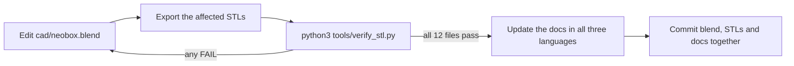

# Design

**English** · [简体中文](design.zh-CN.md) · [日本語](design.ja.md)

> The engineering reference: where every dimension comes from, which numbers are optical and which are structural, what happens if you change one, and how to open, edit, re-export and verify the CAD source.

**Contents:** [1. Light path](#1-light-path) · [2. Dimension chain](#2-dimension-chain) · [3. Optical decisions](#3-optical-decisions) · [4. Cover-stage](#4-cover-stage) · [5. Film holders](#5-film-holders) · [6. Enclosure](#6-enclosure) · [7. Focus light](#7-focus-light) · [8. Flash operation](#8-flash-operation) · [9. Repositioning and repeatability](#9-repositioning-and-repeatability) · [10. 4×5 on the v1 body](#10-45-on-the-v1-body) · [11. Working with the source](#11-working-with-the-source)

Reference flash: a **NEEWER TT560** speedlight with a **ZENIKO T1** 2.4 GHz trigger set. This is only the flash the design was checked against. You do not have to use it. The flash lies on the desk *outside* the box, so no dimension in this document depends on it. Any speedlight with manual power control works.

| Convention | What it means here |
|---|---|
| Dimensions | Millimetres, written width × depth × height (X × Y × Z) |
| `z` | Absolute height above the desk. The box stands directly on the desk, so this is also the height above the outer bottom of the main body |
| Part-local z | The layer-quantisation tables in [§2](#2-dimension-chain) measure each part from its own print-bed face instead. Stated where used |
| XY positions | Measured from the centre of the box, which is also the centre of the light window |
| STL bounding box | Quoted only where it is labelled as such. It is sorted largest first and is often not in X × Y × Z order |
| Source | Every number below is read from `cad/neobox.blend` or from the exported STL files. [§11](#11-working-with-the-source) explains how to read them yourself |

> [!IMPORTANT]
> The geometry has been checked for its dimensions in Blender and checked numerically in the exported STL files, and the box has been printed and used. **Every performance figure in this document is still a design target, not a measurement:** the mixing margins, the ≤ 0.28 mm flatness bound, the depth-of-field coverage. The printed box scans evenly by eye and in the inversions. No evenness has been metered, and nothing here claims otherwise.

---

## 1. Light path


The stack, desk upward:

**flash lying flat on the desk → the fully open front → white cavity 120 × 150 × 70 → light window 62 × 95 in the cover-stage → opal acrylic 68 × 118 × 2, top face at 78.6 → 4.6 mm of air → film plane at z = 83.2.**

The flash is not inside the box. It lies flat on the same desk the box stands on, with its head against the **open front**. The front face of the box has no wall at all. The flash fires horizontally into the cavity. The TT560's emitting face is 60 × 45, with its centre 31 mm above the desk. That is well inside the 70 mm-tall opening.

**Nothing is aimed at the film.** The light window is in the ceiling of the cavity, at right angles to the beam. Light reaches the window only after several diffuse bounces off the bare white PLA. That is what makes the interior an [integrating cavity](glossary.md#integrating-cavity), a space that mixes the light by bouncing it off the walls. The light leaves through the 62 × 95 window. One [opal](glossary.md#opal) acrylic sheet, recessed into the cover-stage directly above, gives it its final smoothing.

The open front is the one change that defines v1. The printed prototype (internal revision 4) sealed the flash inside the box, and every difficulty of the prototype followed from that. The box height was derived from the flash's thickness. An access panel was needed to reach the power dial, and a cable gland to pass wires. The published STLs fitted one flash model and no other. With the flash outside, all of that disappears. Any brand of flash works. The receiver stays on the desk, where its radio signal is clean and its batteries are reachable. There is no panel, gland or ventilation question left to answer ([§6](#6-enclosure)). The price is that ambient light can enter the cavity. That trade is accepted on purpose. The flash pulse is far brighter than room ambient at sync speed ([§8](#8-flash-operation)).

> [!NOTE]
> **Work in a dim room, and keep ceiling lamps from shining straight into the opening.** The pulse overwhelms ambient light by design. A bright lamp aimed into the open front is the one placement that eats into that margin.

---

## 2. Dimension chain

In the prototype the box was derived from the flash, and its numbers went out of date with it. v1 cuts that link. The flash never enters the box, so the chain no longer starts at a product's datasheet. It starts at the desk and runs upward, part stacked on part, held by gravity.

### The printed parts

Twelve STL files, three white and nine black, all printed without supports:

| STL | Colour | Overall (mm) | What it is |
|---|---|---|---|
| `main-body.stl` | white | 124.8 × 154.8 × 75.6 | Main box: 3.0 floor, 2.4 left/right/rear walls, front fully open. Four locating tenons 2.4 × 12 × 2.6 on the side-wall tops |
| `cover-stage.stl` | white | 124.8 × 154.8 × 10.0 | Cover-stage: 6 mm plate seated on the walls, with light window, acrylic recess, washer pockets and holder tray ([§4](#4-cover-stage)) |
| `film-holder-135-base.stl` | black | 94 × 120 × 5 | 135 holder base: 25 × 37 window, inner guide rails, outer rails with the 4.6 element ledge ([§5](#5-film-holders)) |
| `film-holder-135-lid.stl` | black | 94 × 120 × 3 | 135 holder lid: 25 × 37 window, element cavity, 8 magnet pockets |
| `film-holder-120-base.stl` | black | 94 × 120 × 5 | 120 holder base: 57 × 85 window (full 6×9), 62 channel, same outer rails and ledge as the 135 |
| `film-holder-120-lid.stl` | black | 94 × 120 × 3 | 120 holder lid: 57 × 85 window, otherwise identical to the 135 lid |
| `pressure-window-135.stl` | black | 64 × 95 × 2 | Pressure-window insert, 135 (window 25 × 37) |
| `pressure-window-120.stl` | black | 64 × 95 × 2 | Pressure-window insert, 120 (window 57 × 85) |
| `mask-6x6.stl` | black | 94 × 80 × 1 | 6×6 mask (window 56.5 × 56.5), laid in the tray under the 120 base |
| `slide-plate-135.stl` | black | 94 × 120 × 5 | Slide plate for mounted 135 slides: 51.4 × 51.4 pocket, 26 × 38 window, two finger wells. A fourth holder set in one piece ([§5](#5-film-holders)) |
| `cover-stage-4x5.stl` | white | 124.8 × 154.8 × 10.0 | 4×5 cover-stage: the cover-stage's outline, plate and four notches with a 102 × 126 light window, a 107 × 131 acrylic recess and a 112.6 × 138.6 tray. No washer pockets ([§10](#10-45-on-the-v1-body)) |
| `sheet-plate-4x5.stl` | black | 112 × 138 × 5 | 4×5 sheet plate: 102.2 × 127.6 pocket, 97 × 121 window, two edge notches. Stands in the 4×5 cover-stage's tray |

Every part prints with its flat face down. The two lids print top face down. The largest part is 154.8 mm long, so a 160 × 160 print bed is enough. Layer heights, orientation cards and slicer settings are in [printing.md](printing.md).

### Height

The whole assembly is one gravity stack. Each part simply rests on the one below it. World z, desk = 0:

| Layer | z range | Note |
|---|---|---|
| Desk | 0 | the flash and the box stand on the same surface |
| Main-body floor | 0 – 3.0 | |
| Cavity | 3.0 – 73.0 | interior 120 × 150 × 70, open at the front |
| Cover-stage plate | 73.0 – 79.0 | 6 mm plate seated on the wall tops. Deck face at 79.0 |
| Opal acrylic | 76.6 – 78.6 | in its recess, top face 0.4 below the deck |
| Steel washers | 78.0 – 79.0 | in their pockets, flush with the deck |
| Tray flange | 79.0 – 83.0 | rim around the holder seat, 4 high |
| Holder base | 79.0 – 84.0 | stands on the deck inside the flange. The slide plate occupies the same 5 mm |
| **Film plane** | **83.2** | land top. The same height for both formats |
| Slide film plane | ≈ 82.6 – 83.6 | in the slide plate: pocket floor at 82.0 plus about half the mount's thickness. Refocus |
| 4×5 film plane | ≈ 82.2 | a sheet lying on the sheet plate's pocket floor at 82.0. Refocus |
| Pressure element | 83.6 – 85.6 | insert or AN glass on the 4.6 ledge |
| Holder lid | 84.0 – 87.0 | total assembled height 87 |

### Width and depth

The main body is 124.8 × 154.8 outside. The walls are 2.4 and the front is open, so the interior cavity is **120 × 150 × 70**. The open front is the cavity's full 120 × 70 cross-section. The 62 × 95 light window is centred. That leaves **29 mm of white wall in x and 27.5 mm in y** between the window edge and the nearest wall. This is the mixing margin. It is deliberately generous by design. No minimum has been established, and nothing has been measured.

### Generalising to another flash

There is nothing to re-derive. The prototype-era formulas that turned a flash datasheet into a box height are gone, because their input is gone. **No dimension of the v1 box depends on any dimension of any flash.** A substitute flash needs manual power control and a head that can lie flat and fire level into the open front. The TT560's emitting face, 60 × 45 with its centre 31 above the desk, is only the reference. It is not a limit. The receiver stays outside too, so the trigger model is equally free. Swapping flashes touches neither `cad/neobox.blend` nor the STLs ([§11](#11-working-with-the-source)).

### Layer quantisation

**Every printed z-feature in this design is an exact multiple of 0.2 mm, and no exposed horizontal step is under 0.4 mm (two layers).** Each part follows this grid in its own print orientation, measured from the face that sits on the print bed:

| Part (datum = print-bed face) | z stations |
|---|---|
| Main body | 0 · 3.0 floor top · 73.0 wall top · 75.6 tenon top |
| Cover-stage | 0 · 2.8 notch ceiling · 3.6 acrylic-recess floor · 5.0 washer-pocket floor · 6.0 deck · 10.0 flange top |
| Holder bases (both formats) | 0 · 2.2 magnet-pocket floor · 3.8 plate face · **4.2 land** · **4.6 element ledge** · 5.0 rail top |
| Holder lids (printed top face down) | 0 · 1.0 element-cavity ceiling · 3.0 lid underside (assembly-local 8.0 / 7.0 / 5.0) |
| Inserts / mask | flat plates, 2.0 / 1.0 |
| Slide plate | 0 · 1.0 finger-well floor · 3.0 pocket floor · 5.0 top |
| 4×5 cover-stage | 0 · 2.8 notch ceiling · 3.6 acrylic-recess floor · 6.0 deck · 10.0 flange top |
| Sheet plate | 0 · 1.0 notch floor · 3.0 pocket floor · 5.0 top |

The grid matters because of the [layer height](glossary.md#layer-height). At 0.2 mm every one of those stations lands exactly on a layer boundary, so a printed 0.4 step comes out as a true 0.4 step. The slicer never has to round it. A 0.1 mm layer height also fits the grid. 0.12 and 0.16 do not. The reasoning dates from the prototype's holders and carries over unchanged ([design log entry 18](design-log.md#18-layer-quantised-holders)). In the prototype only the holders obeyed it. In v1 the whole design does. The print order spec pins every file at 0.2 ([printing.md](printing.md)). The verifier enforces the grid and the minimum step on every export ([§11](#11-working-with-the-source)).

---

## 3. Optical decisions

**One opal sheet, recessed into the cover-stage, is the final diffuser.** The acrylic is a bought part, 68 × 118 × 2. It drops into a 69 × 119 recess 2.4 deep, which leaves 0.5 mm of side clearance and puts its top face 0.4 below the deck. Because the holder stands on the deck, **nothing ever touches the acrylic**. The sheet only shapes the light. It carries no load. The height of the film plane is set by printed plastic alone, and the acrylic plays no part in it. To lift it out, take the holder off and push the sheet up through the light window from inside the box.

**Dust on the acrylic does not show up in the scan.** The acrylic is itself the glowing, diffuse surface that lights the film. A particle sitting on it becomes part of the light source. It is not an object standing between the source and the lens, so it cannot project an outline onto the film. Wipe the sheet now and then and move on. There is no need to clean it before every session. (Dust on the optional glass is the opposite case. See [§5](#5-film-holders).)

**Mixing margins.** The window-to-wall margins, 29 in x and 27.5 in y, are the numbers that decide how evenly the cavity fills the window. They are design margins, chosen generous. No minimum has been established, and no measurement stands behind them.

**All-white cavity, matte only.** The white PLA *is* the mixing surface. Do not paint the inside. Do not print the white parts in silk or glossy filament. A shiny wall mirrors the flash head as a bright hot spot. A matte wall scatters it.

**Everything above the acrylic is black.** The holders, inserts and mask print in black, so stray light above the diffuser is absorbed. It does not bounce back into the film. An optional A5 black flocking sticker, a velvet-like adhesive sheet, on the deck removes the last of the glare ([bom.md](bom.md)).

**Ambient light is tolerated.** The box is not sealed against it. The open front admits room light. The answer is in how you work: a dim room, no lamp aimed into the opening, and the camera at sync speed. The pulse dwarfs whatever light remains ([§8](#8-flash-operation)).

**No internal adjusters.** There are no reflector plates, baffles or levelling hardware anywhere in the light path. The cavity is bare white walls and nothing else. Every internal part would be one more thing to align and one more thing to knock out of place. Check evenness with a [flat-field-corrected](glossary.md#flat-field-correction) test frame. That correction separates lens vignetting (darker corners caused by the lens) from real unevenness in the source ([assembly.md](assembly.md)).

---

## 4. Cover-stage

The cover-stage is the prototype's top cover and film stage merged into a single white plate. One printed part replaces what used to be a cover, a stage, three studs, six nuts and three heat-set inserts. It seats directly on the wall tops and carries every optical part above the cavity.

What the one part carries:

- **The plate**: 124.8 × 154.8, 10 overall. The structural part is a 6 mm plate whose deck face lands at z = 79.0. Four corner notches, 2.8 deep, drop over the main body's 2.6 tenons with 0.2 of vertical clearance. The plate seats on the wall tops. It never rests on the tenons, which only fix its position in XY.
- **The light window**: 62 × 95, centred, straight through the plate.
- **The acrylic recess**: 69 × 119, 2.4 deep, floor at 76.6, open to the deck. The opal sheet drops in from above and sits 0.4 below the deck ([§3](#3-optical-decisions)).
- **The tray**: a raised rim (the flange) around a 94.6 × 120.6 seat, 4 high, top at 83.0. It locates the holder with 0.3 mm of clearance per side. Its top face catches the film tail 0.2 below the film plane ([§5](#5-film-holders)).
- **The washer pockets**: four, 10.6 square and 1.0 deep, at (±41, ±12). A 10 × 10 × 1 steel washer (or a Ø10 × 1 disc) drops into each, flush with the deck. The washers give the holder-base magnets something to grip, so the holder snaps down onto the tray and stays put. The prototype's glued washers did the same job. These need no glue.

To move it, pinch the flange and lift. The whole cover-stage comes off the box in one piece.

**There is no levelling hardware. That is deliberate.** The prototype levelled its film stage against the box on three M6 studs. v1 deletes the studs, the nuts, the inserts and the procedure.

<details>
<summary>Why levelling moved to the camera end</summary>

Plastic never carries a thread in this design. FDM-printed threads are weak and creep under load. The prototype already avoided them with brass inserts and steel studs. v1 removes the need for even those.

There is a deeper reason. The only parallelism that matters is **film plane to sensor**. Levelling the stage against the box never delivered that directly. After the prototype's three-nut procedure you still had to square the camera to the stage. v1 keeps only the step that matters. Lay a small mirror on the film stage, look through the viewfinder, and move the camera until the reflection of its own lens is centred. At that point the sensor is parallel to the mirror, and therefore to the film plane the mirror is lying on ([assembly.md](assembly.md#step-7--level-at-the-camera-the-mirror-method)).

The mirror lies on the *result* of the whole printed stack (floor, walls, plate, holder). So every print tolerance underneath it is absorbed in that single alignment. The box does not need to be flat to any target. The camera meets the film plane wherever it actually is.

</details>

---

## 5. Film holders

There is one holder set per format: a base and a lid, both 94 × 120, standing in the cover-stage tray. To change format, lift one set off and drop the other in. The magnets release and re-seat in about five seconds, and nothing else moves. To advance the film, pull the strip through the closed holder. The holder is never opened mid-roll. A fourth set, for mounted 135 slides, is a single plate with no lid ([below](#mounted-slides-the-slide-plate)).

| Feature | 135 holder | 120 holder |
|---|---|---|
| Outline, base and lid | 94 × 120 | 94 × 120 |
| Base / lid thickness | 5 / 3 | 5 / 3 |
| [Window](glossary.md#window) (base, lid and insert) | 25 × 37 | 57 × 85 (covers 6×9) |
| Film guide width | 35.4 between the inner rails | 62.0 between the channel walls |
| Element ledge ([§ below](#the-flattening-system)) | 4.6 high, at x 31 – 32.2 | identical |
| Magnets Ø8 × 2 | 8 in the base + 8 in the lid | same |

**Windows are deliberately about 0.5 mm oversize per side** against the nominal frame (135 is nominally 24 × 36, 120 is nominally 56 × 84). The extra room absorbs two things: the camera gate varies a little from body to body, and the printer has its own XY tolerance. You crop to the frame in post. See [scanning.md](scanning.md#loading-film).

### The flattening system

The film plane is the top of the [land](glossary.md#land), a narrow ledge that frames the window **on all four sides**, 4.2 above the base bottom. Film is 0.12 – 0.18 thick, so its top face lies at 4.32 – 4.38. The next 0.2-grid station above that is **4.6**. And 4.6 is exactly where the element ledge places the underside of whatever rests on it. Those three numbers are the whole system:

**land 4.2 → film top 4.32 – 4.38 → element underside 4.6.**

That makes a 0.4 mm channel over the land on all four sides of the window. The film can lift freely by 0.22 – 0.28 mm anywhere under the element. The element is whatever 64 × 95 × 2 plate you set on the ledge. That is what makes the system interchangeable:

- **Default: the printed pressure-window insert**, one per format. A hard ceiling all round the window perimeter holds lift to ≤ 0.28 there. Over the open window the film is unconstrained. But at 1:1 and f/8 the depth of field is about ±0.4 mm, which covers the remaining bow.
- **Upgrade: one anti-Newton glass, 64 × 95 × 2, shared by both formats.** It makes a continuous ceiling over the full frame, so lift is ≤ 0.28 mm at any position. Its matte (AN) face goes down, against the glossy film base, so no [Newton rings](glossary.md#newton-rings) form. The emulsion faces the open window below and touches nothing.

**Why a single glass completes the sandwich:** a classical glass carrier needs two glasses, because nothing else defines the bottom of the stack. Here the bottom is printed. The land frame supports the film on all four sides at 4.2. So one glass on top closes the sandwich. That leaves half as many glass surfaces to keep clean, and no glass at all under the emulsion.

**Why one glass fits both formats:** both bases carry an identical outer-rail profile. The element ledge sits at x 31 – 32.2, 4.6 high. An outer step at 32.2 – 33.5, 5.0 high, locates the element sideways. The same 64 × 95 seat therefore exists in both. In the 135 base, the inner guide rails at ±17.7 – 19.7 steer the narrow strip. They would foul a 64-wide plate, so their middle is left out over |y| < 48. That leaves 12 mm guide stubs at each end. The glass drops through the gap onto the ledge, and the stubs hold it in place lengthwise.

The element is seated once and then never handled. To advance film, grip the leader where it sticks out of the holder and pull. A bowed section is pressed flat as it slides under the element. The lid's cavity (64.8 × 96, ceiling at 7.0) captures the element with 0.4 of float. The lid locates the element but never presses on it, so the element's height stays at the ledge's printed 4.6. Nothing forces it. Loading advice: in **glass mode, bow up** (the glass flattens it). In **insert mode, bow down**. Film that leaves the holder drapes onto the tray flange, whose top sits 0.2 below the film plane. The flange supports the film without pinching it. Hand-support the tail of a long strip.

> [!CAUTION]
> **The glass underside sits 0.2 mm from the focal plane, so dust on it lands essentially in focus.** Blow both faces of the glass clean before seating it. It is the one surface in the box where dust shows up in the scan. Dust on the acrylic does not show ([§3](#3-optical-decisions)).

**Magnets.** Ø8 × 2 N35, press-fitted (pushed into a tight hole, no glue anywhere), 8 per part, 32 across both sets. The base magnets stand 0.4 proud of the plate face. The lid magnets sit flush with the lid underside. With the holder closed, the faces are 0.8 apart and **never touch**. So the lid always seats on the printed rail tops, and the channel height stays a printed number. The magnets do not add to it. Polarity must be paired so that every base–lid position attracts. Check each magnet against its mate before pressing it home. A press-fitted magnet does not come back out.

**6×6 and 6×4.5.** For 6×6, lay `mask-6x6.stl` (94 × 80 × 1, window 56.5 × 56.5) in the tray *under* the 120 base. The whole set then rides 1 mm higher, which is normal. Refocus and carry on. 6×4.5 has no dedicated mask. Crop in post.

### Mounted slides: the slide plate

A slide in its mount is about 1.2 – 3.2 mm thick, many times the 0.4 mm channel, so it can never enter the 135 holder. Cutting a pocket for it into the 135 base would remove the land that supports the strip ([design log entry 25](design-log.md#25-mounted-slides-a-plate-of-their-own)). So `slide-plate-135.stl` is a fourth holder set in one piece: a 94 × 120 × 5 black plate that stands in the tray in place of the 135 set. It has no lid, no magnets and no pressure element. A mount is rigid and the box is horizontal, so the pocket locates the mount and gravity holds it.

| Feature | Slide plate |
|---|---|
| Outline and thickness | 94 × 120 × 5, the same seat in the tray as a holder base |
| Pocket | 51.4 × 51.4, 2.0 deep. Floor at 3.0 above the plate bottom (z = 82.0) |
| Window | 26 × 38, through the pocket floor |
| Finger wells | two, 18 × 12, centred on the pocket's short sides. Floor at 1.0, blind |
| Film plane | pocket floor plus about half the mount's thickness: roughly 82.6 (card mounts) to 83.6 (glass mounts). Refocus |

**Why 51.4:** mounts are nominally 50 × 50, but card mounts run up to 50.8 (2 inch). So 51.4 leaves 0.3 mm per side on the largest mount and 0.7 on a plastic one. That is the same clearance the holder bases have in the tray. **Why 2.0 deep:** the thinnest card mount, about 1.2, is still held by the pocket walls. The thickest glass mount, about 3.2, stands 1.2 proud, and nothing sits above it to get in the way. **Why 26 × 38, not 25 × 37:** the mount can float up to 0.7 mm in the pocket. With 1 mm of margin per side against the nominal 24 × 36 frame, the mount's own aperture always frames the image. The printed edge never does. Every mount still overlaps the window by more than 5 mm on every side, so nothing leaks. **The finger wells** let a fingernail under the edge of a card mount, which sits 0.8 below the pocket rim. They are blind, 2.0 below the pocket floor, so they pass no light.

Load a mount the way you would hold it up to a window: the image reads correctly from above. That puts the emulsion down, the same rule as for strips. Nothing here flattens a warped card mount or a frame that has popped loose in its mount. A dedicated slide scanner does not flatten them either. At 1:1 and f/8 the roughly ±0.4 mm depth of field absorbs most of it.

---

## 6. Enclosure

The **main body** is one printed piece: a 3.0 floor, three 2.4 walls (left, right, rear), and no front wall at all. Four locating tenons, 2.4 × 12 × 2.6, stand on the side-wall tops. They fit into the cover-stage's corner notches.

**What the open front deleted.** The prototype needed an access panel, because the flash's power dial lived inside a sealed box. Wires had to cross a light-tight wall, so it needed a cable gland. Heat had nowhere to go, so it needed a ventilation answer. In v1 there is nothing inside to reach. Flash, receiver and their batteries all sit on the desk. A power change is a fingertip away. The focus light's cable simply runs out through the opening. The cavity is open air. All three problems left with the front wall.

**No screws, no glue, no tools.** No thread engages plastic anywhere in the design. Every joint is a tenon in a notch, gravity, or a magnet. The cover-stage locates on tenons and holds by its own weight. The holder holds by magnets on washers. The lid holds by magnets on the base. The element rests by gravity on its ledge. The magnets press-fit. The washers drop in loose. Assembly is stacking, in order, and is over in minutes ([assembly.md](assembly.md)).

> [!NOTE]
> **The fastener inventory of the entire build is: zero screws, zero adhesive.** Even the prototype's two glue points (holder magnets and steel washers) are gone. v1's magnets are press-fitted and its washers sit in pockets.

> [!WARNING]
> **A gravity stack must not be carried tilted.** Once assembled, the box is only aligned, with nothing fastening it together. Move it flat across the desk, or move the pieces separately. The cover-stage lifts off by its flange in one motion.

### Feature location schedule

XY is measured from the centre of the box, and z from the desk. Read from `cad/neobox.blend`.

| Feature | XY | z | Size |
|---|---|---|---|
| Open front | front face | 3.0 – 73.0 | full cavity cross-section, 120 × 70 |
| Locating tenons, 4 | side-wall tops | 73.0 – 75.6 | 2.4 × 12 × 2.6 |
| Corner notches, 4 | cover-stage underside | 2.8 deep | 0.2 vertical clearance over the tenons |
| Light window | centred | through the plate, 73.0 – 79.0 | 62 × 95 |
| Acrylic recess | centred | floor 76.6, open to the deck at 79.0 | 69 × 119, 2.4 deep |
| Washer pockets, 4 | (±41, ±12) | 78.0 – 79.0 | 10.6 square, 1.0 deep |
| Tray flange | around the 94.6 × 120.6 seat | 79.0 – 83.0 | rim, 4 high |

> [!TIP]
> The tenon-and-notch fit is sized within the normal error of FDM printing. Elephant foot (a squashed-out first layer), XY expansion and warp all eat into it. If the cover-stage binds or rattles, fix it with a slicer setting. Do not edit the file. See [printing.md](printing.md#if-it-came-out-tight-or-loose).

---

## 7. Focus light

There is no built-in focus light, and nothing electrical lives inside the enclosure. Frame and focus with ordinary room light. A dim room shows plenty of film detail. Any lamp works, as long as it does not shine straight into the open front. At capture the flash overwhelms whatever light the room contributes.

---

## 8. Flash operation

Manual power only, normal sync, shoot [raw](glossary.md#raw). [TTL](glossary.md#ttl) metering is useless here. The scene never changes, so power is set once, by hand. [HSS](glossary.md#hss) solves a problem that does not exist at or below [sync speed](glossary.md#sync-speed). Do not pay for either.

**The pulse is the exposure.** Even with the open front, in a dim room a sync-speed exposure collects a negligible amount of ambient light next to the pulse. So the flash's own duration acts as the effective shutter. It is orders of magnitude shorter than any continuous-light exposure you could safely make on a tripod. Vibration, shutter shock and floor rumble stop mattering.

**Shutter speed: 1/125 s is the recommendation.** Focal-plane shutters typically sync at 1/160 – 1/250. A cheap 2.4 GHz trigger's latency costs about one stop of that. Hence 1/125. If you push past the real limit, you will see a clean-edged dark band across the frame. The symptom is unmistakable.

> [!IMPORTANT]
> **An electronic shutter will usually not fire a flash at all.** If nothing happens when you press the button, that is the first thing to check. Details in [scanning.md](scanning.md#exposure).

Power changes are a fingertip away. The flash is on the desk in front of you, with nothing to open and nothing to disturb. The receiver sits beside it, outside the box, where its radio path is clean and a battery swap touches nothing. In practice power is set once, from a test frame, and left alone. The exposure procedure is in [scanning.md](scanning.md#exposure).

---

## 9. Repositioning and repeatability

The film plane is fixed at z = 83.2 for **both** strip formats. The 6×6 mask lifts the 120 set by 1 mm. The slide plate and the sheet plate put their film within a millimetre of it. In each case you refocus, and nothing else changes. What changes between 135 and 120 is the magnification you need, and therefore the camera height. The height of the film does not change. Work the camera height out from the film plane plus your lens's [working distance](glossary.md#working-distance). The arithmetic is in [scanning.md](scanning.md#camera-height-and-the-stand).

**Parallelism is one alignment: the mirror method.** Lay a small mirror on the film stage and centre the reflection of your own lens in the viewfinder. The sensor is then parallel to the film plane, and every print tolerance in the stack below has been absorbed in the same move ([assembly.md](assembly.md#step-7--level-at-the-camera-the-mirror-method), and the reasoning in [§4](#4-cover-stage)). This is why the box carries no levelling hardware at all.

Once the camera is set, the box is what moves. Slide it on the desk to centre the frame, and leave the camera aimed where it is. Then nudge the flash back against the opening. When you are satisfied, make the position repeatable. Two locating pins on the baseboard or a pencil outline of the footprint both work. Write down the column height you used for each format.

**Parallelism first, evenness second.** A flash freezes vibration. It cannot fix a film plane that is not parallel to the sensor. Do the mirror method first. Then shoot a [flat-field-corrected](glossary.md#flat-field-correction) test frame to check evenness.

---

## 10. 4×5 on the v1 body

4×5 sheet film rides on the unchanged main body with two optional parts and one larger acrylic: `cover-stage-4x5.stl` replaces the cover-stage, `sheet-plate-4x5.stl` stands in its tray, and a 106 × 130 × 2 opal sheet lies in its recess. Nothing else changes: the same tenons, the same flash at the same open front, the same gravity stack, the same 160 × 160 bed.

| Feature | 4×5 cover-stage | v1 cover-stage |
|---|---|---|
| Outline, plate, notches | 124.8 × 154.8, 6 mm plate, four notches over the tenons | identical |
| Light window | 102 × 126 | 62 × 95 |
| Acrylic recess | 107 × 131, floor at 3.6, for a 106 × 130 × 2 sheet | 69 × 119, for 68 × 118 × 2 |
| Tray inside the flange | 112.6 × 138.6, flange 4 wide, top at 10.0 | 94.6 × 120.6, flange 7 wide |
| Washer pockets | none: the sheet plate has no magnets | four |
| Mixing margin, window edge to wall | 9 in x, 12 in y | 29 in x, 27.5 in y |

| Feature | Sheet plate |
|---|---|
| Outline and thickness | 112 × 138 × 5, standing on the deck inside the 4×5 flange |
| Pocket | 102.2 × 127.6, 2.0 deep. Floor at 3.0 above the plate bottom (z = 82.0) |
| Window | 97 × 121, through the pocket floor: the 96 × 120 image area plus the usual 0.5 per side |
| Edge notches | two, 18 wide, on the short sides, running from 3.7 under the sheet edge out through the plate edge. Floor at 1.0 |
| Film plane | the sheet lies on the pocket floor: about 82.2 |

**Why the sheet needs no pressure element.** 4×5 on a full-frame camera is about 0.25×. At f/8 the depth of field is then roughly 8 – 10 mm, ten times the 135 case. A sheet's own curl, a millimetre or two, is invisible at that scale. So the plate is a pocket with a land under the sheet edges and nothing on top: no lid, no glass, no magnets. Sheets load one at a time, with the image reading correctly from above (emulsion down). They lift out by the edge notches.

**What is not known: evenness.** The v1 window sits 29 and 27.5 mm from the walls. The 4×5 window sits 9 and 12. No minimum margin has ever been established and nothing has been measured. So the 4×5 stage is published as an experiment on the same body. No evenness figure is claimed for it. Shoot one blank frame first. If it shows a gradient you will not accept, flat-field correction in post is the first remedy ([scanning.md](scanning.md#flat-field-and-inversion)) and a bigger box the second.

<details>
<summary>The bigger-box route, if the margins prove too small</summary>

Derive a bigger box of the same kind. Keep the 102 × 126 window and give it v1's margins. That makes the cavity 160 × 181 inside and the main body about 164.8 × 185.8 outside. That is past a 160 × 160 bed and onto a 220-class one. Scale the cover-stage, tray, sheet plate and acrylic to match. The open-front architecture, the screwless gravity stack and the layer grid carry over unchanged. The flash may not need to grow. The larger window costs about 1.2 stops, and the drop from 1:1 to 0.25× gives back about 1.3. That too is unmeasured.
</details>

---

## 11. Working with the source

`cad/neobox.blend` is the only source of geometry in this repository. The twelve STL files are generated from it. A change made to the STLs without going through the blend file is lost the next time anyone re-exports.

### Opening the file

| Property | Value |
|---|---|
| Blender version | **3.0 or newer.** The file is Zstandard-compressed, which pre-3.0 Blender cannot read at all. The file header records **Blender 5.2** as the version it was last saved with |
| Unit system | Metric, unit scale 0.001, length unit millimetres: **one Blender unit is one millimetre** |
| Scene layout | The assembly is modelled in place, on the same z datum this document uses: the desk (the outer bottom of the box) is z = 0. The camera tube for the Laowa 85, base and column with their ring, lens and camera mock-ups, stands on the 135 holder lid in place. The 120 holder set is parked beside the assembly at x = 200, the 6×6 mask at x = 350, the slide plate at x = 500 and the 4×5 stage at x = 650 |

### The collection tree

```
Scene Collection
├── mock_view-target        an empty, used as a view target
├── Scaffolding             Camera, Light: render scaffolding
├── NeoBox_v1               the enclosure, the cover-stage and the mock-ups
├── Holder_135              the 135 holder set, assembled in place, with the camera-tube stack on its lid
├── Holder_120              the 120 holder set, parked at x = 200
├── Masks                   the 6×6 mask, parked at x = 350
├── Holder_slide            the slide plate and its mount mock-up, parked at x = 500
└── Stage_4x5               the 4×5 cover-stage and sheet plate with their mock-ups, parked at x = 650
```

### Which objects make each STL

| STL file | Blender object(s) | Gloss |
|---|---|---|
| `main-body.stl` | `main-body_floor`, `main-body_wall-left`, `main-body_wall-right`, `main-body_wall-rear` | **four objects**: floor, left wall, right wall, rear wall. The open front needs no lintel or posts |
| `cover-stage.stl` | `cover-stage` | cover-stage, one piece, window 62 × 95 |
| `film-holder-135-base.stl` | `film-holder-135-base` | 135 holder base, flat-bottomed |
| `film-holder-135-lid.stl` | `film-holder-135-lid` | 135 holder lid |
| `film-holder-120-base.stl` | `film-holder-120-base` | 120 holder base, flat-bottomed |
| `film-holder-120-lid.stl` | `film-holder-120-lid` | 120 holder lid |
| `pressure-window-135.stl` | `pressure-window-135` | pressure-window insert, 135 |
| `pressure-window-120.stl` | `pressure-window-120` | pressure-window insert, 120 |
| `mask-6x6.stl` | `mask-6x6` | 6×6 mask |
| `slide-plate-135.stl` | `slide-plate-135` | slide plate, one piece |
| `cover-stage-4x5.stl` | `cover-stage-4x5` | 4×5 cover-stage, one piece |
| `sheet-plate-4x5.stl` | `sheet-plate-4x5` | 4×5 sheet plate, one piece |

### What is a mock-up and must never be exported

**The name says whether an object is printed.** A printed part carries the name of the STL file it becomes. `cover-stage` is the object that becomes `cover-stage.stl`, and the main body is the four shells sharing the `main-body_` prefix. Everything else in the scene is a mock-up, there to show fit and light path, and takes the `mock_` prefix instead. None of it is printed or exported. The mock-ups are: the flash body and its emitting face (`mock_flash-body`, `mock_flash-face`), the T1 receiver (`mock_trigger-receiver`), the four light-path arrows (`mock_ray-1-into-cavity` to `mock_ray-4-through-window`), the 135 and 120 film-strip mock-ups (`mock_film-135`, `mock_film-120`), a 50 × 50 × 2 slide mount (`mock_slide-mount-50x50x2`), a 4×5 sheet (`mock_film-4x5`), the two opal acrylics (`mock_diffuser-68x118x2`, `mock_diffuser-106x130x2`), the AN glass (`mock_an-glass-64x95x2`), the four steel washers (`mock_steel-shim-1` to `mock_steel-shim-4`), a text label (`mock_label`), the camera tube's step-up ring, clamp ring, lens and camera body (`mock_ring`, `mock_retainer`, `mock_lens`, `mock_camera-body`), and the view target (`mock_view-target`). `Camera` and `Light` carry no prefix and need none. Neither is a mesh, so neither can reach an STL.

The script enforces this convention. `tools/export_stl.py` fails the whole export when it finds a mesh object that is not listed in its `MAPPING` table (reproduced above), does not carry the `mock_` prefix, and is not one of the camera-tube parts that `tools/camera_tube.py` generates. Those camera-tube parts carry the `camera-tube-`, `lens-column-` and `lens-carrier-` prefixes. They stay in the scene for fit and renders and are not published ([scanning.md](scanning.md#the-camera-tube)). So a printed part that is added to the scene and forgotten in that table stops the export. It cannot quietly drop out of the release.

> [!CAUTION]
> **Material names do not tell you the filament colour.** The eight materials (`NB_white`, `NB_black`, `NB_steel`, `NB_opal`, `NB_film`, `NB_glow`, `NB_ray`, `NB_receiver`) exist for the renders. Each is named for what it is applied to, and that is not the filament you load into the printer. `NB_black`, for one, covers every black printed part, the two camera-tube parts and seven mock-ups: the flash body, the label, the slide mount, and the tube's two rings, lens and camera body. The prototype-era materials have been deleted, so nothing misleading survives in the list. Colours still come from [printing.md](printing.md#the-twelve-parts). Do not read them from the material slot.

### The export convention

Every STL is exported **in assembly world space**. Nothing is moved to the origin or rotated on the way out.

| File | Where it sits inside the exported file |
|---|---|
| `main-body.stl` | z 0 – 75.6, centred on XY |
| `cover-stage.stl` | z 73 – 83, centred on XY |
| `film-holder-135-base.stl` / `-lid.stl` | z 79 – 84 / 84 – 87, in place on the assembly |
| `pressure-window-135.stl` | z 83.6 – 85.6, in place |
| `film-holder-120-base.stl` / `-lid.stl` | parked at x 153 – 247, z 0 – 5 / 5 – 8 |
| `pressure-window-120.stl` | parked at x 168 – 232, z 4.6 – 6.6 |
| `mask-6x6.stl` | parked at x 303 – 397, z 0 – 1 |
| `slide-plate-135.stl` | parked at x 453 – 547, z 0 – 5 |
| `cover-stage-4x5.stl` | parked at x 587.6 – 712.4, z 0 – 10 |
| `sheet-plate-4x5.stl` | parked at x 594 – 706, z 6 – 11, standing on the 4×5 cover-stage's deck |

A slicer drops each file onto the build plate by its bounding box. Ten of the twelve files arrive already lying on their print face. The two holder lids do not. They print **top face down** and have to be flipped after import. The required rotation is on each part card in [printing.md](printing.md#the-twelve-parts).

### Re-exporting

One command regenerates all twelve files. It is the committed form of the pipeline that produced the published STLs, and it is the only supported way to export:

```
blender --background cad/neobox.blend --python tools/export_stl.py
```

(`blender` is the program inside your Blender installation. Any 4.x/5.x build works. Run it from the repository root, then run `python3 tools/verify_stl.py`.)

The script matters because the printable parts are **modelled as overlapping shells**. They overlap by 0.2 – 0.5 mm on purpose: the walls sink into the floor, the flange into the cover-stage plate, the rails into the holder bases. That keeps the source parametric and easy to edit. For every output file the script copies the source objects, splits them into shells, boolean-unions the shells into one solid (EXACT solver), welds away the boolean slivers, checks the result is watertight, and exports it in assembly world space. The scene itself is never touched. A plain File → Export → STL of the raw objects produces multi-shell files. Their internal faces fail the verifier's layer-grid check.

Regenerated files may differ from the published ones **byte for byte**, because triangulation is not stable across Blender versions. The geometry is still identical. The verifier is the referee: bounding box, watertightness, layer grid and minimum step must all pass.

<details>
<summary>Manual export, if you cannot run the script</summary>

1. **Select the objects** for one output file, using the mapping table above. *Checkpoint:* the number of selected objects matches the table: four for the main body, one for everything else.
2. **Make every part one solid, the main body included.** Single-object parts can still be multi-shell inside. Join what needs joining, separate by loose parts, boolean-union the shells, then merge vertices by distance (0.02 mm) and run a limited dissolve (1°) to remove the boolean slivers. *Checkpoint:* the part is one connected shell and the verify script reports no non-manifold edges.
3. **Export.** File → Export → STL, with *Selection Only*, scale 1.00, forward Y, up Z. No axis conversion. The numbers in the file must be the numbers in Blender. *Checkpoint:* re-importing the file puts the part back exactly where it was.
4. **Write it to the same path** under `stl/white-pla/` or `stl/black-pla/`, keeping the filename. *Checkpoint:* `git status` shows the file as modified and lists no new file.
5. **Verify** before you commit anything. *Checkpoint:* `python3 tools/verify_stl.py` prints `all 12 files pass` and exits 0.

</details>



### Running the verifier

`tools/verify_stl.py` is plain Python 3 with no dependencies. Run it from the repository root:

```
python3 tools/verify_stl.py
```

It walks every `.stl` under `stl/` and checks four conditions per file:

| Check | What it enforces |
|---|---|
| watertight | Every edge is shared by exactly two triangles: a closed solid, no holes |
| layer grid | Every horizontal face sits on a 0.2 mm multiple above that part's own base |
| minimum step | No exposed horizontal step below 0.4 mm, which is two layers at 0.2 |
| bounding box | The part still measures what the documentation says it measures |

Horizontal faces smaller than 1 mm² are ignored when hunting for steps, so modelling slivers do not raise false alarms. The output is one line per file plus a total. The exit status is non-zero if anything fails, so the script can gate a commit:

```
ok    film-holder-120-base.stl  [94.0, 120.0, 5.0]  256 triangles
...
all 12 files pass
```

The published bounding boxes live in the `EXPECTED` table at the top of the script, sorted largest first. **If you change a published dimension on purpose, edit `EXPECTED` in the same commit.** Otherwise the check fails on the part you meant to change, and quietly passes on the part you did not.

### Changing the flash

In the prototype era this heading introduced a re-derivation checklist. In v1 there is nothing to change. **No dimension of the box depends on the flash**, so a different flash (or a different trigger) touches neither `cad/neobox.blend` nor the STLs. The new flash needs manual power control and a head that can lie flat and fire level into the open front. After swapping, redo the metering test frame and carry on ([§8](#8-flash-operation)).

### Other files in `cad/`

- `film-stage-aluminium-3mm.dxf`: the prototype's aluminium film stage, kept for history only. v1 has no film stage. The part was merged into the cover-stage, and nothing in the current design is cut from this file.
- `legacy-plywood/`: DXFs from the plywood revision, kept for history only. Between them the two files do not describe a complete shell, and nothing in the current design is cut from them.

Contribution rules (what is source, what is generated, and the three-language requirement) are in [CONTRIBUTING.md](../CONTRIBUTING.md#source-of-truth-vs-generated-files).

---

← [Glossary](glossary.md) · [Documentation index](../README.md#documentation) · [Design log](design-log.md) →
