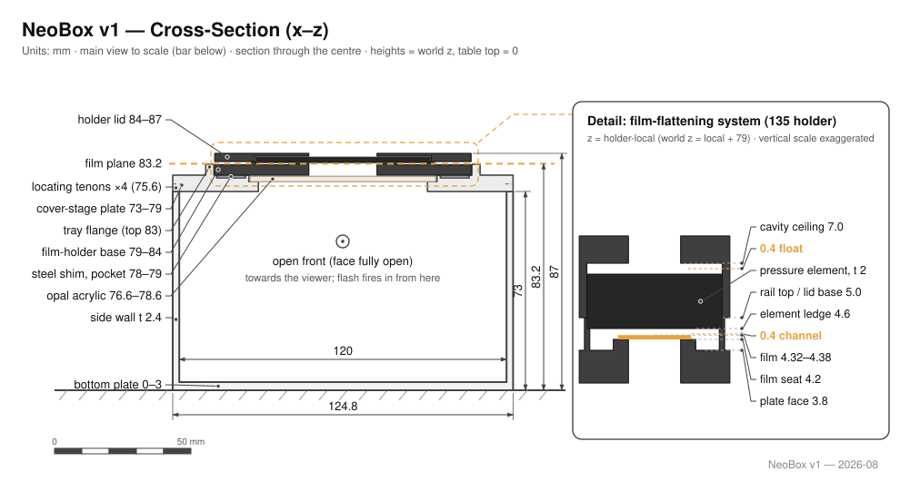

# Design

**English** · [简体中文](design.zh-CN.md) · [日本語](design.ja.md)

> Where every number comes from, why the box is shaped like this, and how to edit the source. Everything here is read from `cad/neobox.blend`. The box has been printed and used, but no optical figure has been measured with instruments. Evenness and flatness numbers are design targets.

Dimensions are in millimetres, width × depth × height. `z` is the height above the desk. XY positions are measured from the centre of the light window.

## 1. Light path



Desk, then the fully open front, then the white cavity 120 × 150 × 70, then the light window 62 × 95 in the cover-stage, then the opal acrylic 68 × 118 × 2 with its top face at z 78.6, then 4.6 mm of air, then the film plane at z 83.2.

The flash lies on the desk with its head at the open front and fires horizontally. Nothing is aimed at the film. The window is in the ceiling of the cavity, so the light reaches it mostly after several diffuse bounces off the bare white PLA. The window-to-wall margins, 29 mm in x and 27.5 mm in y, are the mixing margins. They were chosen generous. No minimum has been established.

## 2. Dimension chain

| STL | Colour | Size | What it is |
|---|---|---|---|
| `main-body.stl` | white | 124.8 × 154.8 × 75.6 | 3.0 floor, 2.4 walls on three sides, open front, four tenons 2.4 × 12 × 2.6 on the side-wall tops |
| `cover-stage.stl` | white | 124.8 × 154.8 × 10.0 | 6 mm plate on the walls, with the light window, the acrylic recess, the shim pockets and the holder tray |
| `film-holder-135-base.stl` | black | 94 × 120 × 5 | window 25 × 37, inner guide rails, outer rails with the 4.6 element ledge |
| `film-holder-135-lid.stl` | black | 94 × 120 × 3 | window 25 × 37, element cavity, 8 magnet pockets |
| `film-holder-120-base.stl` | black | 94 × 120 × 5 | window 57 × 85, 62 channel, the same outer rails and ledge |
| `film-holder-120-lid.stl` | black | 94 × 120 × 3 | window 57 × 85 |
| `pressure-window-135.stl` | black | 64 × 95 × 2 | insert, window 25 × 37 |
| `pressure-window-120.stl` | black | 64 × 95 × 2 | insert, window 57 × 85 |
| `mask-6x6.stl` | black | 94 × 80 × 1 | window 56.5 × 56.5, laid under the 120 base |
| `slide-plate-135.stl` | black | 94 × 120 × 5 | pocket 51.4 × 51.4 × 2.0, window 26 × 38, two finger wells |
| `cover-stage-4x5.stl` | white | 124.8 × 154.8 × 10.0 | window 102 × 126, recess 107 × 131, tray 112.6 × 138.6, no shim pockets |
| `sheet-plate-4x5.stl` | black | 112 × 138 × 5 | pocket 102.2 × 127.6 × 2.0, window 97 × 121, two edge notches |

The stack, with the desk at 0:

| Layer | z |
|---|---|
| Main-body floor | 0 – 3.0 |
| Cavity | 3.0 – 73.0 |
| Cover-stage plate, deck face at 79.0 | 73.0 – 79.0 |
| Opal acrylic | 76.6 – 78.6 |
| Steel shims, flush with the deck | 78.0 – 79.0 |
| Tray flange | 79.0 – 83.0 |
| Holder base | 79.0 – 84.0 |
| **Film plane** | **83.2** |
| Pressure element | 83.6 – 85.6 |
| Holder lid | 84.0 – 87.0 |
| Slide in the slide plate | about 82.6 – 83.6 |
| 4×5 sheet | about 82.2 |

**Layer grid.** Every printed z-feature is a multiple of 0.2 mm in its own print orientation, and no exposed horizontal step is under 0.4 mm. At a 0.2 mm layer height every station lands on a layer boundary, so a printed 0.4 step is a true 0.4 step. `tools/verify_stl.py` enforces both rules on every export.

| Part, datum = print-bed face | z stations |
|---|---|
| Main body | 0 · 3.0 · 73.0 · 75.6 |
| Cover-stage | 0 · 2.8 · 3.6 · 5.0 · 6.0 · 10.0 |
| Holder bases | 0 · 2.2 · 3.8 · **4.2 land** · **4.6 ledge** · 5.0 |
| Holder lids, printed top face down | 0 · 1.0 · 3.0 |
| Slide plate and sheet plate | 0 · 1.0 · 3.0 · 5.0 |

## 3. Cover-stage

One white plate that replaced the prototype's top cover, film stage, three studs, six nuts and three inserts.

| Feature | Position and size |
|---|---|
| Plate | 124.8 × 154.8, 6 mm thick, deck at z 79.0. Four corner notches 2.8 deep drop over the 2.6 tenons with 0.2 of clearance. The plate seats on the wall tops. The tenons only fix it in XY |
| Light window | 62 × 95, centred, through the plate |
| Acrylic recess | 69 × 119, 2.4 deep, floor at 76.6. The 68 × 118 × 2 sheet sits 0.4 below the deck and nothing ever touches it |
| Tray | A flange around a 94.6 × 120.6 seat, 4 high, top at 83.0. It locates the holder with 0.3 per side, and its top catches the film tail 0.2 below the film plane |
| Shim pockets | Four, 10.6 square, 1.0 deep, at (±41, ±12). A 10 × 10 × 1 steel shim sits flush, as the seat for the holder's base magnets |

## 4. Film holders

| Feature | 135 | 120 |
|---|---|---|
| Base and lid | 94 × 120, 5 and 3 thick | the same |
| Window in base, lid and insert | 25 × 37 | 57 × 85 |
| Film guide | 35.4 between the inner rails | 62.0 between the channel walls |
| Element ledge | 4.6 high at x 31 – 32.2, outer step at 32.2 – 33.5 | identical |
| Magnets Ø8 × 2 | 8 in the base, 8 in the lid | the same |

The windows are about 0.5 mm larger per side than the nominal frame, to absorb camera-gate and printer variance. You crop the rebate in post.

**Flattening.** The film plane is the top of the land, a ledge framing the window on all four sides at 4.2 above the base bottom. Film is 0.12 – 0.18 thick, so its top face is at 4.32 – 4.38. The next grid station is 4.6, and that is where the element ledge puts the underside of the element. The result is a 0.4 channel on all four sides and 0.22 – 0.28 of free lift under the element. The printed insert caps the lift at the window edges, and the depth of field at 1:1 and f/8, about ±0.4 mm, covers the rest. The anti-Newton glass caps the whole frame, matte face down against the glossy film base. The lid cavity, 64.8 × 96 with its ceiling at 7.0, holds the element with 0.4 of float and never presses on it. The film advances by pulling the leader, so the element is seated once and never handled.

**Magnets.** Ø8 × 2 N35, press-fitted, no glue. The base magnets stand 0.4 proud of the plate face and the lid magnets sit flush with the lid underside, so the faces stay 0.8 apart and the lid always seats on the printed rail tops.

**Slide plate.** A mount is 1.2 – 3.2 thick, so it never enters the 0.4 channel. The plate stands in the tray in place of the 135 base. Its 51.4 pocket takes card mounts up to 50.8 with 0.3 per side. The 2.0 depth captures the thinnest mount. The 26 × 38 window leaves 1 mm per side, so that the mount, never the print, frames the image. The two finger wells are blind at 1.0, so they pass no light.

**4×5.** The 4×5 cover-stage carries a 102 × 126 window, a recess for a 106 × 130 × 2 sheet and a 112.6 × 138.6 tray. The sheet plate holds the 101.6 × 127 sheet in a 102.2 × 127.6 pocket over a 97 × 121 window. At 0.25× the depth of field at f/8 is roughly 8 – 10 mm, so there is no pressure element. The window sits 9 and 12 mm from the cavity walls instead of 29 and 27.5. Whether that shows as a gradient is unknown. Flat-field correction is the first remedy. A bigger box with the full margins, about 164.8 × 185.8 outside, is the second.

## 5. Why it is like this

- **The flash stays outside.** Earlier revisions sealed it inside, so the box was sized around one flash and needed an access panel, a cable gland and a ventilation answer. A hand-held test with the printed prototype showed that a flash merely held at the opening lit the window just as evenly. The open front removed all of that. Its price is room light, which the pulse dwarfs in a dim room.
- **One diffuser.** Two diffusers with a mixing space between them would be the textbook way and would cost about 43 mm of height. One sheet close under the film is the author's own light-pad workflow, and the printed box confirmed it.
- **A bare white cavity.** The matte white filament is the mixing surface. There is no reflector plate, no baffle and no adjuster inside, because every internal part is one more thing to align. Silk or glossy white reproduces the flash head as a hot spot.
- **Black above the diffuser.** Holders, inserts and plates are black, so stray light is absorbed instead of bounced back onto the film.
- **No levelling hardware.** The only parallelism that matters is film to sensor. A mirror on the holder and the camera's own reflection measure exactly that, and the move absorbs every print tolerance underneath. Studs on the box could only ever level the box.
- **No threads in plastic.** Every joint is a tenon in a notch, gravity or a magnet. Printed threads creep, and the heat-set inserts and studs of the prototype existed only to serve them.
- **The 0.2 mm grid.** A print vendor found that 0.5 mm steps slice to two and a half layers. Every z-feature was requantised, and the 0.2 steps that remained were doubled to 0.4, because a single layer cannot be trusted to come out at height.
- **The insert platform.** Pressure strips, a glass lid lifted for every frame and a foam-loaded element were all considered. The ledge-and-element design was kept because the operator's cost lands once per session, never once per frame, and a part that is never handled cannot drift.
- **A separate slide plate.** A pocket cut into the 135 base would remove the land, which is the whole flattening system.
- **4×5 as an experiment.** Two parts and one acrylic cut find out what the existing body can do before a bigger body is derived.
- **Why a flash.** The pulse is the shutter, the spectrum is continuous, and every frame gets the same light. The README carries the spectrum argument and its figure.
- **Rejected.** An LED panel would make the box about 4 litres, but it loses the effective-shutter and the spectrum arguments. A top cover fused to the body cannot be printed without supports across a 202 × 267 ceiling. Ventilation holes are light leaks, and a speedlight at low duty needs none.

## 6. Flash and exposure

Manual power only, normal sync, raw. TTL and HSS do nothing here. The shutter stays at 1/125 s, because focal-plane shutters sync at 1/160 – 1/250 and a cheap 2.4 GHz trigger costs about one stop of that. A fully electronic shutter usually will not fire a flash at all. The TT560's emitting face is 60 × 45 with its centre 31 above the desk, well inside the 70 mm opening, but no dimension of the box depends on it.

## 7. Camera tube

A printed stand that replaces the copy stand for 135, 120 and 4×5. It is modelled and checked, not yet printed, and no tube STL is published.

The base is a hood over the box top. A 45° seat inside it rests on the cover-stage's top edge along all four sides, so it centres itself with no play and the camera load goes straight down the main-body walls. It sits on the 4×5 cover-stage the same way, because a 4 mm straight band above the seat clears that stage's wider tray flange. Neither a magnet nor the film holder is in that path. A 4 mm skirt hangs over the plate edge, 70 mm slots in both end walls let the film strip through, and the corners are cut back so the seat touches only the straight edges. The hood narrows to a Ø84 socket at 60 mm of working distance, and `--base-wd` can lower it to 58.4. One column per lens turns in that socket and carries the lens by its filter thread through a bought step-up ring, clamped by a second ring from below. Six crush ribs on every spigot, the spacer's included, grip the socket with 0.1 mm of interference, so you can turn the column by hand to square the frame, but focusing cannot turn it. The column's height is the lens's working distance minus 60, at least 6.4. Two 0.6 mm chamfers protect the bed-side fits from elephant foot, and `--coupon` writes two test pieces of about 10 g to prove the turning fit before a hood is printed. The hood is about 40 g of PLA, 9 g less than the holder-mounted base it replaced, and has no magnets.

Every joint between the camera and the box now outlasts the box. With a 640 g body and a 300 g lens the rig weighs about 1.3 kg. A sideways push of about 2.9 N at the camera tips the whole box, while the hood needs about 3.2 N to lift and the column about 3.4 N. The box's width is the limit. Use a remote release. Columns past about 150 mm belong on a stand.

4×5 needs 0.25× on full frame. With an 85 mm macro the working distance grows to roughly 350–420 mm by estimate, which takes a spacer and a column of about 150 mm each, and the rig then tips at about 1.6 N. Measure your lens first, and consider a shorter macro or the stand for 4×5.

```
blender --background cad/neobox.blend --python tools/camera_tube.py -- --ring 62-67 --ring-od 69 --ring-h 4.5 --wd 141 --coupon --out out/
python3 tools/verify_stl.py out/*.stl
```

`--ring` is the step-up ring, lens thread first. `--ring-od` and `--ring-h` are its body diameter and height. `--wd` is the working distance you measured at your magnification: put a ruler in the viewfinder, fill the long side with 36 mm for 135, and measure from the lens rim to the ruler. Published working distances at 1:1, for orientation only: Sony FE 90 mm Macro 130 – 132, Sigma 105 mm DG DN 141, Tamron 90 mm 86 – 90, Laowa 100 mm 100, Nikon Z MC 105 mm 130 – 134, Laowa 85 mm f/5.6 96 measured. APS-C bodies need 0.65× and about 40 – 55 mm more.

## 8. Working with the source

`cad/neobox.blend` needs Blender 3.0 or newer and was last saved by 5.2. One Blender unit is one millimetre, and the desk is z = 0. The assembly is modelled in place, with the camera tube standing on the 135 holder lid. The 120 holder set is parked at x = 200, the 6×6 mask at x = 350, the slide plate at x = 500 and the 4×5 stage at x = 650.

A printed part is named after the STL it becomes, and the main body is four shells with the `main-body_` prefix. Everything else is a mock-up with the `mock_` prefix: the flash, the receiver, the light-path arrows, the film strips, the acrylics, the glass, the shims, a label, and the camera tube's rings, lens and camera body. The tube parts themselves carry the `camera-tube-`, `lens-column-` and `lens-carrier-` prefixes and are not exported. `tools/export_stl.py` fails if it meets a mesh that is none of these, so a new part cannot drop out of the release silently.

The parts are modelled as overlapping shells. The exporter unions each part into one solid, welds the slivers, checks that it is watertight and writes it in world space:

```
blender --background cad/neobox.blend --python tools/export_stl.py
python3 tools/verify_stl.py
```

The verifier checks watertightness, the 0.2 grid, the 0.4 minimum step and the published bounding boxes in its `EXPECTED` table. Change a published dimension and `EXPECTED` in the same commit. Regenerated files may differ byte for byte from the published ones while being geometrically identical. The drawings are regenerated by the scripts in `tools/drawings/`. Nothing in the current design is cut from the DXF files in `cad/`. They are kept for history.

---

← [README](../README.md) · [Contributing](../CONTRIBUTING.md)
