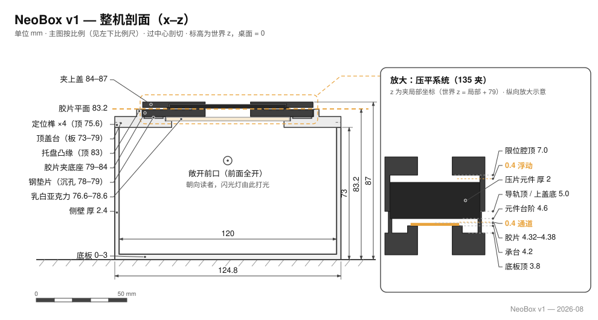

# 设计

[English](design.md) · **简体中文** · [日本語](design.ja.md)

> 每一个数字从哪里来，箱子为什么是这个形状，以及怎么修改源文件。这里的一切都读自 `cad/neobox.blend`。箱子已经打印并在用，但没有任何光学指标经过仪器测量。均匀度和压平数字都是设计目标。

尺寸单位是毫米，按宽 × 深 × 高写。`z` 是离桌面的高度。XY 位置从透光窗中心量起。

## 1. 光路



桌面，然后是完全敞开的前口，然后是 120 × 150 × 70 的白色混光腔，然后是顶盖台上 62 × 95 的透光窗，然后是 68 × 118 × 2 的乳白亚克力，顶面在 z 78.6，然后是 4.6 mm 的空气，然后是 z 83.2 的胶片平面。

闪光灯躺在桌面上，灯头对着敞开前口，水平发光。没有任何东西对着胶片。透光窗在混光腔的顶上，所以光大多在裸白 PLA 墙面上漫反射几次之后才到达它。窗到墙的距离，x 向 29 mm，y 向 27.5 mm，就是混光余量。它们取得很宽裕。没有确立过最小值。

## 2. 尺寸链

| STL | 颜色 | 尺寸 | 是什么 |
|---|---|---|---|
| `main-body.stl` | 白 | 124.8 × 154.8 × 75.6 | 3.0 底板，三面 2.4 的墙，前面敞开，侧墙顶上四个 2.4 × 12 × 2.6 的定位榫 |
| `cover-stage.stl` | 白 | 124.8 × 154.8 × 10.0 | 搁在墙上的 6 mm 板，带透光窗、亚克力暗槽、垫片沉孔和夹子托盘 |
| `film-holder-135-base.stl` | 黑 | 94 × 120 × 5 | 开窗 25 × 37，内导轨，带 4.6 元件台阶的外导轨 |
| `film-holder-135-lid.stl` | 黑 | 94 × 120 × 3 | 开窗 25 × 37，元件腔，8 个磁铁孔 |
| `film-holder-120-base.stl` | 黑 | 94 × 120 × 5 | 开窗 57 × 85，62 的滑槽，外导轨和台阶相同 |
| `film-holder-120-lid.stl` | 黑 | 94 × 120 × 3 | 开窗 57 × 85 |
| `pressure-window-135.stl` | 黑 | 64 × 95 × 2 | 插片，开窗 25 × 37 |
| `pressure-window-120.stl` | 黑 | 64 × 95 × 2 | 插片，开窗 57 × 85 |
| `mask-6x6.stl` | 黑 | 94 × 80 × 1 | 开窗 56.5 × 56.5，垫在 120 底座下面 |
| `slide-plate-135.stl` | 黑 | 94 × 120 × 5 | 方槽 51.4 × 51.4 × 2.0，开窗 26 × 38，两个指窝 |
| `cover-stage-4x5.stl` | 白 | 124.8 × 154.8 × 10.0 | 开窗 102 × 126，暗槽 107 × 131，托盘 112.6 × 138.6，没有垫片沉孔 |
| `sheet-plate-4x5.stl` | 黑 | 112 × 138 × 5 | 槽 102.2 × 127.6 × 2.0，开窗 97 × 121，两个边缺口 |

堆叠，桌面为 0：

| 层 | z |
|---|---|
| 主箱底板 | 0 – 3.0 |
| 混光腔 | 3.0 – 73.0 |
| 顶盖台板，台面在 79.0 | 73.0 – 79.0 |
| 乳白亚克力 | 76.6 – 78.6 |
| 钢垫片，与台面齐平 | 78.0 – 79.0 |
| 托盘凸缘 | 79.0 – 83.0 |
| 夹底座 | 79.0 – 84.0 |
| **胶片平面** | **83.2** |
| 压片元件 | 83.6 – 85.6 |
| 夹上盖 | 84.0 – 87.0 |
| 幻灯片板里的幻灯片 | 约 82.6 – 83.6 |
| 4×5 页片 | 约 82.2 |

**层高网格。** 每一个打印出来的 z 向特征，在它自己的打印朝向里都是 0.2 mm 的整数倍，而且没有任何暴露的水平台阶低于 0.4 mm。层高 0.2 mm 时每一级都正好落在层边界上，所以打印出来的 0.4 台阶就是真正的 0.4。`tools/verify_stl.py` 在每次导出时强制检查这两条。

| 零件，基准为贴床面 | z 分级 |
|---|---|
| 主箱 | 0 · 3.0 · 73.0 · 75.6 |
| 顶盖台 | 0 · 2.8 · 3.6 · 5.0 · 6.0 · 10.0 |
| 夹底座 | 0 · 2.2 · 3.8 · **4.2 承托** · **4.6 台阶** · 5.0 |
| 夹上盖，顶面朝下打印 | 0 · 1.0 · 3.0 |
| 幻灯片板和片板 | 0 · 1.0 · 3.0 · 5.0 |

## 3. 顶盖台

一块白色板，取代了原型机的顶盖、胶片台、三根螺杆、六颗螺母和三颗铜螺母。

| 特征 | 位置和尺寸 |
|---|---|
| 板 | 124.8 × 154.8，厚 6 mm，台面在 z 79.0。四角的榫槽深 2.8，套在 2.6 高的榫上，留 0.2 间隙。板坐在墙顶上。榫只在 XY 方向定位 |
| 透光窗 | 62 × 95，居中，贯穿板体 |
| 亚克力暗槽 | 69 × 119，深 2.4，槽底在 76.6。68 × 118 × 2 的板比台面低 0.4，永远没有东西碰到它 |
| 托盘 | 围着 94.6 × 120.6 夹座的一圈凸缘，高 4，顶在 83.0。它给胶片夹每边留 0.3 定位，顶面比胶片平面低 0.2，托住伸出的片尾 |
| 垫片沉孔 | 四个，10.6 见方，深 1.0，在 (±41, ±12)。10 × 10 × 1 的钢垫片齐平放入，给夹底座的磁铁当吸附面 |

## 4. 胶片夹

| 特征 | 135 | 120 |
|---|---|---|
| 底座和上盖 | 94 × 120，厚 5 和 3 | 相同 |
| 底座、上盖和插片的开窗 | 25 × 37 | 57 × 85 |
| 走片宽度 | 内导轨之间 35.4 | 滑槽壁之间 62.0 |
| 元件台阶 | 高 4.6，在 x 31 – 32.2，外侧台阶在 32.2 – 33.5 | 相同 |
| 磁铁 Ø8 × 2 | 底座 8 颗，上盖 8 颗 | 相同 |

开窗比标称画幅每边大约 0.5 mm，用来吸收相机片门和打印机的误差。片边在后期裁掉。

**压平。** 胶片平面就是承托的顶面。承托是四边围着开窗的一圈台阶，高出底座底面 4.2。胶片厚 0.12 – 0.18，所以它的上表面在 4.32 – 4.38。再往上一级网格是 4.6，元件台阶正好把元件的底面放在这里。结果是四边各有 0.4 的滑槽，元件下方有 0.22 – 0.28 的自由起伏。打印插片在开窗边缘限住起伏，剩下的由 1:1、f/8 时约 ±0.4 mm 的景深覆盖。防牛顿环玻璃盖住整个画幅，磨砂面朝下贴着光亮的片基。上盖的元件腔 64.8 × 96，顶在 7.0，给元件留 0.4 的浮动，从不压它。过片靠拉片头，所以元件装一次就不再碰。

**磁铁。** Ø8 × 2 N35，压入，不用胶。底座磁铁凸出板面 0.4，上盖磁铁与盖底齐平，所以两组磁面相距 0.8，上盖永远坐在打印的导轨顶上。

**幻灯片板。** 幻灯片框厚 1.2 – 3.2，永远进不了 0.4 的滑槽。这块板立在托盘里，代替 135 底座。它 51.4 的方槽能放最大 50.8 的纸框，每边留 0.3。2.0 的深度能扣住最薄的框。26 × 38 的开窗每边留 1 mm，这样框住画面的永远是框本身，而不是打印件。两个指窝深到 1.0 为止，是盲孔，不透光。

**4×5。** 4×5 顶盖台带 102 × 126 的开窗、放 106 × 130 × 2 板的暗槽和 112.6 × 138.6 的托盘。片板用 102.2 × 127.6 的槽接住 101.6 × 127 的页片，槽下是 97 × 121 的开窗。0.25× 时 f/8 的景深大约 8 – 10 mm，所以没有压片元件。开窗离箱壁只有 9 和 12 mm，而不是 29 和 27.5。这会不会表现成渐变还不知道。平场校正是第一个办法。留足余量的大箱子，外形约 164.8 × 185.8，是第二个。

## 5. 为什么是这样

- **闪光灯留在箱外。** 早期版本把它封在箱内，箱子只能围着一款闪光灯定尺寸，还要抽口、过线孔和通风。用打印出来的原型机手持测试，发现闪光灯只是举在箱口，窗口照样均匀。敞开前口把这些全都去掉了。代价是室内光，而在昏暗的房间里脉冲远远盖过它。
- **一块扩散板。** 两块扩散板中间留混光空间是教科书做法，要多出约 43 mm 的高度。一块板紧贴胶片下方是作者自己用灯板的做法，打印出来的箱子证实了它。
- **裸白混光腔。** 哑光白耗材本身就是混光面。里面没有反射板、挡板或任何调节件，因为每一个内部零件都是多一件要对齐的东西。丝绸或亮面白料会把灯头映成一块亮斑。
- **扩散板以上全黑。** 胶片夹、插片和板都是黑的，杂光被吸收，不会反射回胶片上。
- **没有调平五金。** 唯一要紧的平行是胶片对传感器。放在胶片夹上的镜子和相机自己的倒影量的正是这个，而且这一步吸收了下面所有打印公差。箱子上的螺杆只能调平箱子。
- **塑料上没有螺纹。** 每一处连接都是榫入槽、重力或磁铁。打印螺纹会蠕变，原型机的铜螺母和螺杆只是为了伺候螺纹而存在。
- **0.2 mm 网格。** 打印店发现 0.5 mm 的台阶会切成两层半。所有 z 向特征重新量化，剩下的 0.2 台阶加倍到 0.4，因为单层打不准高度。
- **插片平台。** 压条、每格都要掀的玻璃盖和海绵压紧的元件都考虑过。保留台阶加元件的做法，是因为操作成本落在每次开工，而不是每一格，而且从不触碰的零件不会跑位。
- **单独的幻灯片板。** 在 135 底座上挖方槽会去掉承托，而承托就是整个压平系统。
- **4×5 作为实验。** 两个件加一次亚克力裁切，先弄清现有箱体能做到哪里，再去推导更大的箱子。
- **为什么用闪光灯。** 脉冲就是快门，光谱是连续的，每一格得到同样的光。光谱的论证和图在 README 里。
- **否决的。** LED 面板能把箱子缩到约 4 升，但失去有效快门和光谱两条理由。与主箱一体的顶盖需要在 202 × 267 的顶面上加支撑才能打。通风孔就是漏光孔，低占空比的闪光灯也不需要。

## 6. 闪光灯与曝光

只用手动出力，普通同步，拍 raw。TTL 和 HSS 在这里没有用。快门停在 1/125 s，因为焦平面快门的同步速度是 1/160 – 1/250，廉价的 2.4 GHz 引闪器又要吃掉约一档。全电子快门通常根本不会触发闪光灯。TT560 的发光面 60 × 45，中心离桌面 31，完全在 70 mm 的开口之内，但箱子没有任何尺寸依赖它。

## 7. 相机筒

一个打印的支架，在 135 和 120 下代替翻拍台。已经建模并校验，还没打印，没有发布任何相机筒的 STL。

底座立在 135 夹上盖上，靠八颗 Ø8 × 2 磁铁吸住，磁铁孔正对夹上盖自己的磁铁，往上收成 Ø84 的承口，对应 60 mm 的工作距离。每支镜头一根载筒，在承口里转动，通过买来的转接环托住镜头的滤镜螺纹，再用第二只环从下面夹紧。载筒的高度是镜头工作距离减 60，最少 6.4。两处 0.6 mm 的倒角保护贴床面的配合不被象足卡死，`--coupon` 会多写出两件约 10 g 的试片，先验证转动配合再打底座。整套头重脚轻。640 g 的机身加 300 g 的镜头，整堆约 1.4 kg，重心高约 195 mm，在相机处推约 3 N 就会倒。用快门线。载筒超过约 150 mm 就该回到翻拍台。

```
blender --background cad/neobox.blend --python tools/camera_tube.py -- --ring 62-67 --ring-od 69 --ring-h 4.5 --wd 141 --coupon --out out/
python3 tools/verify_stl.py out/*.stl
```

`--ring` 是转接环，镜头那端的口径在前。`--ring-od` 和 `--ring-h` 是环体的外径和高度。`--wd` 是你在所用倍率下量到的工作距离：在取景器里放一把尺子，135 让 36 mm 占满长边，然后量镜头前圈到尺子的距离。1:1 时公开的工作距离，只供参考：索尼 FE 90 mm Macro 130 – 132，Sigma 105 mm DG DN 141，Tamron 90 mm 86 – 90，Laowa 100 mm 100，尼康 Z MC 105 mm 130 – 134，Laowa 85 mm f/5.6 实测 96。APS-C 机身要 0.65×，再加约 40 – 55 mm。

## 8. 修改源文件

`cad/neobox.blend` 需要 Blender 3.0 以上，最后一次用 5.2 存盘。一个 Blender 单位是一毫米，桌面是 z = 0。装配体就位建模，相机筒立在 135 夹上盖上。120 那副夹子停放在 x = 200，6×6 遮幅插片在 x = 350，幻灯片板在 x = 500，4×5 套件在 x = 650。

打印件的名字就是它生成的 STL 文件名，主箱是四片带 `main-body_` 前缀的壳体。其余都是带 `mock_` 前缀的示意件：闪光灯、接收器、光路箭头、胶片条、亚克力、玻璃、垫片、一个标签，以及相机筒的环、镜头和机身。相机筒零件本身带 `camera-tube-`、`lens-column-` 和 `lens-carrier-` 前缀，不导出。`tools/export_stl.py` 遇到不属于这几类的网格就会失败，所以新零件不可能悄悄从发布里漏掉。

零件按互相咬合的壳体建模。导出脚本把每个零件并成一个实体，焊掉碎片，检查水密，再按世界坐标写出：

```
blender --background cad/neobox.blend --python tools/export_stl.py
python3 tools/verify_stl.py
```

校验脚本检查水密、0.2 网格、0.4 最小台阶，以及它 `EXPECTED` 表里发布的外形尺寸。改了发布尺寸就在同一次提交里改 `EXPECTED`。重新生成的文件可能与发布的文件逐字节不同，但几何完全一致。图纸由 `tools/drawings/` 里的脚本重新生成。`cad/` 里的 DXF 文件与现在的设计无关，只是留作历史。

---

← [README](../README.zh-CN.md) · [贡献指南](../CONTRIBUTING.md)
