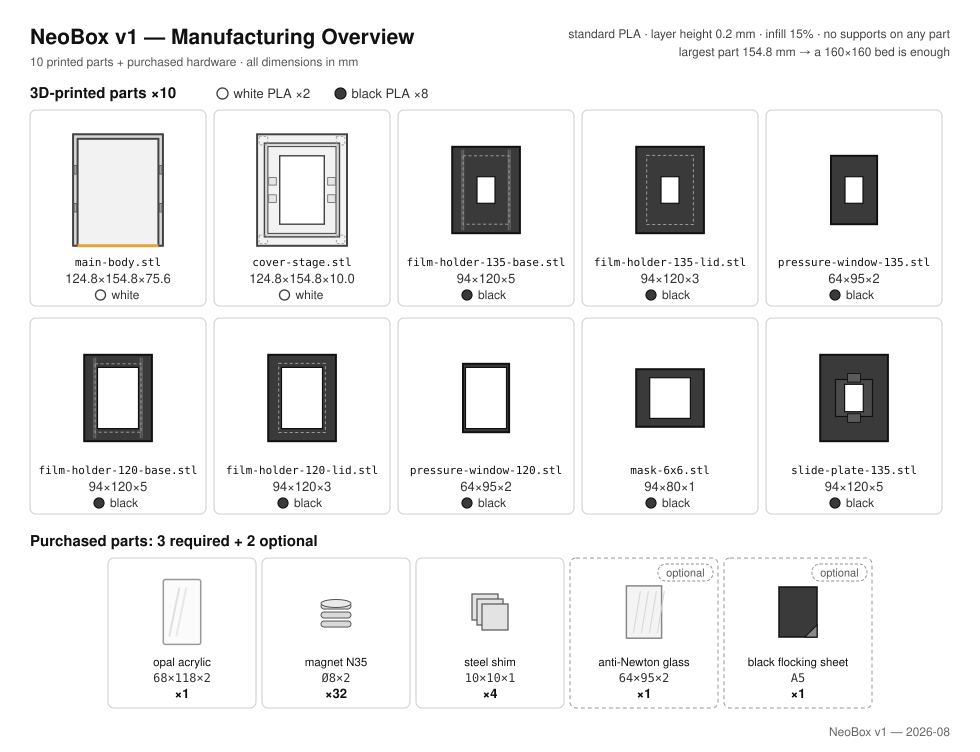
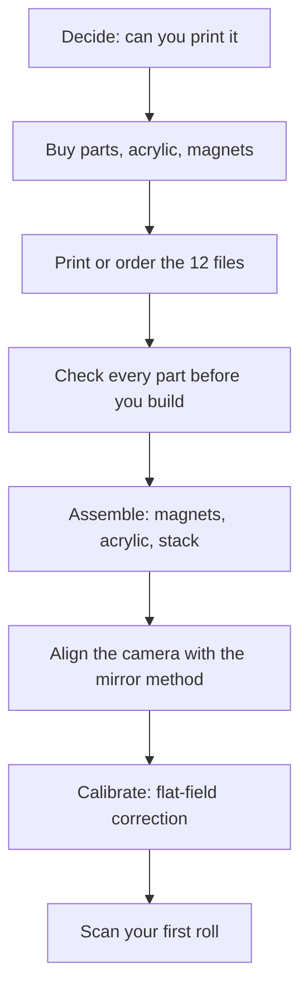

# Getting started

**English** · [简体中文](getting-started.zh-CN.md) · [日本語](getting-started.ja.md)

> Read this before you spend anything: what NeoBox is, whether you can build it, what you must already own, what it costs, how long it takes, and the order to do it in.

**Contents:** [Is this project for you?](#is-this-project-for-you) · [What camera scanning is](#what-camera-scanning-is) · [What you must already own](#what-you-must-already-own) · [What it costs and how long it takes](#what-it-costs-and-how-long-it-takes) · [The road map](#the-road-map) · [Skills you need](#skills-you-need) · [FAQ](#faq) · [Where to look things up](#where-to-look-things-up)

---

## Is this project for you?

NeoBox is a box you 3D-print. It sits under your camera and turns a flash into an even light source, so you can photograph, or [camera-scan](glossary.md#camera-scanning), your film. It takes 35 mm and 120 negatives up to 6×9, and with the optional parts also mounted 135 slides and 4×5 sheets. The assembled stack has a 124.8 × 154.8 mm footprint and is 87 mm tall. It lives on a desk.

A bare speedlight (a hot-shoe flash) lies flat on the desk. Its head rests against the box's fully open front, and it fires horizontally into the white [cavity](glossary.md#integrating-cavity). Nothing points at the film. The light bounces off the white walls several times. Then it leaves upward through a 62 × 95 mm window and one [opal](glossary.md#opal) acrylic [diffuser](glossary.md#diffuser) directly under the film. The open front also lets room light in. Work in a dim room and keep ceiling lights from shining into the opening. The flash pulse is far stronger than anything the room adds.

The whole build is smaller than it sounds:

- **12 printed parts** (three white, nine black). The 6×6 mask, the slide plate and the two 4×5 parts are optional. All twelve STL files print without supports, each with its flat face down.
- **1 opal acrylic diffuser**, 68 × 118 × 2 mm. It drops into a pocket in the cover-stage.
- **32 magnets and 4 steel washers**: Ø8 × 2 mm N35 disc magnets pressed into the film holder parts, and 10 × 10 × 1 mm washers that sit flush in the cover-stage.
- **No screws, threads, glue or tools.** Gravity and magnets hold the box together. You level the camera, and there is nothing to adjust on the box.

> [!IMPORTANT]
> This is the first release. The dimensions have been checked in the Blender source file. All twelve STL files are watertight single solids, and every horizontal face lies on the 0.2 mm grid. The author has printed the box and uses it for scanning, and friends have used it with their own flashes and film. **Nothing has been measured with instruments yet.** The evenness and flatness figures in these documents are design targets.

**Build it if you** already shoot film, own a camera you can put on a stand, and want [base-ISO](glossary.md#base-iso), f/8 captures where vibration does not matter. You also need to be happy to print the parts and press in some magnets. There is nothing to screw, solder or glue.

**Do not start if you** have neither a 3D printer nor access to a print service. Every structural part is printed, and the released files offer no other way to make them. 4×5 is possible on the same body, with a caveat about evenness. See the [FAQ](#faq).

> [!WARNING]
> **Build-plate go/no-go.** The two largest parts, `main-body.stl` and `cover-stage.stl`, each have a 124.8 × 154.8 mm footprint. So a 160 × 160 mm [bed](glossary.md#bed-size), the printer's build plate, prints the entire set, and any current desktop printer is big enough. Nothing needs supports. The one orientation rule is that the two holder lids print top face down, and every other part prints flat bottom down. If you cannot get access to a 160 × 160 mm bed, line up a print service before you spend anything else.

Settle three things before you spend any money:

- [ ] Can you use a 160 × 160 mm bed, your own or a print service's, for parts with a 124.8 × 154.8 mm footprint?
- [ ] Do you own, or will you buy, a hot-shoe speedlight with **manual power control**? Any brand will do. It sits outside the box.
- [ ] Do you own a macro-capable lens, and something that holds the camera above the box, pointing straight down?

If all three are yes, continue to the [bill of materials](bom.md#tools-and-consumables). If the first is no, stop here.

## What camera scanning is

Camera scanning means photographing a backlit negative with a digital camera instead of running it through a scanner. The film sits in a holder above an evenly glowing surface. The camera looks straight down at it. Afterwards you [invert](glossary.md#inversion) the [raw](glossary.md#raw) file, which turns the negative into a positive.

Compared with a flatbed scanner, you trade setup work for speed. Lining everything up takes an evening, but after that each frame is one press of the shutter. Compared with a lab scan, you keep the negative in your own hands, and every colour decision stays yours.

NeoBox is only the light source half of that setup. It replaces the light pad, and the choice of camera is yours. The camera half is real work too, and it is written up in [scanning](scanning.md#camera-side-equipment).

## What you must already own

Nothing below is a printed part. The flash and the trigger appear in the [bill of materials](bom.md#tools-and-consumables) as reference picks. Everything else you must already have, and this project does not count its cost.

| You need | Why | Cost |
|---|---|---|
| A camera with manual exposure and raw | You set the exposure by hand, and it never changes across a roll | not costed here |
| A macro-capable lens | Filling a full-frame sensor with a 135 frame needs 1:1 [magnification](glossary.md#magnification-ratio). Any 1:1 macro lens covers every format this box handles, because the larger formats need less magnification | not costed here |
| A [copy stand](glossary.md#copy-stand), or a tripod with a horizontal or reversible column | The film plane sits 83.2 mm above whatever the box stands on. The camera must hang above that, square to it | not costed here |
| A hot-shoe speedlight with manual power control | The light source. It lies flat on the desk with its head at the open front and never enters the box. Any brand fits, and the NEEWER TT560 is only the reference pick | see the bill of materials |
| A radio trigger set | The transmitter goes on the camera hot shoe. The receiver stays outside with the flash, so the signal is never boxed in and you change batteries without touching the box. Reference pick: ZENIKO T1 | see the bill of materials |
| A remote release | Keeps your hand off the camera between frames | not costed here |
| Inversion software | Turns the raw capture into a positive | not costed here |
| A rocket blower and a small flat mirror | The blower keeps film (and the optional glass) free of dust. The mirror is the levelling tool. You centre the reflection of your own lens in it | listed in [bom](bom.md#tools-and-consumables) |

> [!NOTE]
> The camera side is deliberately not priced. A macro lens and a stand can cost nothing, if you already own them, or more than the rest of the project combined. Any figure quoted here would be made up. Make sure you have them before you order parts.

Only one thing decides whether a flash is suitable: **manual power control**. Its size does not matter, and the head does not need to tilt or swivel, because the flash simply lies at the opening. [TTL](glossary.md#ttl) and [HSS](glossary.md#hss) are useless here, so do not pay for them.

## What it costs and how long it takes

All prices are in one place, the [bill of materials](bom.md#tools-and-consumables). This page only sorts the spending into groups:

| What you are buying | Cost |
|---|---|
| Everything structural: twelve PLA parts, the opal acrylic sheet, 32 magnets, 4 steel washers | priced in the bill of materials |
| A speedlight (any hot-shoe model with manual power control) | reference pick priced in the bill of materials |
| A radio trigger set | reference pick priced in the bill of materials |
| Optional upgrades: anti-Newton glass and flocking sheet | priced in the bill of materials |
| Camera, lens, stand, release, software | not costed here |

Printing is a small job. Nothing is longer than 154.8 mm, plain PLA is fine, and no part needs supports. Print with 0.2 mm layers and 15 % infill.

| Stage | Typical elapsed time | Notes |
|---|---|---|
| 3D printing, at home or from a service | days | usually the critical path, the step everything else waits for. Two colours, no supports to remove |
| Opal acrylic cut to size | days | 68 × 118 × 2 mm custom cut. A prototype-era 110 × 130 mm sheet can be cut down and reused |
| Magnets and washers | usually the fastest order | stock sizes, nothing custom |
| Assembly | minutes | no tools. Pressing in the 32 magnets is most of the work |
| First set-up | an evening | level the camera with the mirror, then check evenness |

> [!TIP]
> The three orders have very different lead times, so place all three on the same day. The printing is almost always the critical path.

## The road map

| Step | What actually happens | Written up in |
|---|---|---|
| Decide | Bed size (160 × 160 mm is enough), whether you have a flash, what else you already own | this page |
| Buy | Parts and consumables, what to tell the vendors, what to check when the orders arrive | [bom](bom.md#tools-and-consumables) |
| Print | Twelve STL files in plain PLA: 0.2 mm [layers](glossary.md#layer-height), 15 % infill, no supports | [printing](printing.md#ordering-from-a-print-service) |
| Check parts | Measure before you build. A wrong part found now costs one reprint. Found later, it costs the whole build | [printing](printing.md#check-each-part-before-you-assemble) |
| Assemble | Press 32 magnets into the holder parts, drop the acrylic and washers into the cover-stage, stack everything, no tools | [assembly](assembly.md#assembly-steps) |
| Align | Lay a small mirror on the film plane and move the camera until the reflection of its own lens is centred. You adjust the camera, and the box has no adjustment | [assembly](assembly.md#step-7--level-at-the-camera-the-mirror-method) |
| Calibrate | Photograph the empty glowing window and apply [flat-field correction](glossary.md#flat-field-correction) before you judge evenness | [scanning](scanning.md#flat-field-and-inversion) |
| First roll | Camera height, focus, flash power, loading film, shooting, inverting | [scanning](scanning.md#loading-film) |
| Something is wrong | Symptom → likely cause → fix, for every stage | [troubleshooting](troubleshooting.md#printing) |

## Skills you need

Nothing exotic. A slicer is the program that prepares a model for the printer. If you can follow its default profile and keep your hands clean around film, you can build this. There is no screwdriver, spanner, soldering iron or glue anywhere in the build, and no CAD work at all. The design is not tied to any flash model.

Two steps catch people out. Both are worth reading twice before you reach them:

**Magnet polarity.** Thirty-two Ø8 × 2 mm magnets go into the holder parts, eight per part. They are press-fits, which means a magnet is not meant to come back out once it is in. Every magnet must attract its partner in the mating part. So before you press a magnet home, hold it up to the partners already seated and check that it attracts them.

**Parallelism.** The film plane must be parallel to the camera's sensor. Horizontal alone is not enough, and in this design nothing on the box adjusts. Lay a small flat mirror where the film goes. Move the camera until the reflection of its own lens sits dead centre in the frame. At that point the sensor is parallel to the film plane, and the same move has absorbed every tolerance in the printed parts underneath. Do parallelism first and evenness second.

Why the design uses a flash instead of a continuous LED panel

The flash pulse **is** the exposure. In a dim room, the light it sends through the cavity dwarfs any room light that comes in through the open front. The pulse is also over in a small fraction of any real shutter time, so vibration, shutter shock and floor rumble stop mattering.

Other benefits follow from the same choice. Every frame receives identical light, so one inversion profile fits the whole roll. Base-ISO, f/8 shooting is the design's working point. And a xenon flash tube gives a genuinely continuous, daylight-balanced spectrum.

## FAQ

**Has anyone built one?** Yes. The author has printed this geometry and has been scanning 135 and 120 film with it. Friends have run it with their own flashes and film. The 6×6 mask, the slide plate and the 4×5 stage have been printed and used too. Nobody has measured it with instruments yet. The evenness and flatness figures in these documents are design targets from the CAD. The optical claims are reasoned out, then confirmed by eye and in the inverted scans. They have not been metered.

**Can I use an LED panel instead of a flash?** Not with the released files. No LED version is published, and the reasons against one are in the collapsed block above. The optional LED strip in the bill of materials is only a positioning light. It never provides the exposure.

**Will my flash fit?** Yes. The flash never enters the box. It lies flat on the desk with its head at the fully open front, so its size does not matter. Any hot-shoe speedlight with manual power control works. The NEEWER TT560 is only the reference model the light path was designed around.

**Do I need the magnets?** Yes, all 32, plus the 4 steel washers. Eight magnets in each lid pull against eight in each base and clamp the holder shut. The base magnets also grip the washers set flush in the cover-stage. That is what holds the holder to the cover-stage and makes the five-second format swap possible. Without them, everything merely rests under its own weight.

**Can I print this on a 220 × 220 mm build plate?** Yes, the entire set, with room to spare. No part has a footprint larger than 124.8 × 154.8 mm, so even a 160 × 160 mm bed is enough. No part needs supports.

**Do I need the anti-Newton glass?** No. The default pressure element, the part that holds the film flat, is a printed insert, one per format. The window edges act as hard limits, so the film cannot bow more than 0.28 mm. That is inside the roughly ±0.4 mm depth of field at 1:1, f/8. The anti-Newton glass (64 × 95 × 2 mm, one sheet shared by both formats) is an upgrade that covers the whole frame continuously. Its matte face rests on the glossy base side of the film, so there are no [Newton rings](glossary.md#newton-rings). The emulsion side faces the open window below and touches nothing.

> [!CAUTION]
> With the glass in place, its underside sits 0.2 mm from the focal plane, so a dust speck there lands in the image. The glass goes in once and stays, so blow it clean before it goes in. Dust on the opal acrylic never shows in the image. It lies on the glowing surface itself, and an occasional wipe is enough.

**Does it do 4×5?** Yes, with two optional parts, a larger acrylic sheet and one caveat. `cover-stage-4x5.stl` replaces the cover-stage on the same main body. It has a 102 × 126 mm light window and a recess for a 106 × 130 × 2 mm opal sheet. `sheet-plate-4x5.stl` stands in its tray and holds the sheet of film in a 102.2 × 127.6 mm pocket over a 97 × 121 mm window. It has no lid and no glass, because at 4×5 magnification the depth of field covers any curl. The caveat is evenness. The window sits 9 and 12 mm from the cavity walls, where v1 has 29 and 27.5, and nothing has been measured, so shoot a blank frame first. See [Design § 10](design.md#10-45-on-the-v1-body) and [4×5 sheets](scanning.md#45-sheets).

**Does it do mounted slides?** Yes, with the optional slide plate. The 135 channel is 0.4 mm high and sized for bare strips, so a mount never goes into the holder. Instead `slide-plate-135.stl` stands in the tray in the holder's place. Its 51.4 mm square pocket takes card, plastic and glass mounts over a 26 × 38 mm window. It has no lid and no magnets. The pocket locates the mount and gravity holds it. See [Mounted slides](scanning.md#mounted-slides). Unmounted transparencies go through the 135 holder like any strip.

**How do I advance film, and switch formats?** Advance by pulling. Grip the strip where it leaves the holder and draw it through. The pressure element flattens any arch as the film slides under it, and you never open the holder mid-roll. To switch formats, lift one holder off and set the other down. The magnets locate it, and it takes about five seconds. For 6×6, lay the mask under the 120 base. The holder then rides 1 mm higher, which is normal. 6×4.5 has no dedicated mask, so crop the frame afterwards. A long strip's tail rests on the tray flange just below the film plane, so support its far end with your hand. Loading and handling are covered in [scanning](scanning.md#loading-film).

## Where to look things up

This project uses words from three different trades (film photography, optics and FDM printing) and often mixes them in one sentence. Every term is defined once, in one line, in the [glossary](glossary.md#camera-scanning).

Go there whenever a word stops you: [integrating cavity](glossary.md#integrating-cavity), [flat-field correction](glossary.md#flat-field-correction), [sync speed](glossary.md#sync-speed), [guide number](glossary.md#guide-number), [supports](glossary.md#supports), [layer height](glossary.md#layer-height), [working distance](glossary.md#working-distance), [Newton rings](glossary.md#newton-rings), [base ISO](glossary.md#base-iso), [EV](glossary.md#ev).

If you want to know why a dimension is what it is, the [design](design.md#3-optical-decisions) document holds the engineering reasoning, and the design log records what was tried and rejected.

---

← [README](../README.md) · [Documentation index](../README.md#documentation) · [Bill of materials](bom.md) →
