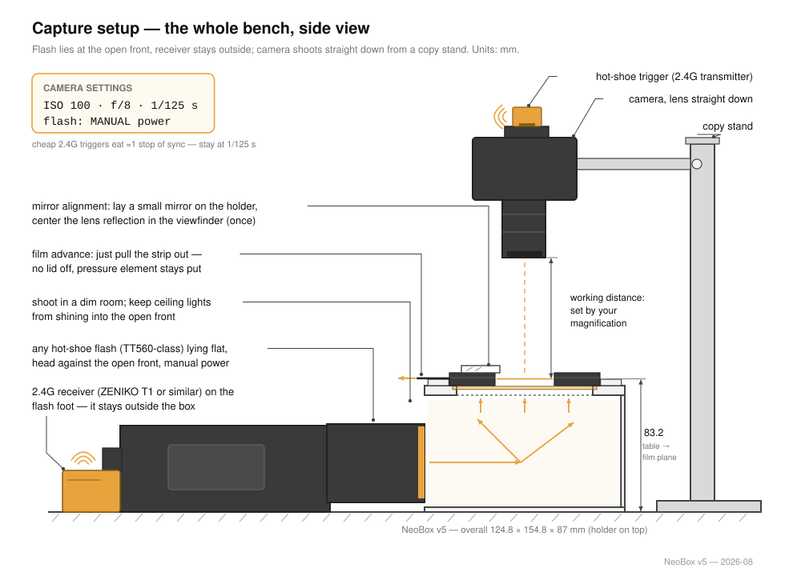
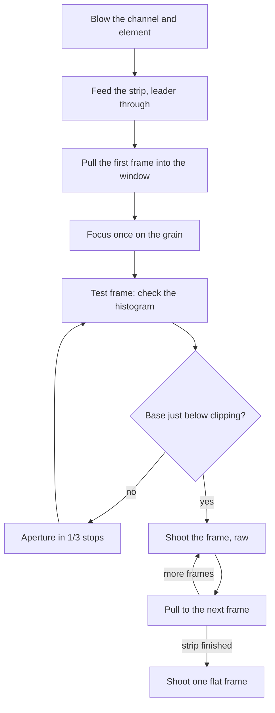

# Scanning

**English** · [简体中文](scanning.zh-CN.md) · [日本語](scanning.ja.md)

> The camera half of the project: what goes above the box, how to set the camera parallel to the film, how to focus and expose, how to load and advance film, and what to do with the raw files afterwards.

**Contents:** [Before you start](#before-you-start) · [Camera-side equipment](#camera-side-equipment) · [Magnification and lens choice](#magnification-and-lens-choice) · [Camera height and the stand](#camera-height-and-the-stand) · [The camera tube](#the-camera-tube) · [Parallelism](#parallelism) · [Focus](#focus) · [Exposure](#exposure) · [Loading film](#loading-film) · [Mounted slides](#mounted-slides) · [4×5 sheets](#45-sheets) · [Shooting a roll](#shooting-a-roll) · [Flat-field and inversion](#flat-field-and-inversion) · [When something looks wrong](#when-something-looks-wrong)

## Before you start

NeoBox is a light source for [camera scanning](glossary.md#camera-scanning): you photograph the film with a digital camera instead of feeding it through a scanner. The box lights a 62 × 95 mm window evenly through an opal-acrylic diffuser. The film strip is held flat 4.6 mm above that diffuser. Everything that turns the lit film into a file happens on the camera side, and none of it comes with the project.

Work through this list before you set a camera up:

- [ ] The main body stands on the desk. The cover-stage sits on the wall tenons, the opal acrylic lies in its recess, and the protective film is peeled from **both** faces.
- [ ] The four steel shims sit flush in their pockets in the cover-stage.
- [ ] The flash lies flat on the desk with its head at the fully open front, firing into the cavity. Any hot-shoe flash works here. The T1 receiver stays with the flash, outside the box.
- [ ] The film holder for your format sits inside the tray flange. Its pressure element sits in its ledge: the pressure-window insert by default, or the AN glass for badly curled rolls.
- [ ] The room is dim, and no ceiling light shines straight into the open front.
- [ ] You have blown the channel and the pressure element clean with a rocket blower. In glass mode, you have also blown both faces of the glass before it went in.

> [!NOTE]
> The box has been printed and used, but this page was written from the design. Nothing below is a published measurement. The exposure figures are starting points to bracket from. Do not read them as predictions.

## Camera-side equipment

| Item | What it does here | What actually matters |
|---|---|---|
| Camera body | Records the frame | Manual exposure, raw files, live view with magnification, a hot shoe, and a **mechanical shutter** (or [EFCS](glossary.md#efcs) that still fires flash) |
| Macro-capable lens | Fills the sensor with the frame | Enough magnification for your format (see the table below) |
| [Copy stand](glossary.md#copy-stand), or a tripod with a horizontal or reversible column | Holds the camera still, parallel to the film, and directly over the light window | Rigidity first, then enough column height |
| Trigger transmitter | Fires the receiver on the flash, outside the box | Must pair with the receiver you bought. It goes on the camera hot shoe |
| Remote release, or the self-timer | Keeps your hand off the camera | Anything that trips the shutter without touching the body |
| Inversion software | Turns a raw negative into a positive | Covered in [Flat-field and inversion](#flat-field-and-inversion) |
| Small flat mirror, about 30 mm | Sets the sensor parallel to the film plane | Flat, and small enough to sit on the holder |
| Rocket blower · cotton gloves or clean hands | Dust and fingerprints | Listed with the other consumables |

None of this is included in the build cost, and neither is the flash. The wider list is in [what you must already own](getting-started.md#what-you-must-already-own). The mirror, blower and gloves are in [tools and consumables](bom.md#tools-and-consumables).

The transmitter goes on the camera's hot shoe. The receiver stays on the desk with the flash, outside the box. Both must be on the same channel, and both need charge. An unpaired channel and a flat receiver battery are common causes of a black frame. Check the shutter type first, though. See [Exposure](#exposure).



## Magnification and lens choice

[Magnification ratio](glossary.md#magnification-ratio) is the size of the image on the sensor divided by the size of the subject. At 1.0× the frame lands on the sensor at life size. At 0.5× it covers half as much sensor in each direction.

Magnification needed to fill the sensor with the frame (approximate, for choosing a lens):

| Format | Frame | Full frame (36 × 24) | APS-C (23.5 × 15.6) |
|---|---|---|---|
| 135 | 36 × 24 | 1.0× (a 1:1 macro lens) | 0.65× |
| 6×4.5 | 56 × 41.5 | 0.58× | 0.38× |
| 6×6 | 56 × 56 | 0.43× | 0.28× |
| 6×7 | 56 × 70 | 0.43× | 0.28× |
| 6×9 | 56 × 84 | 0.43× | 0.28× |
| 4×5 | 96 × 120 | 0.25× | 0.16× |

Any 1:1 macro lens covers every row in this table. For the larger formats you simply use less than full magnification. The demanding case is 135 on full frame, which needs the full 1.0×.

What matters with dust is which surface it lands on. Magnification makes no difference. A particle on the acrylic diffuser does not show in the image at all. The diffuser is itself the glowing surface, so anything sitting on it just becomes part of the light. Wipe it now and then. Dust at or near the film plane does show: dust on the film itself, always, and in glass mode dust on the underside of the AN glass, which sits only 0.2 mm from the film. That is why you blow the glass before it goes in, and why you blow the [film gate](glossary.md#film-gate) and channel before every strip. The optical reasoning is in [Design](design.md#3-optical-decisions).

## Camera height and the stand

The film plane sits at **83.2 mm above whatever surface the box stands on**. The design fixes that height, and it is the same for 135 and 120 film. Both holders present the film at the same level, so you do not re-level anything when you change format. The exceptions are small: the 6×6 mask lifts the 120 holder by 1 mm, a mounted slide sits at about 82.6 – 83.6 and a 4×5 sheet at about 82.2. That is normal. Refocus and carry on. What does change a lot at 4×5 is the working distance. A 100 mm macro at 0.25× wants its front element roughly half a metre above the film. Check that the column reaches that high, or use a 50 – 60 mm macro, which halves that distance.

Camera height follows from two numbers:

```
lens front to desk = 83.2 mm + the lens's working distance at the magnification you need
```

[Working distance](glossary.md#working-distance) is a property of your lens. The box does not change it. Look it up or measure it, then check the stand:

| Check before you buy or commit | Why |
|---|---|
| Column travel reaches 83.2 mm + working distance, measured from the baseboard | A macro lens at 1:1 can want far more height than a copy stand's normal range |
| The head does not sag when you let go | Sag shows up as a slow focus drift across a roll |
| The baseboard is comfortably larger than the box footprint of 124.8 × 154.8 mm, with clear desk in front for the flash | The box has to sit straight, the flash has to lie at the open front, and your hands still need room |
| The lens axis can reach the centre of the light window without the column hitting the box | A reversible-column tripod often puts a leg exactly where the box needs to stand |

Once the height is right, record it so you can come back to it. Mark the box's footprint on the desk or mat, with two locating pins or simply tape, and write down the column height for each format. Only the magnification changes between formats. The film plane does not move. If you have to move the box, lift it level. The assembled stack is held together by gravity and magnets. There are no fasteners.

## The camera tube

The camera tube is a printed alternative to the stand, for 135 and 120. It stands on the 135 holder lid, and the lid's own 8 magnets hold it down. It carries the lens by its filter thread, at the working distance your magnification needs. The camera body never touches the tube, so it makes no difference whether the body is a Sony, a Canon, a Nikon or a Fujifilm. Only two things about the lens matter: its filter thread, and its [working distance](glossary.md#working-distance) at the [magnification](#magnification-and-lens-choice) you scan at.

> [!NOTE]
> The tube is still a design in progress. It has been modelled and checked, but not yet printed. Its geometry lives in the Blender source, and `tools/camera_tube.py` generates the parts from four numbers you measure. No tube STL is published yet.

There are three printed parts. Every face sits on the 0.2 mm layer grid, and each part prints top face down without supports:

| Part | What it is | Who prints it |
|---|---|---|
| `camera-tube-base` | A skirt that wraps the lid, 8 magnet pockets right above the lid's magnets, and a 58.4 mm tapered section up to a Ø84 socket. On its own it gives 60 mm of working distance | Everyone, once |
| `lens-column-<ring>-h<H>` | A Ø94 tube. Its spigot turns in the base's socket, and the ring pocket is on top. H = working distance − 60 | One per lens |
| `camera-tube-spacer-<L>` | A riser with the same joint at both ends, for a second magnification with the same lens | Optional |
| `camera-tube-coupon-socket` · `-spigot` | The turning joint on its own, written with `--coupon`: the base's socket and the column's spigot, about 10 g each. They prove the fit on your printer before you spend a whole base on it | Optional, once per printer |

Two bought step-up rings hold the lens. The first screws into the lens and sits in the column's pocket. The second screws into the first from below, and clamps the column's 1.2 mm lip between them. Nothing threads into plastic. The column still turns in the base, so you line the frame up with the sensor by turning the lens. The box stays where it is. The height is built in, so there is nothing to record. Check parallelism with the mirror all the same.

Fit the rings to the column before the lens. The step-up ring drops into the pocket from above. The clamp ring goes up through the column from below and screws into the step-up ring. The lens then screws onto the thread the ring presents, as it would onto a filter. With a long column you cannot reach the clamp ring once the lens is on. Nothing locks the rotation. The column turns in its socket under friction alone, and by estimate it gives way to a push of about 1.3 N at the camera. So set the angle, pencil a mark across column and base, and fire with a remote release. Never fire with a finger on the body.

**Measure, do not look up.** Working distance at a given magnification is a property of the lens, and spec sheets rarely state it. Mount the lens. Set the magnification with a ruler in the viewfinder: 36 mm fills the long side for 135 film, 56 mm fills the short side for 120 film. Then measure from the front rim of the lens to the ruler. That number minus 60 is the column height. For orientation, here are the lenses people scan with, at the magnification 135 needs on that body. The figures come from maker specifications and reviews:

| Body | Lens | Filter | Working distance, mm | Column H |
|---|---|---|---|---|
| Sony E, full frame, 1.0× | FE 90 mm F2.8 Macro G | 62 | 130 – 132 | 70 |
| | Sigma 105 mm F2.8 DG DN Macro Art | 62 | 141 | 81 |
| | Tamron 90 mm F/2.8 Di III Macro VXD | 67 | 86 – 90 | 26 – 30 |
| | Laowa 100 mm f/2.8 2× Ultra Macro | 67 | 100 | 40 |
| | Voigtländer 110 mm f/2.5 Macro APO-Lanthar | 58 | 170 | 110 |
| | FE 50 mm F2.8 Macro | 55 | 45 | below the base: about 0.8× on the bare base, or a base printed at 50 |
| Canon RF, full frame, 1.0× | RF 100 mm F2.8 L Macro | 67 | 86 at 1.4×, 1:1 not published, measure | about 45 – 50 |
| | EF 100 mm f/2.8L Macro on the adapter | 67 | 133 | 73 |
| Nikon Z, full frame, 1.0× | Z MC 105 mm f/2.8 VR S | 62 | 130 – 134 | 70 – 74 |
| | Z MC 50 mm f/2.8 | 46 | 56 – 57 | 0: a column with no riser on the bare base, about 0.95× |
| | Tamron 90 mm F/2.8 Di III Macro VXD | 67 | 86 | 26 |
| | AF-S Micro 105 mm f/2.8G VR on the FTZ | 62 | 139 – 151, sources disagree, measure | about 80 – 90 |
| | AF-S Micro 60 mm f/2.8G on the FTZ | 62 | 48 – 50 | below the base, as the FE 50 |
| Fujifilm X, APS-C, 0.65× | XF 80 mm F2.8 R LM OIS WR Macro | 62 | 102 at 1:1, about 140 at 0.65×, measure | about 80 |
| | Laowa 65 mm f/2.8 2× Ultra Macro | 52 | 52 at 2×, about 115 at 0.65×, measure | about 55 |
| | XF 30 mm F2.8 R LM WR Macro | 43 | 12 at 1:1, about 25 at 0.65× | too short for any base |
| Leica M and others, full frame, 1.0× | Laowa 85 mm f/5.6 2× Ultra Macro APO | 46 | 96, measured | 36 |

An APS-C body on any of these mounts needs 0.65× instead of 1.0×. That adds roughly 40 – 55 mm to every working distance above. A 120 frame on full frame needs 0.43×, which adds about 100 – 130 mm. That is what the spacer is for.

What the tube cannot do: a lens whose working distance is below 60 mm cannot reach its full magnification on the bare base. It still scans at a lower magnification, and the base can be printed shorter, down to 45 mm, with `--base-wd`. Columns start at H = 6.4 mm. Ring bodies up to Ø86 fit, which covers filter threads to 77 mm. The rig is also top-heavy. With a 640 g body and a 300 g lens on the Laowa column, the stack weighs about 1.4 kg, box included, and its centre of mass sits about 195 mm up. By estimate, a push of about 3 N at the camera tips it, and a finger brushing past is enough. Either the box tips over its long edge, or the holder comes off its four magnets, at about the same push. The design answer is a remote release and a desk nobody knocks. Every 100 mm of column lowers that push by about 30 %. So a heavier body, or a column past about 150 mm, belongs on the stand, with the box as its light source.

To generate your column, measure the step-up ring's body with callipers and run, from the repository root:

```
/Applications/Blender.app/Contents/MacOS/Blender --background cad/neobox.blend \
    --python tools/camera_tube.py -- --ring 62-67 --ring-od 69 --ring-h 4.5 --wd 141 --out out/
python3 tools/verify_stl.py out/*.stl
```

`--ring` names the step-up ring, lens thread first. `--ring-od` and `--ring-h` are the outside diameter and the height of its body below the shoulder. `--wd` is your measured working distance. The script writes the base and your column, checks that both are watertight and on the layer grid, and prints their mass. Add `--coupon` the first time. It then also writes the two joint test pieces, so you can check that the joint turns freely on your printer before you print the base.

## Parallelism

> [!IMPORTANT]
> Parallelism first, evenness second. The flash pulse freezes vibration, but nothing in the box can rescue a film plane that is not parallel to the sensor. One edge of every frame will be soft.

Judging by eye is not enough. Use a mirror:

1. Lay the small flat mirror on the film plane, on top of the holder.
   *Checkpoint:* the mirror lies flat and does not rock.
2. Look through the camera in live view at the mirror.
   *Checkpoint:* you can see the lens and the front of the camera reflected back at you.
3. Move the camera until that reflection sits exactly in the centre of the frame and looks symmetrical.
   *Checkpoint:* the reflected lens barrel looks like a set of centred circles, with no oval pushed to one side. When the reflection of the lens is dead centre, the sensor is parallel to the film plane.
4. Correct at the camera. Leave the box alone. Tilt the copy-stand head, or shim its mount if it has no tilt adjustment, then check again. Two passes are enough. The box has no levelling hardware. The mirror method absorbs the box's printing tolerances along the way.
   *Checkpoint:* the reflection stays centred after you take your hands off everything.

<details>
<summary>Why the mirror works, and why a spirit level does not</summary>

A spirit level measures against gravity. What you actually need is the sensor plane parallel to the film plane. The camera can be perfectly level and still tilted relative to the box. The box can be level while the camera hangs off a sagging arm.

The mirror takes gravity out of the problem. A mirror reflects the lens back along the optical axis only when the mirror is perpendicular to that axis. A centred, symmetrical reflection means the mirror is perpendicular to the axis. Perpendicular to the axis means parallel to the sensor. This is a null test, so it gets more sensitive as you get closer to correct.
</details>

Re-check parallelism whenever the box or the camera has been moved. The rest of the [session routine](assembly.md#formats-and-everyday-handling) assumes it is already right.

## Focus

1. Give the room just enough light to see film detail. Keep every lamp out of the open front's line of sight.
   *Checkpoint:* you can see film detail in the window.
2. Load a strip and pull the first frame into the window.
   *Checkpoint:* the frame sits centred in the window, with no rebate line (the unexposed film edge around the frame) intruding.
3. Go to live view and magnify to 100 %.
   *Checkpoint:* the magnified view is steady and shows only one small patch of the frame.
4. Focus on the **grain**, and ignore the picture. Grain sits at the film plane. A soft-edged subject in the picture does not.
   *Checkpoint:* you can see individual grain clumps break apart, not just a sharper picture.
5. Stop down to the aperture you will actually shoot at. Check the centre and two opposite corners again.
   *Checkpoint:* grain is crisp in the centre and in both corners. If one corner never gets sharp, go back to [Parallelism](#parallelism).
6. Switch the lens to manual focus, or tape the focus ring, and do not touch it again for the rest of the session.
   *Checkpoint:* nudging the focus ring does nothing, or the tape holds it fast.

## Exposure

| Setting | Value | Why |
|---|---|---|
| Mode | Manual | Nothing here should change frame to frame |
| ISO | [Base ISO](glossary.md#base-iso), usually 100 | The flash has power to spare, so use the cleanest setting |
| Aperture | Start at f/5.6–f/8 | The metering start point for this box |
| Shutter | **1/125 s**, at or below your camera's [sync speed](glossary.md#sync-speed) | Above sync speed the shutter curtain shades part of the frame. A focal-plane shutter tops out at 1/160–1/250, and a cheap 2.4G trigger eats about a stop of that. 1/125 s works on almost every camera and leaves margin |
| Shutter type | Mechanical, or EFCS if your camera still fires flash with it | See the warning below |
| File | [Raw](glossary.md#raw) | Inversion needs the linear data |
| White balance | Fixed, any value | You will set it off the film base in post |
| Stabilisation | Off | On a stand it hunts and softens frames |
| Flash | Manual power | [TTL](glossary.md#ttl) and [HSS](glossary.md#hss) do nothing useful here |

> [!WARNING]
> A fully electronic shutter will usually not fire a flash at all. If your first frame is black, check the shutter-type menu before you check anything else.

Finding the working power:

1. Set the flash to 1/8 power as a starting point. Any hot-shoe flash with manual power works here. The reference TT560 offers [manual power](glossary.md#manual-power-fraction) from 1/1 to 1/128 in full stops: eight steps, nothing in between.
   *Checkpoint:* the flash's ready lamp lights.
2. Shoot one test frame with film in the holder.
   *Checkpoint:* the frame is not black. That means the flash fired and the trigger is paired.
3. Read the histogram. The clear film base between frames is the brightest thing in the image. Expose so that it sits just below clipping.
   *Checkpoint:* you can find the film-base peak at the right-hand end of the histogram and see how far it sits from the edge.
4. Make coarse changes with the flash power and fine changes with the aperture, in 1/3 stops. The flash only moves in full stops, so the aperture does the fine work.
   *Checkpoint:* the clear film base sits just below the right-hand edge of the histogram, with no clipping warning.
5. Lock it and leave it for the whole roll.
   *Checkpoint:* flash power and aperture are written down.

Expect to need several stops more flash power than a reading off the bare flash would suggest, because the light bounces around inside the box. No loss figure has been published for this box yet. Treat 1/8 as nothing more than a start, and bracket.

> [!TIP]
> The flash and its T1 receiver sit on the desk in front of the box. Changing flash power never touches the box, and changing the receiver's batteries never opens anything. Settle the power once during calibration, then do the fine work with the aperture. Keep two sets of NiMH cells in rotation.

<details>
<summary>Why the flash pulse is the exposure, and why that lets you shoot at base ISO</summary>

The front of the box is open, but in a dim room that changes nothing. The flash pulse is orders of magnitude brighter than anything the room leaks in through the opening. The shutter opens in near-darkness, the flash fires, the shutter closes. So the **flash pulse is the exposure**. At working power it lasts 1/1,000 to 1/20,000 s.

That is an effective shutter speed one to three orders of magnitude shorter than the 1/15 to 1/60 s a continuous LED panel would need at ISO 100 and f/8. Vibration, shutter shock and floor rumble stop mattering.

Two further consequences you will feel while working:

- Every frame gets identical output, so one inversion setting usually fits the whole roll.
- The xenon tube gives a genuinely continuous, daylight-like spectrum of about 5600 K. Colour negative film behaves better under that than under a narrow-band light source.
</details>

## Loading film

> [!CAUTION]
> Blow the channel mouths and the pressure element before every strip. In glass mode, blow both faces of the glass before it goes in. The film runs through a 0.4 mm space. A grain of grit trapped in it scratches every frame you pull across it, and a scratch on a negative is permanent.

| Holder feature (mm) | 135 | 120 |
|---|---|---|
| Channel width | 35.4 | 62.0 |
| Channel height | 0.4 | 0.4 |
| Window | 25 × 37 | 57 × 85 (a full 6×9 frame) |
| Outline, both parts | 94 × 120 | 94 × 120 |

Two flattening modes share the same holder, and the film handling is identical in both:

- **Pressure-window insert (the default).** A printed 64 × 95 × 2 frame, one per format. It holds the film down hard at all four edges of the window. Any ripple left stays within about 0.28 mm, which is inside the roughly ±0.4 mm depth of field at 1:1 and f/8.
- **AN glass (the upgrade for badly curled rolls).** One 64 × 95 × 2 sheet of anti-Newton glass serves both formats. It caps the whole frame, and holds every point of it within the same 0.28 mm. The matte AN face goes **down**, riding on the shiny film base. That pairing does not form [Newton rings](glossary.md#newton-rings). The emulsion faces the open window below and touches nothing.

Set this up once per mode. There is no need to repeat it for each strip:

1. Blow the element clean and seat it in the 4.6 mm ledge on the holder base. In glass mode, pay particular attention to the underside. It sits only 0.2 mm from the film plane, so any dust on it lands in the image.
   *Checkpoint:* the element lies flat in the ledge and does not rock.
2. Close the holder lid. The closure magnets pull the sandwich shut. The cavity in the lid holds the element in place, with a little room to float.
   *Checkpoint:* the lid sits down flat.
3. Set the holder into the tray flange on the cover-stage. The magnets in its base grip the steel shims set into the stage.
   *Checkpoint:* the holder sits inside the flange without rocking.

Then, per strip:

1. Blow the channel from both mouths.
   *Checkpoint:* the channel is visibly clean under a light.
2. Feed the strip into either channel mouth and push gently until the leader comes out of the far side. By default, the emulsion (the dull face) goes down and the shiny base goes up. The guide rails lead the strip under the element, and the holder stays closed.
   *Checkpoint:* the strip slides with finger pressure alone. Never force it.
3. Mind the bow. A strip with a pronounced curl goes bow **down** in insert mode and bow **up** in glass mode. If that puts the emulsion up, the edge markings will read mirrored in live view. Flip the image in post instead of fighting the film.
   *Checkpoint:* the strip lies in the channel without lifting at the mouths.
4. Pinch the leader where it sticks out of the holder and pull until the first frame is centred in the window.
   *Checkpoint:* the frame sits centred, with no rebate line intruding.

Handling notes:

- **Strips or a whole roll.** Anything longer than the holder hangs out of the open ends and rests on the tray flange. The flange runs 0.2 mm below the film plane precisely so that it can act as a support. With a long strip, carry the far end in your free hand so it does not drag across the flange edge.
- **Advance by pulling the leader.** You never open the holder mid-roll. Pinch the end that sticks out and pull. The motion is the same in insert and glass mode. Any bowed patch is pressed flat against the underside of the element as it slides through.
- **Changing format = changing the holder.** Lift the whole holder off the cover-stage against its magnets and set the other one in. It takes a few seconds, and nothing needs re-levelling.
- **Handle by the edges**, with clean hands or cotton gloves.
- **6×6** uses the 120 holder with `mask-6x6.stl` laid **under** the base, in the tray. The holder then sits 1 mm higher. That is normal, just refocus. **6×4.5** has no dedicated mask. Frame it in the 120 window and crop in post.
- **Mounted slides** go in the slide plate, never in a holder. See [Mounted slides](#mounted-slides).

<details>
<summary>Why the film comes out flat, and why you always crop in post</summary>

The film's edges ride on the land of the holder base, 0.4 mm below the underside of the pressure element. That makes a channel with hard limits on all four sides and across the full width of the frame. With the insert, nothing touches the image area at all. The film can ripple by at most about 0.28 mm, and the roughly ±0.4 mm depth of field at 1:1 and f/8 covers that. With the AN glass, the whole frame is capped, and every point of it is held within the same 0.28 mm. Still nothing touches the emulsion. The matte face of the glass rides on the shiny base, a pairing that does not form [Newton rings](glossary.md#newton-rings), and the emulsion faces the open window below.

The windows are deliberately about 0.5 mm oversize per side against the nominal frame (135 nominal 24 × 36, 120 nominal 56 × 84). That absorbs the differences in film-gate size between cameras, and the printer's XY tolerance between holders. The cost is that you see a sliver of rebate around the frame, and you crop it off in post. The full geometry is in [Design](design.md#5-film-holders).
</details>

## Mounted slides

A mount is about 1.2 – 3.2 mm thick and the channel is 0.4, so a mounted slide never goes into a holder. It has its own part, `slide-plate-135.stl`: a plate that stands in the tray in place of the 135 holder set, with a 51.4 mm square pocket and a 26 × 38 mm window under it. The plate has no lid, magnets or pressure element. The mount is rigid and the box is horizontal, so the pocket locates the mount and gravity holds it.

1. Lift the 135 holder out of the tray and set the slide plate in.
   *Checkpoint:* the plate lies flat inside the flange and does not rock.
2. Blow the pocket and both faces of the slide.
3. Drop the mount into the pocket the same way round as you would hold it up to a window: the image reads correctly from above, which puts the emulsion down.
   *Checkpoint:* the mount sits on the pocket floor with the window fully covered.
4. Refocus. The film in a mount sits at about 82.6 – 83.6 mm, while a strip sits at 83.2 mm. Card and plastic mounts also differ from each other. Focus on the grain once per mount type.
5. Lift the mount out by the two finger wells at the sides of the pocket, and drop in the next.

A warped card mount, or a frame that popped in a projector, is not flattened by anything here. A dedicated slide scanner does not flatten it either. At 1:1 and f/8, the roughly ±0.4 mm depth of field absorbs most of the warp. Glass mounts go in as they are. The window is larger than any mount's opening, so the mount itself frames the image. Crop to it in post.

## 4×5 sheets

4×5 needs the optional 4×5 stage: `cover-stage-4x5.stl` in place of the cover-stage, its own 106 × 130 × 2 opal sheet in the recess, and `sheet-plate-4x5.stl` in its tray. The sheet plate takes the 101.6 × 127 sheet in a 102.2 × 127.6 pocket, over a 97 × 121 window. The main body, the flash and the stand do not change.

1. Lift the cover-stage off by its flange. Set the 4×5 cover-stage down on the same four tenons, with its acrylic already in its recess.
   *Checkpoint:* it settles onto the tenons under its own weight, exactly like the cover-stage.
2. Set the sheet plate into the tray.
   *Checkpoint:* it lies flat inside the flange and does not rock.
3. Blow the pocket and both faces of the sheet. Drop the sheet in the same way round as you would hold it up to a window: the image reads correctly from above, emulsion down.
   *Checkpoint:* the sheet lies on the pocket floor with the window fully covered.
4. Refocus and re-set the column height. 4×5 on full frame is about 0.25×, and the sheet lies at about 82.2 mm. At 0.25× and f/8 the depth of field is roughly 8 – 10 mm, so a curled sheet is not a focus problem.
5. Lift the sheet out by the two edge notches.

**Evenness is the one unknown.** The 4×5 window sits 9 and 12 mm from the cavity walls instead of v1's 29 and 27.5. Shoot a blank frame first and look at it. If it shows a gradient you will not accept, [flat-field correction](#flat-field-and-inversion) removes it in post. [Design § 10](design.md#10-45-on-the-v1-body) describes the bigger box that restores the margins.

## Shooting a roll



Per frame, the whole job is: pull the leader until the next frame is centred in the window, take your hands off, trip the shutter with the remote release, repeat.

*Checkpoint per frame:* no frame edge or rebate line intrudes into the window before you fire.

Habits worth forming on the first roll:

- **Slate the roll.** Before the first image, shoot one frame of a card with the roll's ID written on it. The files then group by roll without renaming.
- **Shoot the flat frame at the end of the session too**, as well as at the start. Then you can tell whether anything shifted.
- **Do not change flash power mid-roll.** The flash sits on the open desk, where it is easy to nudge. Resist. One power change breaks the one-profile-per-roll advantage.
- **Blow between strips**, every time.

Your speed depends on two things: the flash's recycle time at the power you settled on, and how carefully you check each frame. No frames-per-hour figure has been published for this box, because it depends on those two things far more than on the box. For a long session, the practical arrangement is two sets of NiMH cells in rotation.

## Flat-field and inversion

Do these in order. [Flat-field correction](glossary.md#flat-field-correction) first, [inversion](glossary.md#inversion) second. Flat-fielding a positive is much harder to judge, and inverting an uncorrected frame bakes the vignetting (the darkening towards the corners) into the file.

**Shoot the flat frame.** With no film in the holder, and the aperture, focus and height unchanged, photograph the bare lit surface in raw. That one frame records the lens vignetting and the unevenness of the light source together.

**Apply it.** Divide every frame by the flat frame. That removes both at once. What is left is what the light source itself is doing.

**Check it.** On a corrected flat frame, sample a small patch in each of the four corners and one in the centre, and compare them. A practical acceptance band for the source is about ±0.1 [EV](glossary.md#ev) corner to corner, measured after flat-field correction. That band is 0.2 EV wide end to end, a linear ratio of 2^0.2 ≈ 1.15, so you are looking for under about 15 % spread between the brightest and the darkest sample in the linear raw values. If it misses, the fix is on the light side, in how the flash lies against the open front. The camera is not the problem.

Software that does these two jobs is listed below. The names are there because these tools exist and are in common use. They are not endorsements:

| Tool | Flat-field | Inversion |
|---|---|---|
| RawTherapee | Flat-Field tool, Raw tab | Film Negative tool |
| ART | Same lineage as RawTherapee | Film negative support |
| darktable | — | `negadoctor` module |
| Capture One | LCC (lens cast calibration) | — |
| Lightroom + Negative Lab Pro | Via a plug-in or a divide layer | Negative Lab Pro |

Then invert:

1. **Set white balance off the clear film base.** Sample the unexposed rebate between frames. On colour negative that is the orange mask, and neutralising it is what makes the inversion behave.
   *Checkpoint:* the rebate reads close to neutral grey, with no orange left.
2. **Invert** with your chosen tool.
   *Checkpoint:* the frame reads as a positive, without an overall cast left across it.
3. **Copy the settings across the roll.** Every frame received the same flash output, so one inversion profile normally fits the whole roll. Spot-check a dense frame and a thin one before you commit.
   *Checkpoint:* the dense frame and the thin frame both invert without clipping.
4. **Crop to the frame.** The window is oversize by design, so trim the rebate sliver off.
   *Checkpoint:* no rebate sliver or holder edge is left on any side.

**Black-and-white film** has no orange mask, but sampling the base still gives you a usable neutral reference.

## When something looks wrong

| Symptom | Look here first |
|---|---|
| The frame is completely black | Shutter type (electronic shutter will not fire the flash), sync speed, receiver battery, trigger channel |
| A clean dark band across the frame | The shutter is above the effective sync speed. Focal-plane shutters top out at 1/160–1/250, and a cheap 2.4G trigger eats about a stop of that. Drop to 1/125 s |
| Soft along one edge only | [Parallelism](#parallelism). This is not a focus problem |
| Soft blobs that stay put frame to frame | Dust at the film plane: on the film, or in glass mode on the underside of the glass. Blow it off and re-shoot the flat frame. Dust on the diffuser itself does not show in the image |
| Exposure drifts across the roll | Flash power got nudged (the flash sits on the open desk), or the cells are flat |
| Corners still uneven after flat-field correction | The light source. Re-seat the flash head against the open front and re-shoot the flat frame. The lens is not the cause |

The full symptom-cause-fix tables, including the printing and assembly faults that show up as capture problems, are in [Troubleshooting](troubleshooting.md#capture).

---

← [Assembly](assembly.md) · [Documentation index](../README.md#documentation) · [Troubleshooting](troubleshooting.md) →
