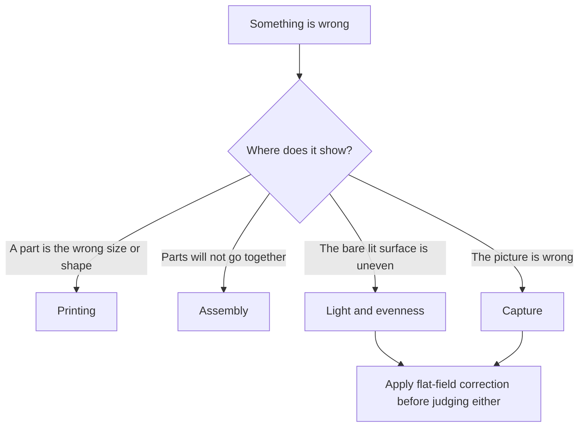

# Troubleshooting

**English** · [简体中文](troubleshooting.zh-CN.md) · [日本語](troubleshooting.ja.md)

> Symptom, likely cause and fix for each fault this design can actually produce: while printing, while assembling, in the light itself, and at the camera.

**Contents:** [How to use this page](#how-to-use-this-page) · [Printing](#printing) · [Assembly](#assembly) · [Light and evenness](#light-and-evenness) · [Capture](#capture) · [Still stuck](#still-stuck)

## How to use this page

> [!NOTE]
> Every row below is a fault the geometry, the materials or the procedure can produce, worked out from the design. None comes from a repair log. The box has been printed and used, but this page was written before that, and nothing here is a measured result.

Check these before you look for anything unusual. Most symptoms on this page come down to one of them:

- [ ] Every part passed [the acceptance checks](printing.md#check-each-part-before-you-assemble). Nothing was scaled by the slicer, the software that prepares a model for printing.
- [ ] The protective film has been peeled off **both** faces of the opal acrylic diffuser.
- [ ] The flash lies flat on the desk, head centred on the open front, zoom at its widest.
- [ ] The room is dim, and no ceiling light shines straight into the open front.
- [ ] The camera has been squared to the film plane with the mirror method: lay a small mirror on the stage and centre the lens's own reflection in live view.
- [ ] Glass mode only: the underside of the anti-Newton glass was blown clean this session, before it went back into its ledge.

---

## Printing

| Symptom | Likely cause | Fix |
|---|---|---|
| A part measures smaller than its card in [The twelve parts](printing.md#the-twelve-parts) | The slicer scaled it down to fit the build plate | Reslice at 100 %, in millimetres, and reprint. The largest part is 154.8 mm across and fits a 160 × 160 plate without scaling, so any scaling was an accident. Re-run the acceptance checks. |
| A corner of the main body or the cover-stage has lifted off the build plate | A cold or draughty machine, or a dirty plate | Reprint on a clean plate, out of the draught, with whatever adhesion aid your machine likes. A lifted corner is more than cosmetic. The cover-stage rests on the wall tops and the film plane stands on the cover-stage, so warp at either face rocks everything above it. |
| A part has drooped, ragged overhangs | It was sliced in the wrong orientation | Every part prints without supports, but only one way up: flat base down for the holder bases, the inserts, the main body and the cover-stage, and **top face down** for the two holder lids. Reorient and reprint. Nothing recovers the part as printed. |
| The white parts came back shiny or silky | Silk or glossy filament | They have to be reprinted in matte. The bare white interior *is* the reflector. A glossy one reproduces the flash head as a hot spot, and painting the inside is not the fix. |
| Steps and ledges sit at heights that do not match the part cards | A [layer height](glossary.md#layer-height) that does not divide the design's 0.2 mm grid | Print the holder parts at 0.2 mm. The 0.4 mm step between the film lands and the element ledge sets the film clearance, and it only comes out right on that grid ([design log entry 18](design-log.md#18-layer-quantised-holders)). |

> [!CAUTION]
> Never add supports to force a different orientation. Every part in this build prints without supports by design, but only in its stated orientation. The two holder lids go top face down. Everything else goes flat base down. Orientation in this project is always described by a feature you can see.

---

## Assembly

| Symptom | Likely cause | Fix |
|---|---|---|
| The cover-stage rocks on the main body, or sits high at one corner | The four locating tenons are not all seated in their notches, or [elephant foot](glossary.md#elephant-foot) at a tenon or notch edge | Lift the cover-stage and set it down again so all four tenons drop into place under its own weight. If it still rocks, a light knife pass on the first layer of the tenons usually clears it. Never force or shim it. |
| The holder lid pushes itself away instead of snapping shut | One or more magnet pairs repel. A magnet was pressed in the wrong way round | Find the repelling spot by holding a spare magnet over each position in turn. The flipped one has to come out, be turned over and pressed back in. Next time, before pressing any of them, mark the same face of every magnet while they are still in one stack: mark up in the bases, mark down in the lids. |
| Lifting the lid (or the holder) brings the whole stage up with it | A straight upward pull fights every magnet pair at once, and nothing in this build is screwed down | Do not pull straight up. Tip the lid (or the holder) up from one corner so the pairs release one at a time. |
| The holder will not snap down onto the cover-stage, or slides around on it | The four steel washers are stainless (not magnetic), or missing from their counterbores (the shallow recesses in the deck) | Fit carbon-steel or zinc-plated washers, one in each counterbore, flush with the deck. Test every new batch with a magnet the day it arrives. |
| A magnet drops loosely into its pocket with no press fit | The pocket printed oversize | Add a drop of cyanoacrylate (super glue) and seat it to the pocket's full depth. A magnet that stands proud changes the closing gap. |
| The whole holder sits about 1 mm high with the 6 × 6 mask fitted | The mask goes underneath the 120 base | Not a fault. The design does exactly this. |
| The diffuser has gone cloudy or is covered in fine cracks | Alcohol, or an ammonia-based glass cleaner | Fit a new sheet. A 68 × 118 × 2 mm custom cut is cheap, and a prototype-era 110 × 130 sheet can be cut down to it. |
| The diffuser looks dull and milky all over, straight out of the packet | Protective film still on one face | Peel both faces. It is easy to remove one and miss the other. |

> [!CAUTION]
> Never clean the opal acrylic diffuser with alcohol, ammonia or glass cleaner. They craze the surface permanently (fill it with fine cracks), and a crazed sheet is no longer an even source. Use a rocket blower and a dry microfibre cloth, nothing else.

Why nothing in this box screws down, and what that means for a fix

There is not a single thread in the build. Gravity, tenons and magnets locate the stack. The tolerances that fasteners would normally fight are absorbed at the camera end instead. Lay a small mirror on the stage and centre the lens's own reflection in live view. The sensor is then parallel to the film plane, whatever small errors the plastic carries.

So mechanical fixes here are always *reseat, peel, deburr*. Never tighten, shim or glue the stack. If something rocks, find the seat it is not sitting in. Do not clamp it down.

---

## Light and evenness

Judge all of this on a flat frame (the bare lit surface, no film, shot raw at the aperture you scan with), and only after [flat-field correction](glossary.md#flat-field-correction). The procedure is in [Flat-field and inversion](scanning.md#flat-field-and-inversion).

| Symptom | Likely cause | Fix |
|---|---|---|
| The corners are still uneven after correction | The flash head is not centred on the open front, the zoom is not at its widest, or room light is mixing in | In this order: centre the head on the mouth of the box, set the zoom to its widest, then dim the room. |
| The corners look uneven, but you have not done flat-field correction | Lens vignetting (the lens's own corner darkening) and source unevenness are being read as one thing | Correct first, then judge. |
| A bright patch in the shape of the flash head | Glossy or silk white filament, or an interior that has been sanded, polished or painted | The [cavity](glossary.md#integrating-cavity) must be bare matte white filament. The only fix is new parts. |
| Everything is darker than the meter suggested | The bounce cavity costs light. That is the price of evenness | Add flash power before you raise the ISO. |
| The image is grey and veiled, with low contrast | The white deck reflecting stray light up around the holder, or a ceiling light shining into the open front | Stick the optional black flocking sheet onto the deck, and keep overhead light off the mouth of the box. The flash overwhelms room light, but only in a dim room. |
| Evenness has changed since the last session | The flash has moved on the desk | Tape or trace its footprint so the head always returns to the same spot against the front opening. |
| A 4×5 frame is brighter toward the back of the box than the front | The 4×5 window sits 9 and 12 mm from the cavity walls, a third of the v1 mixing margin, and nothing has been measured | Flat-field correction removes a smooth gradient. If it is more than you will accept, the bigger box in [Design § 10](design.md#10-45-on-the-v1-body) restores the margins. |

> [!IMPORTANT]
> Get the film plane parallel to the sensor before you chase evenness. A flash freezes vibration, but nothing in the box can rescue a film plane that is not parallel to the sensor. The whole adjustment lives at the camera end, in the mirror method. A tilted plane can also look like a brightness gradient once you start examining the corners closely.

---

## Capture

| Symptom | Likely cause | Fix |
|---|---|---|
| The frame is completely black | From most to least likely: a fully electronic shutter, a shutter faster than [sync speed](glossary.md#sync-speed), a flat receiver battery, a channel mismatch between transmitter and receiver, a transmitter not seated in the hot shoe | Work down that list before touching anything else. Flash, receiver and transmitter all live outside the box, so none of it means opening anything. A fully electronic shutter usually will not fire a flash at all. [EFCS](glossary.md#efcs) sometimes does. |
| Part of the frame is exposed, the rest is a clean dark band | The shutter beat the flash, at a speed above the real sync limit. Focal-plane shutters sync at 1/160–1/250 on paper, and a budget 2.4G trigger costs about a stop of that | Start at 1/125 s. If the band goes, raise the speed one step at a time until it returns, then stay one step below. Settings table in [Exposure](scanning.md#exposure). |
| One edge of every frame is soft and the rest is sharp | The film plane is not parallel to the sensor | Use the mirror method in [Parallelism](scanning.md#parallelism). This is never a focus problem. |
| The frame edges or corners are soft, and it varies from frame to frame | The film is not lying flat. The pressure element has not fully tamed its curl | In order: stop down to f/8–f/11 (at 1:1 and f/8 the depth of field is about ±0.4 mm, against rises of at most 0.28 mm with the insert). Then check the loading direction: bow **down** under the pressure-window insert, bow **up** under the glass. If a stubborn film still shows it, upgrade to the anti-Newton glass, which caps the whole frame in one continuous surface. |
| Soft dark blobs in the same place in every frame | Glass mode: dust on the underside of the glass, 0.2 mm from the film plane, close enough to show in the image | Take the glass out and blow its underside before it goes back in. Make that the habit at every session start. Dust on the acrylic does *not* show, since it sits on the diffuse source itself. A periodic wipe there is enough. |
| Exposure varies from frame to frame | Flash power was changed mid-roll, or the batteries are running down and the flash is firing before it has recharged | Settle the power once during calibration and do the fine work with the aperture in 1/3 stops. Wait for the ready lamp. Keep two sets of NiMH batteries in rotation. |
| Interference rings across the image | Glass mode with the glass in upside down (the frosted anti-Newton face must be **down**, against the film's shiny base), or a plain glass substituted for the anti-Newton one | Refit the glass frosted face down. In insert mode rings cannot form at all (see the note below), so rings there mean something extra is lying on the film. |
| A scratch runs the length of a strip | Grit under the pressure element. The film slides beneath it with 0.4 mm of clearance | Blow the channel and the underside of the element before every strip. |
| The strip drags or jams as you pull it through | A curled edge catching at the break in the inner rails, or the tail of a long strip hanging off and dragging | Back the strip out and re-feed it straight. The rail ends carry 12 mm guides for exactly this. Support the tail of a long strip with your free hand. The flange top helps, 0.2 mm below the film plane, but a long overhang still needs a hand under it. |
| The edge markings read mirrored in live view | The strip is in upside down | Dull emulsion side down toward the light, shiny base up toward the camera. Full sequence in [Loading film](scanning.md#loading-film). |
| A sliver of film edge (the rebate) shows around the frame | The windows are deliberately oversize (25 × 37 for a 24 × 36 frame, about 0.5 mm per side) to absorb camera-gate variation and printer tolerance | Not a fault. Crop it off in post. |
| A mounted slide will not go in | The holders take film strips only | Use the slide plate: lift the 135 holder out, set `slide-plate-135.stl` in the tray, and drop the mount into its pocket. See [Mounted slides](scanning.md#mounted-slides). |
| The frame does not fill the sensor | Not enough [magnification](glossary.md#magnification-ratio) for your format and sensor | See the table in [Magnification and lens choice](scanning.md#magnification-and-lens-choice). Any 1:1 macro lens covers every format the box handles. |

> [!CAUTION]
> Blow the channel out before every strip. Film is advanced by pulling it sideways beneath the pressure element, and a single trapped grain of grit will scratch every frame that passes. A scratched negative stays scratched.

Where Newton rings can and cannot form in this holder

[Newton rings](glossary.md#newton-rings) are interference fringes that appear where film almost touches a smooth, hard surface.

With the pressure-window insert, the image area touches nothing. The film rides on its edges, with 0.4 mm of clearance to the insert above, so there is no optical contact and rings have nothing to form on. Rings in insert mode mean something has been added to the stack: a sleeve left on, a loose glass laid over the film.

With the glass, contact is intended. The film's shiny base rests against the glass, and the frosted anti-Newton face is what breaks up the interference. With the frosted face down against the base and the emulsion facing the open window below, rings cannot form. Rings in glass mode therefore mean the glass is in upside down, or a plain glass was substituted for the anti-Newton one.

---

## Still stuck

1. **Prove which half is at fault.** Shoot a flat frame: no film, everything else untouched. If the corrected flat frame is clean, the box is fine and the problem is on the camera side. If it is not, stay in [Light and evenness](#light-and-evenness).
2. **Re-run the acceptance checks.** [Check each part before you assemble](printing.md#check-each-part-before-you-assemble) catches scaling, warp and tight fits, the faults that make everything after them impossible to build.
3. **Change one thing at a time**, and re-shoot the flat frame after each. The calibration remedies are deliberately ordered. Applying the last one first hides what the first one would have told you.
4. **Report it.** Few of these boxes exist yet, so what goes wrong on a different printer is new information for everyone. The repository is public: <https://github.com/Neoanaloglab/Neobox>.

Reference material: [Design](design.md) for why a part is shaped the way it is, [Design log](design-log.md#things-deliberately-not-done) for what was tried and rejected, and the [Glossary](glossary.md) for any term on this page that is new to you.

---

← [Scanning](scanning.md) · [Documentation index](../README.md#documentation) · [Glossary](glossary.md) →
